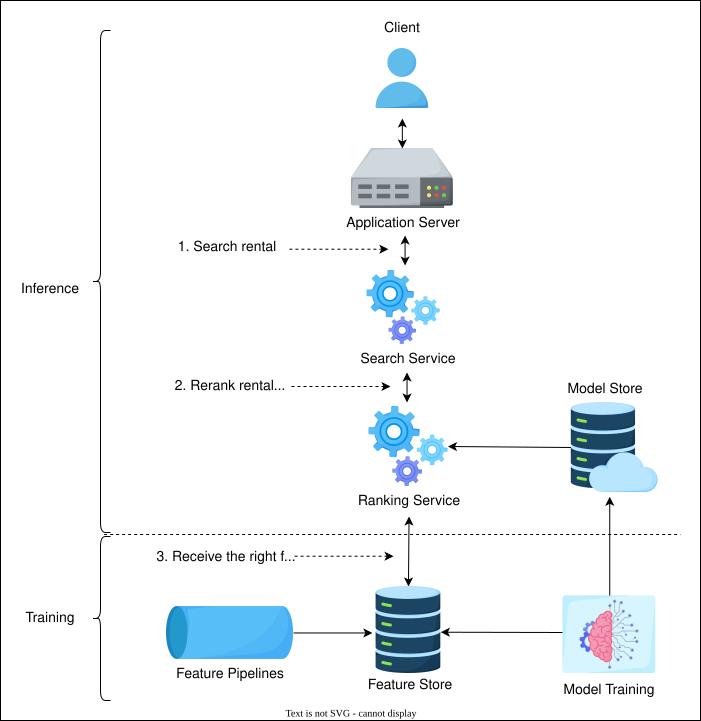
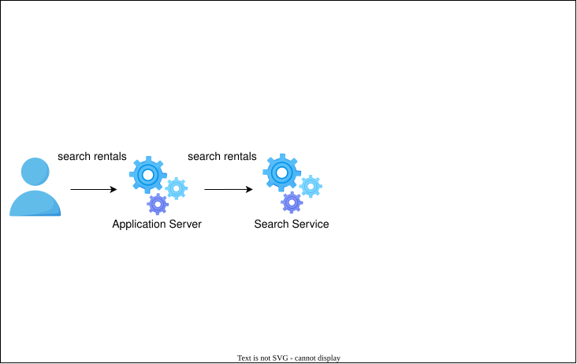
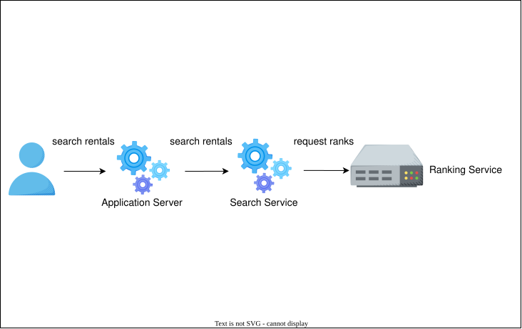
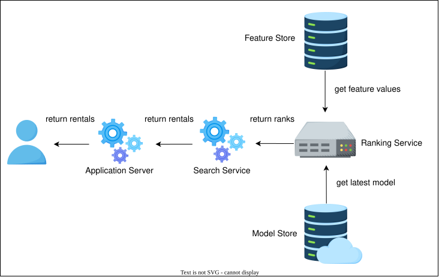

# Designing_a_Scalable_Rental_Search_Ranking_System

Source: https://www.educative.io/courses/machine-learning-system-design/rental-search-ranking-system-design

---

[Home](https://www.educative.io/)

[Courses](https://www.educative.io/search?tab=courses)

[Machine Learning System Design](https://www.educative.io/courses/machine-learning-system-design)

# Rental Search Ranking System Design

Explore how to design a rental search ranking system by framing it as a machine learning problem with booking likelihood prediction. Understand the data scale, feature processing, low-latency inference, and methods to scale the system to serve millions of requests per second. Gain insight into practical tradeoffs like feature storage, retraining strategy, and monitoring metrics for production-grade ranking services.

We'll cover the following...

- [4. Calculation & estimation](https://www.educative.io/courses/machine-learning-system-design/rental-search-ranking-system-design#4-Calculation--estimation)
  - [Assumptions](https://www.educative.io/courses/machine-learning-system-design/rental-search-ranking-system-design#Assumptions)
  - [Data size](https://www.educative.io/courses/machine-learning-system-design/rental-search-ranking-system-design#Data-size)
  - [Scale](https://www.educative.io/courses/machine-learning-system-design/rental-search-ranking-system-design#Scale)
- [5. High-level design](https://www.educative.io/courses/machine-learning-system-design/rental-search-ranking-system-design#5-High-level-design)
- [6. Scale the design](https://www.educative.io/courses/machine-learning-system-design/rental-search-ranking-system-design#6-Scale-the-design)
- [7. Follow up questions](https://www.educative.io/courses/machine-learning-system-design/rental-search-ranking-system-design#7-Follow-up-questions)
- [8. Summary](https://www.educative.io/courses/machine-learning-system-design/rental-search-ranking-system-design#8-Summary)

## 4. Calculation & estimation[#](https://www.educative.io/courses/machine-learning-system-design/rental-search-ranking-system-design#4-Calculation--estimation)

### Assumptions[#](https://www.educative.io/courses/machine-learning-system-design/rental-search-ranking-system-design#Assumptions)

- 100 million monthly active users
- On average, users book rental homes 5 times per year. Users see about 30 rentals from the search result before booking.
- There are 5 \* 30 \* 108{10 ^ 8}108 or 15 billion observations/samples per year or 1.25 billion samples per month.

### Data size[#](https://www.educative.io/courses/machine-learning-system-design/rental-search-ranking-system-design#Data-size)

- Assume there are hundreds of features per sample. For the sake of simplicity, each row takes 500 bytes to store.
- Total data size: 500 \* 1.25 \* 109{10^9}109 = 625 \* 109{10^9}109 bytes = 625 GB. To save costs, we can keep the last 6 months or 1 year of data in the data lake, and archive old data in cold storage.

### Scale[#](https://www.educative.io/courses/machine-learning-system-design/rental-search-ranking-system-design#Scale)

- Support 150 million users

## 5. High-level design[#](https://www.educative.io/courses/machine-learning-system-design/rental-search-ranking-system-design#5-High-level-design)

Rental Search Ranking high level design

- Feature pipeline: Processes online features and stores features in key-value storage for low latency, down-stream processing.
- Feature store is a features values storage. During inference, we need low latency (<10ms) to access features before scoring. Examples of feature stores include MySQL Cluster, Redis, and DynamoDB.
- Model Store is a distributed storage, like S3, to store models.

Let’s examine the flow of the system:

1 / 5

User searchs rentals and request Application Server for result

1 / 5

Application Server sends search request to Search Service

1 / 5

Search Service gets rentals from database and sends rental rank request to Ranking Service

1 / 5

Ranking Service scores each rental results and returns the score to Search Service

1 / 5

Search Service returns rentals to Application Server and Application Server returns rentals to user

- The user searches for rentals with given queries, i.e., city and time. The Application Server receives the query and sends a request to the Search Service.
- Search Service looks up in the indexing database and retrieves a list of rental candidates. It then sends those candidates list to the Ranking Service.
- Ranking service uses the Machine Learning model to score each candidate. The score represents how likely it is a user will book a specific rental. The Ranking service returns the list of candidates with their score.
- Search Service receives the candidates list with booking probability and uses the probability to sort the candidates. It then returns a list of candidates to the Application server, which, in turn, returns it to the users.

As you can see, we started with a simple design, but this would not scale well for our demands, i.e., 150 million users and 1.25 billion searches per month. We will see how to scale the design in the next section.

## 6. Scale the design[#](https://www.educative.io/courses/machine-learning-system-design/rental-search-ranking-system-design#6-Scale-the-design)

Rental Search ranking system design at scale

- To scale and serve millions of requests per second, we can start by scaling out Application Servers and use Load Balancers to distribute the load accordingly.
- We can also scale out Search Services and Ranking Services to handle millions of requests from the Application Server.
- Finally, we need to log all candidates that we recommended as training data, so the Search Service needs to send logs to a cloud storage or send a message to a Kafka cluster.

## 7. Follow up questions[#](https://www.educative.io/courses/machine-learning-system-design/rental-search-ranking-system-design#7-Follow-up-questions)

| **Question** | **Answer** |
| --- | --- |
| What are the cons of using ListingID embedding as features? | ListingIDs are limited with only millions of unique IDs, plus each listing has a limited number of bookings per year which might not be sufficient to train embedding. |
| Assuming there is a strong correlation between how long users spend on listings and the likelihood of booking, how would you redesign the network architecture? | Train multiple output networks for two outputs: view\_time and booking |
| How often do we need to retrain models? | It depends, we need to have infrastructure in place to monitor the online metrics. When online metrics go down, we might want to trigger retraining the models. |

## 8. Summary[#](https://www.educative.io/courses/machine-learning-system-design/rental-search-ranking-system-design#8-Summary)

- We learned to formulate search ranking as a Machine Learning problem by using booking likelihood as a target.
- We learned to use `Discounted Cumulative Gain` as one metric to train a model.
- We also learned how to scale our system to handle millions of requests per second.
- We can read more about how companies scale there design [here](https://rebrand.ly/mleio).

Booking Model

Problem Statement and Metrics

Ask

[4. Calculation & estimation](https://www.educative.io/courses/machine-learning-system-design/rental-search-ranking-system-design#4-Calculation--estimation)

[Assumptions](https://www.educative.io/courses/machine-learning-system-design/rental-search-ranking-system-design#Assumptions)

[Data size](https://www.educative.io/courses/machine-learning-system-design/rental-search-ranking-system-design#Data-size)

[Scale](https://www.educative.io/courses/machine-learning-system-design/rental-search-ranking-system-design#Scale)

[5. High-level design](https://www.educative.io/courses/machine-learning-system-design/rental-search-ranking-system-design#5-High-level-design)

[6. Scale the design](https://www.educative.io/courses/machine-learning-system-design/rental-search-ranking-system-design#6-Scale-the-design)

[7. Follow up questions](https://www.educative.io/courses/machine-learning-system-design/rental-search-ranking-system-design#7-Follow-up-questions)

[8. Summary](https://www.educative.io/courses/machine-learning-system-design/rental-search-ranking-system-design#8-Summary)