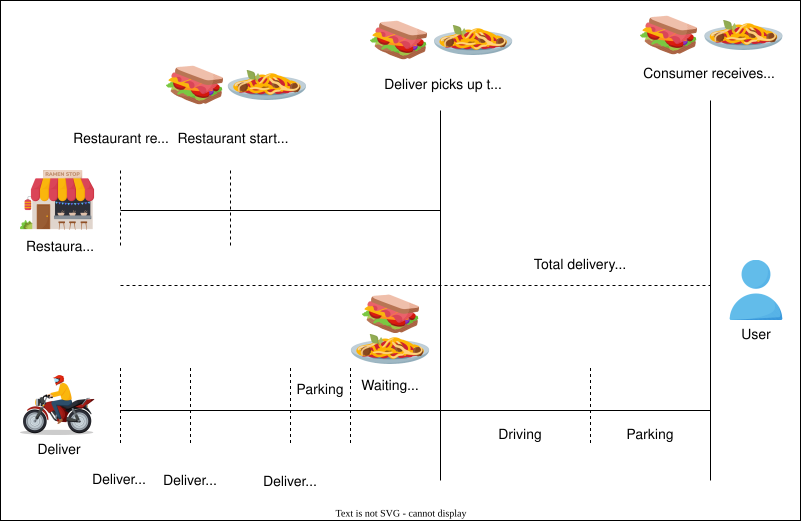

# Estimating_Food_Delivery_Time_Using_Effective_Metrics

Source: https://www.educative.io/courses/machine-learning-system-design/problem-statement-and-metrics

---

[Home](https://www.educative.io/)

[Courses](https://www.educative.io/search?tab=courses)

[Machine Learning System Design](https://www.educative.io/courses/machine-learning-system-design)

# Problem Statement and Metrics

Explore how to formulate a problem statement for estimating total food delivery time using order details and environmental factors. Understand designing offline and online metrics like RMSE and A/B testing to evaluate accuracy and customer impact. Learn requirements for high-throughput training pipelines and near real-time inference with low latency. This lesson prepares you to build scalable, accurate time estimation models that adapt to dynamic conditions.

We'll cover the following...

- [Estimate Delivery Time](https://www.educative.io/courses/machine-learning-system-design/problem-statement-and-metrics#Estimate-Delivery-Time)
  - [1. Problem statement](https://www.educative.io/courses/machine-learning-system-design/problem-statement-and-metrics#1-Problem-statement)
  - [2. Metrics design and requirements](https://www.educative.io/courses/machine-learning-system-design/problem-statement-and-metrics#2-Metrics-design-and-requirements)
    - [Metrics](https://www.educative.io/courses/machine-learning-system-design/problem-statement-and-metrics#Metrics)
    - [Requirements](https://www.educative.io/courses/machine-learning-system-design/problem-statement-and-metrics#Requirements)
      - [Training](https://www.educative.io/courses/machine-learning-system-design/problem-statement-and-metrics#Training)
      - [Inference](https://www.educative.io/courses/machine-learning-system-design/problem-statement-and-metrics#Inference)
    - [Summary](https://www.educative.io/courses/machine-learning-system-design/problem-statement-and-metrics#Summary)

## Estimate Delivery Time[#](https://www.educative.io/courses/machine-learning-system-design/problem-statement-and-metrics#Estimate-Delivery-Time)

### 1. Problem statement[#](https://www.educative.io/courses/machine-learning-system-design/problem-statement-and-metrics#1-Problem-statement)

Build a model to estimate the total delivery time given order details (e.g. order size, restaurant location, customer location), market conditions (e.g. weather, events, holidays), and real-time traffic status (e.g. road closures, congestion levels).

Food Delivery flow

> To keep it simple, we do not consider batching (group multiple orders at restaurants) in this exercise.

DeliveryTime=PickupTime+Point\_to\_PointTime+Drop\_off\_TimeDelivery Time = Pickup Time + Point\\_to\\_Point Time + Drop\\_off\\_TimeDeliveryTime=PickupTime+Point\_to\_PointTime+Drop\_off\_Time

### 2. Metrics design and requirements[#](https://www.educative.io/courses/machine-learning-system-design/problem-statement-and-metrics#2-Metrics-design-and-requirements)

#### Metrics[#](https://www.educative.io/courses/machine-learning-system-design/problem-statement-and-metrics#Metrics)

- Offline metrics: Use Root Mean Squared Error (RMSE) to measure the difference between the predicted delivery time and the actual delivery time. The target RMSE should be less than 10-15 minutes to ensure accurate estimates.

  ∑k=1n(predict−y)2n\sqrt{\sum\_{k=1}^n\frac{(predict-y)^2}{n}}∑k=1n​n(predict−y)2​​

  where,

  nnn is the total number of samples,

  predictpredictpredict is Estimated wait time,

  yyy is the actual wait time.

- Online metrics: Conduct A/B testing to monitor RMSE, as well as customer engagement (order completion rate) and retention (repeat orders) to ensure the model is providing reliable and useful delivery time estimates.

#### Requirements[#](https://www.educative.io/courses/machine-learning-system-design/problem-statement-and-metrics#Requirements)

##### Training[#](https://www.educative.io/courses/machine-learning-system-design/problem-statement-and-metrics#Training)

- During training, we need to handle a large amount of data. For this, the training pipeline should have a high throughput. To achieve this purpose, data can be organized in [Parquet files](https://www.educative.io/courses/machine-learning-system-design/training-pipeline)
- The model should undergo retraining every few hours. Delivery operations are under a dynamic environment with a lot of external factors: traffic, weather conditions, etc. So, it is important for the model to learn and adapt to the new environment. For example, on game day, traffic conditions can get worse in certain areas. Without a retraining model, the current model will consistently underestimate delivery time. Schedulers are responsible for retraining models many times throughout the day.
- Balance between overestimation and under-estimation. To help with this, retrain multiple times per day to adapt to market dynamic and traffic conditions.

##### Inference[#](https://www.educative.io/courses/machine-learning-system-design/problem-statement-and-metrics#Inference)

- For every delivery, the system needs to make real-time estimations as frequently as possible. For simplicity, we can assume we need to make 30 predictions per delivery.
- Near real-time update, any changes on status need to go through model scoring as fast as possible, i.e., the restaurant starts preparing meals, the driver starts driving to customers.
- Whenever there are changes in delivery, the model runs a new estimate and sends an update to the customer.
- Capture near real-time aggregated statistics, i.e., feature pipeline aggregates data from multiple sources (Kafka, database) to reduce latency.
- Latency from 100ms to 200ms

#### Summary[#](https://www.educative.io/courses/machine-learning-system-design/problem-statement-and-metrics#Summary)

| **Type** | **Desired goals** |
| --- | --- |
| Metrics | Optimized for low RMSE. Estimation should be less than 10-15 minutes. If we overestimate, customers are less likely to make orders. Underestimation can cause customers upset. |
| Training | High throughput with the ability to retrain many times per day |
| Inference | Latency from 100ms to 200ms |

Rental Search Ranking System Design

Estimated Delivery Model

Ask

[Estimate Delivery Time](https://www.educative.io/courses/machine-learning-system-design/problem-statement-and-metrics#Estimate-Delivery-Time)

[1. Problem statement](https://www.educative.io/courses/machine-learning-system-design/problem-statement-and-metrics#1-Problem-statement)

[2. Metrics design and requirements](https://www.educative.io/courses/machine-learning-system-design/problem-statement-and-metrics#2-Metrics-design-and-requirements)

[Metrics](https://www.educative.io/courses/machine-learning-system-design/problem-statement-and-metrics#Metrics)

[Requirements](https://www.educative.io/courses/machine-learning-system-design/problem-statement-and-metrics#Requirements)

[Training](https://www.educative.io/courses/machine-learning-system-design/problem-statement-and-metrics#Training)

[Inference](https://www.educative.io/courses/machine-learning-system-design/problem-statement-and-metrics#Inference)

[Summary](https://www.educative.io/courses/machine-learning-system-design/problem-statement-and-metrics#Summary)