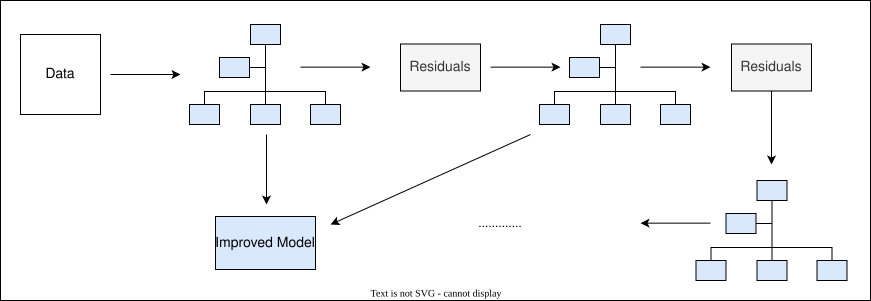

# Designing_Accurate_Food_Delivery_Time_Estimation_Models

Source: https://www.educative.io/courses/machine-learning-system-design/estimated-delivery-model

---

[Home](https://www.educative.io/)

[Courses](https://www.educative.io/search?tab=courses)

[Machine Learning System Design](https://www.educative.io/courses/machine-learning-system-design)

# Estimated Delivery Model

Understand how to design an accurate and scalable food delivery time estimation system by leveraging historical delivery data and Gradient Boosted Decision Trees. Explore model training, residual error correction, and iterative improvement to optimize delivery time predictions and balance under- and over-estimation effects.

We'll cover the following...

- [3. Model](https://www.educative.io/courses/machine-learning-system-design/estimated-delivery-model#3-Model)
  - [Training data](https://www.educative.io/courses/machine-learning-system-design/estimated-delivery-model#Training-data)
  - [Model](https://www.educative.io/courses/machine-learning-system-design/estimated-delivery-model#Model)
    - [Gradient Boosted Decision Tree](https://www.educative.io/courses/machine-learning-system-design/estimated-delivery-model#Gradient-Boosted-Decision-Tree)

## 3. Model[#](https://www.educative.io/courses/machine-learning-system-design/estimated-delivery-model#3-Model)

|  |  |  |
| --- | --- | --- |
| **Feature Category** | **Feature engineering** | **Description** |
| Order features | Subtotal, Cuisine | Basic characteristics of the order itself |
| Item features | Price, Type | Information about individual items within the order |
| Order type | Group, Catering | Indicates whether the order is a group order, catering request, etc. |
| Merchant details | — | Merchant-specific metadata (e.g., ratings, popularity, etc.) |
| Store ID | Store Embedding | Dense representation capturing latent store characteristics |
| Realtime feature | Number of orders, Number of dashers, Traffic, Travel estimates | Live system load and conditions |
| Time feature | Time of day (lunch/dinner), Day of week, Weekend, Holiday | Temporal context around the delivery |
| Historical aggregates | Past X weeks average delivery time for: Store / City / Market / Time of Day | Rolling historical statistics to capture service performance trends |
| Similarity | Average parking times, Variance in historical times | Metrics from similar past deliveries to estimate expected behavior |
| Latitude / Longitude | Measure estimated driving time between restaurant and consumer | Spatial/geographic context used to estimate delivery time |

### Training data[#](https://www.educative.io/courses/machine-learning-system-design/estimated-delivery-model#Training-data)

- We can use historical deliveries for the last 6 months as training data.
  Historical deliveries include delivery data and actual total delivery time, store data, order data, customers data, location, and parking data.

### Model[#](https://www.educative.io/courses/machine-learning-system-design/estimated-delivery-model#Model)

#### Gradient Boosted Decision Tree[#](https://www.educative.io/courses/machine-learning-system-design/estimated-delivery-model#Gradient-Boosted-Decision-Tree)

- Gradient Boosted Decision Tree sample

- How do Gradient Boosted Decision Trees work?

  - Step 1: Given historical delivery, the model first calculates the average delivery time. This value will be used as a baseline.
  - Step 2: The model measures the residual (error) between prediction and actual delivery time.

    Error=ActualDeliveryTime−EstimatedDeliveryTimeError = Actual Delivery Time - Estimated Delivery TimeError=ActualDeliveryTime−EstimatedDeliveryTime
  - Step 3: Next, we build the decision tree to predict the residuals. In other words, every leaf will contain a prediction for residual values.
  - Step 4: Next we predict using all the trees. The new predictions will be used to construct predictions for delivery time using this formula:

    EstimatedDeliveryTime=Average\_delivery\_time+learning\_rate∗residualsEstimated Delivery Time = Average \\_delivery\\_time + learning\\_rate \* residualsEstimatedDeliveryTime=Average\_delivery\_time+learning\_rate∗residuals
  - Step 5: Given the new estimated delivery time, the model then computes the new residuals. The new values will then be used to build new decision trees in step 3.
  - Step 6: Repeat steps 3-5 until we reach the number of iterations that we defined in our hyperparameter.

- One problem with optimizing RMSE is that it penalizes similarly between under-estimate prediction and over-estimate prediction. Have a look at the table below. Note that both models use boosted decision trees.

| **Actual** | **Model 1 Prediction** | **Model 1 square error** | **Model 2 Prediction** | **Model 2 square error** |
| --- | --- | --- | --- | --- |
| 30 | 34 | 16 | 26 | 16 |
| 35 | 37 | 4 | 33 | 4 |

- Although Model 1 and Model 2 have the same RMSE error, model1 overestimates delivery time which prevents customers from making orders. Model2 underestimates the delivery time and might cause customers to be unhappy.

| **Actual** | **Model 1 Prediction** | **Model 1 square error** | **Model 2 Prediction** | **Model 2 square error** |
| --- | --- | --- | --- | --- |
| 30 | 34 | 16 | 26 | 16 |
| 35 | 37 | 4 | 33 | 4 |

1.

We trained 2 boosted decision tree models to predict delivery time: Model1 and Model2. In this table, we have an example of sample data and model predictions.

Which model should we choose to deploy?

A.

Model 1 because it consistently over-predicts by just a few minutes. In other words, customers tend to get the food earlier than expected.

B.

Model 2 because it consistently under-predicts by just a few minutes. In other words, customers tend to order more.

C.

It depends. We should deploy both models and run A/B testing to measure online metrics.

---

1 / 1

Problem Statement and Metrics

Estimate Food Delivery System Design

Ask

[3. Model](https://www.educative.io/courses/machine-learning-system-design/estimated-delivery-model#3-Model)

[Training data](https://www.educative.io/courses/machine-learning-system-design/estimated-delivery-model#Training-data)

[Model](https://www.educative.io/courses/machine-learning-system-design/estimated-delivery-model#Model)

[Gradient Boosted Decision Tree](https://www.educative.io/courses/machine-learning-system-design/estimated-delivery-model#Gradient-Boosted-Decision-Tree)