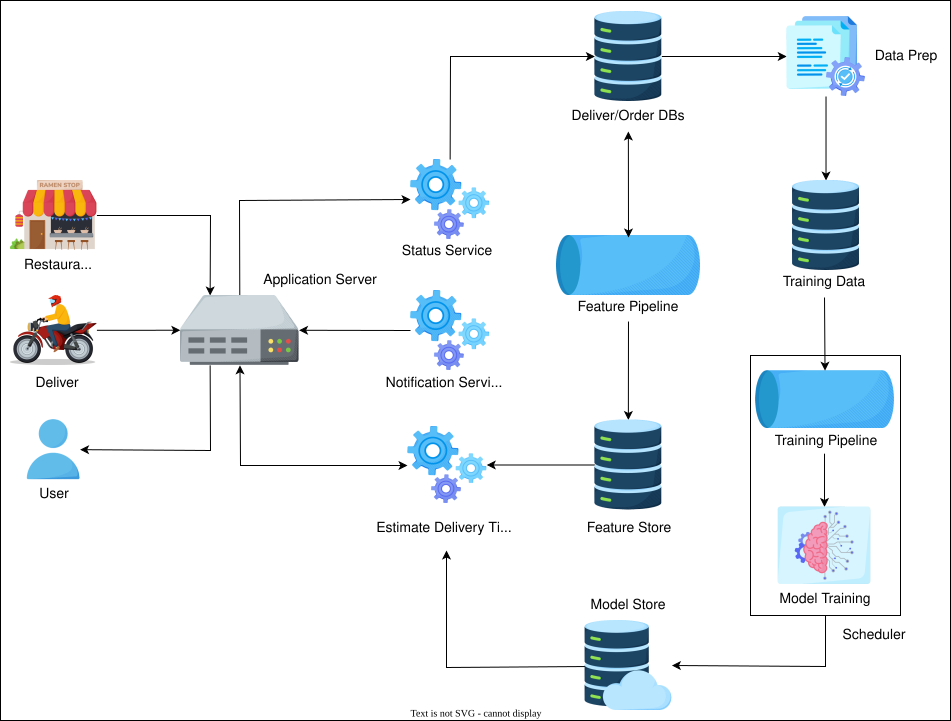
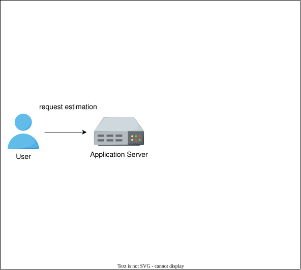
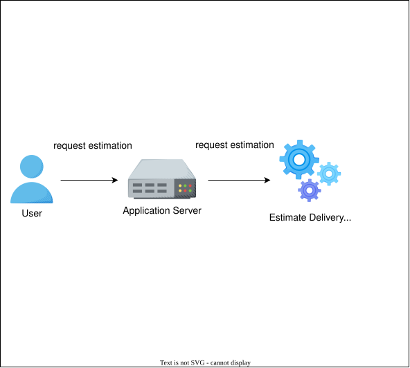
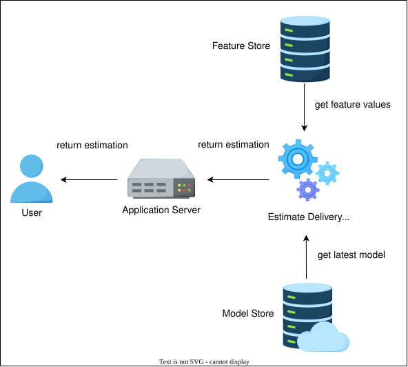

# Design_an_Accurate_Food_Delivery_Time_Estimation_System

Source: https://www.educative.io/courses/machine-learning-system-design/estimate-food-delivery-system-design

---

[Home](https://www.educative.io/)

[Courses](https://www.educative.io/search?tab=courses)

[Machine Learning System Design](https://www.educative.io/courses/machine-learning-system-design)

# Estimate Food Delivery System Design

Explore how to design a machine learning system that estimates food delivery times accurately and at scale. Understand data assumptions, system components like feature stores and Kafka, and the user-service interactions. Learn best practices for model training, real-time updates, and system scalability to improve delivery time predictions.

We'll cover the following...

- [4. Calculation & estimation](https://www.educative.io/courses/machine-learning-system-design/estimate-food-delivery-system-design#4-Calculation--estimation)
  - [Assumptions](https://www.educative.io/courses/machine-learning-system-design/estimate-food-delivery-system-design#Assumptions)
  - [Data size](https://www.educative.io/courses/machine-learning-system-design/estimate-food-delivery-system-design#Data-size)
  - [Scale](https://www.educative.io/courses/machine-learning-system-design/estimate-food-delivery-system-design#Scale)
- [5. System Design](https://www.educative.io/courses/machine-learning-system-design/estimate-food-delivery-system-design#5-System-Design)
- [6. Scale the design](https://www.educative.io/courses/machine-learning-system-design/estimate-food-delivery-system-design#6-Scale-the-design)
- [7. Follow up questions](https://www.educative.io/courses/machine-learning-system-design/estimate-food-delivery-system-design#7-Follow-up-questions)
- [8. Summary](https://www.educative.io/courses/machine-learning-system-design/estimate-food-delivery-system-design#8-Summary)

## 4. Calculation & estimation[#](https://www.educative.io/courses/machine-learning-system-design/estimate-food-delivery-system-design#4-Calculation--estimation)

### Assumptions[#](https://www.educative.io/courses/machine-learning-system-design/estimate-food-delivery-system-design#Assumptions)

For the sake of simplicity, we can make these assumptions:

- There are 2 million monthly active users,
  a total of 20 million users, 300k restaurants, and 200k drivers deliver food.
- On average, there are 20 million deliveries per year.

### Data size[#](https://www.educative.io/courses/machine-learning-system-design/estimate-food-delivery-system-design#Data-size)

- For 1 month, we collected data on 2 millions deliveries. Each delivery has around 500 bytes related features.
- Total size: 500 \* 2 \* 10610^{6}106 = 10910^9109 bytes = 1 Gigabytes.

### Scale[#](https://www.educative.io/courses/machine-learning-system-design/estimate-food-delivery-system-design#Scale)

- Support 20 million users

## 5. System Design[#](https://www.educative.io/courses/machine-learning-system-design/estimate-food-delivery-system-design#5-System-Design)

High level design of Food Delivery Time Estimation system

- Feature Store: Provides fast lookup for low latency. A feature store with any key-value storage with high availability like Amazon DynamoDB is a good choice.
- Feature pipeline: Reads from Kafka, transforms, and aggregates near real-time statistics. Then, it stores them in feature storage.
- Database: Delivery Order database stores historical Orders and Delivery. Data prep is a process to create training data from a database. We can store training data in cloud storage, for example, S3.
- We have three services: Status Service, Notification Service, and Estimate Delivery Time service. The first two services handle real-time updates and the Estimate Delivery Time service uses our Machine Learning Model to estimate delivery time.
- We have a scheduler that handles and coordinates retraining models multiple times per day. After training, we store the Model in Model Storage.

Let’s examine the flow of the system:

1 / 4

User requests for Estimated Delivery Time

1 / 4

Estimate Delivery Time service returns time estimation to Application Server. Application Server returns time estimation to user

1 / 4

Estimate Delivery Time service returns time estimation to Application Server. Application Server returns time estimation to user

1 / 4

Estimate Delivery Time service returns time estimation to Application Server. Application Server returns time estimation to user

- There are three main types of users: Consumer/User, Deliver, and Restaurant.
- User flow

  - User visits a homepage, checks their food orders, and requests Application Server for an estimated delivery time.
  - The Application Server sends the requests to the Estimate Delivery Time Service.
  - The Estimate Delivery Time service loads the latest ML model from Model Storage and gets all the feature values from the Feature Store. It then uses the ML model to predict delivery time and return results to the Application Server.
- Restaurant/Deliver flow:

  - When restaurants make progress, i.e., start making the dish or packaging the food, they send the status to Status Service.
  - Status Service updates the order status. This event is usually updated in a queue service, i.e, Kafka, so other services can subscribe and get updates accordingly.
  - Notification Service subscribed to the message queue, i.e., Kafka, and received the latest order status in near real-time.

## 6. Scale the design[#](https://www.educative.io/courses/machine-learning-system-design/estimate-food-delivery-system-design#6-Scale-the-design)

- We scale out our services to handle large requests per second. We also use a Load Balancer to balance loads across Application Servers.
- We leverage streaming process systems like Kafka to handle notifications as well as model predictions. Once our Machine Learning model completes its predictions, it sends them to Kafka so other services can get notifications right away.

## 7. Follow up questions[#](https://www.educative.io/courses/machine-learning-system-design/estimate-food-delivery-system-design#7-Follow-up-questions)

| **Question** | **Answer** |
| --- | --- |
| What are the cons of using StoreID embedding as features? | We need to evaluate if using StoreID embedding is efficient in handling new stores. |
| How often do we need to retrain models? | It depends, we need to have infrastructure in place to monitor the online metrics. When online metrics go down, we might want to trigger our models to retrain. |

## 8. Summary[#](https://www.educative.io/courses/machine-learning-system-design/estimate-food-delivery-system-design#8-Summary)

- We learned to formulate estimated delivery times as a Machine learning problem using Gradient Boosted Decision Trees.
- We learned how to collect and use data to train models.
- We learned how to use Kafka to handle logs and model predictions for near real-time predictions.
- We can read more about how companies scale there design [here](https://rebrand.ly/mleio).

Estimated Delivery Model

Summary

Ask

[4. Calculation & estimation](https://www.educative.io/courses/machine-learning-system-design/estimate-food-delivery-system-design#4-Calculation--estimation)

[Assumptions](https://www.educative.io/courses/machine-learning-system-design/estimate-food-delivery-system-design#Assumptions)

[Data size](https://www.educative.io/courses/machine-learning-system-design/estimate-food-delivery-system-design#Data-size)

[Scale](https://www.educative.io/courses/machine-learning-system-design/estimate-food-delivery-system-design#Scale)

[5. System Design](https://www.educative.io/courses/machine-learning-system-design/estimate-food-delivery-system-design#5-System-Design)

[6. Scale the design](https://www.educative.io/courses/machine-learning-system-design/estimate-food-delivery-system-design#6-Scale-the-design)

[7. Follow up questions](https://www.educative.io/courses/machine-learning-system-design/estimate-food-delivery-system-design#7-Follow-up-questions)

[8. Summary](https://www.educative.io/courses/machine-learning-system-design/estimate-food-delivery-system-design#8-Summary)