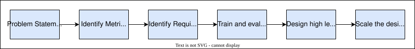

# Complete_Guide_to_Machine_Learning_System_Design_Techniques

Source: https://www.educative.io/courses/machine-learning-system-design/summary

---

[Home](https://www.educative.io/)

[Courses](https://www.educative.io/search?tab=courses)

[Machine Learning System Design](https://www.educative.io/courses/machine-learning-system-design)

# Summary

Explore comprehensive insights into designing practical Machine Learning systems. This lesson reviews key concepts such as recommendation systems and feature stores, preparing you to apply these frameworks effectively in interviews and real-world projects.

We'll cover the following...

- [What’s next?](https://www.educative.io/courses/machine-learning-system-design/summary#Whats-next)
- [Machine Learning assessment](https://www.educative.io/courses/machine-learning-system-design/summary#Machine-Learning-assessment)

Congratulations! You have finished the Machine Learning System Design course.

- We have covered Machine Learning System Design from end to end and have learned to apply the same framework for various different problems.

The 6 basic steps to approach Machine Learning System Design

## What’s next?[#](https://www.educative.io/courses/machine-learning-system-design/summary#Whats-next)

- From Video Recommendation to Ad Click Prediction, we showed how Recommendation Systems can be used in various applications. In recent years, there are more advanced techniques that take advantage of the big data volume and combine different types of features to improve the recommendation system models. One example is Facebook’s [recommendation model](https://ai.facebook.com/blog/dlrm-an-advanced-open-source-deep-learning-recommendation-model/).
- Another common component across different use cases is the **Feature Store**. It became more critical in Machine Learning technical stacks.
- You can find more resources to learn about the modern techniques from this [collection](https://rebrand.ly/mleio)

## Machine Learning assessment[#](https://www.educative.io/courses/machine-learning-system-design/summary#Machine-Learning-assessment)

- The course includes two Machine Learning assessments to help you in testing your knowledge and polishing your strengths.
- I hope you have learned something useful and are able to apply these concepts in your next interview, or at your job.

Estimate Food Delivery System Design

Machine Learning Knowledge

Ask

[What’s next?](https://www.educative.io/courses/machine-learning-system-design/summary#Whats-next)

[Machine Learning assessment](https://www.educative.io/courses/machine-learning-system-design/summary#Machine-Learning-assessment)