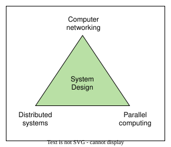

# Introduction_to_System_Design_Interview_Preparation_Course

Source: https://www.educative.io/courses/system-design-interview-prep-crash-course/introduction-to-the-system-design-interview-prep-crash-course

---

[Home](https://www.educative.io/)

[Courses](https://www.educative.io/search?tab=courses)

[System Design Interview: Fast-Track in 48 Hours](https://www.educative.io/courses/system-design-interview-prep-crash-course)

# Introduction to the System Design Interview Prep Crash Course

Explore the basics of system design including its key concepts, importance in interviews, and course structure. Understand how this course prepares software engineers, SREs, and product managers to design scalable, reliable, and maintainable systems to meet real-world needs and interview challenges.

We'll cover the following...

- [What is system design?](https://www.educative.io/courses/system-design-interview-prep-crash-course/introduction-to-the-system-design-interview-prep-crash-course#What-is-system-design)
- [About this course](https://www.educative.io/courses/system-design-interview-prep-crash-course/introduction-to-the-system-design-interview-prep-crash-course#About-this-course)
- [Who should take this course?](https://www.educative.io/courses/system-design-interview-prep-crash-course/introduction-to-the-system-design-interview-prep-crash-course#Who-should-take-this-course)
- [Prerequisites for this course](https://www.educative.io/courses/system-design-interview-prep-crash-course/introduction-to-the-system-design-interview-prep-crash-course#Prerequisites-for-this-course)

## What is system design?[#](https://www.educative.io/courses/system-design-interview-prep-crash-course/introduction-to-the-system-design-interview-prep-crash-course#What-is-system-design)

**System design** is the process of defining components and their integration, APIs, and data models to build large-scale systems that meet a specified set of functional and non-functional requirements.

System design uses the concepts of computer networking, parallel computing, and distributed systems to craft systems that scale well and are performant. Distributed systems scale well by nature. However, distributed systems are inherently complex. The discipline of system design helps us tame this complexity and get the work done.

System design aims to build reliable, effective, and maintainable systems, among other characteristics.

- **Reliable systems** handle faults, failures, and errors.
- **Effective systems** meet all user needs and business requirements.
- **Maintainable systems** are flexible and easy to scale up or down. The ability to add new features also comes under the umbrella of maintainability.

## About this course [#](https://www.educative.io/courses/system-design-interview-prep-crash-course/introduction-to-the-system-design-interview-prep-crash-course#About-this-course)

This course is about designing systems that scale with increasing users, remain available even under different faults, and meet functional goals with good performance.

This course focuses on immersing ourselves into carefully selected system design endeavors to enable us to tackle any novel design problem, whether in a systems design interview or a task at the office. This system design course provides a formula to attack a specific problem. It gives a quick insight into the design of a specific system.

> **Note:** This course is developed to cover each design problem in approximately 15 minutes.

## Who should take this course?[#](https://www.educative.io/courses/system-design-interview-prep-crash-course/introduction-to-the-system-design-interview-prep-crash-course#Who-should-take-this-course)

System design is for any software engineer who wants to advance in their career.

- **Interview preparation:** Lately, system design is becoming an important part of software development interviews. This course helps software engineers prepare for interviews.
- **Software developers:** System design is primarily for back-end developers who aim to become principal engineers or solution architects. The full stack or front-end developers may also want to learn system design to improve their work. At the same time, **support engineers** (also called **SREs**) who work on call in the production environment have to deal with all sorts of problems daily. Therefore, system design concepts enable SREs to efficiently find the root causes of complex problems.
- **Product/project managers:** A big challenge in product/project management is to build systems that scale well and perform effectively over time. Managers that are aware of system design can steer the design of large-scale performant systems. Therefore, it's imperative for product/project managers to understand system design concepts to lead the design and development of successful applications.
- **System design learners:** System design is an interesting subject, and people in tech domains can greatly benefit from learning system design.

## Prerequisites for this course[#](https://www.educative.io/courses/system-design-interview-prep-crash-course/introduction-to-the-system-design-interview-prep-crash-course#Prerequisites-for-this-course)

We assume that you know the fundamental concepts of a distributed system.

System design borrows many great concepts from distributed systems. We have an [excellent course](https://www.educative.io/courses/distributed-systems-practitioners) for learners who are interested in revisiting and reviewing the concepts of distributed systems. Apart from distributed systems, we also offer courses for basic concepts on [computer networking](https://www.educative.io/courses/grokking-computer-networking) and [operating systems](https://www.educative.io/courses/operating-systems-virtualization-concurrency-persistence), which can prove helpful before taking this course.

> **Note:** Real-world system building is an iterative process where we start with a reasonably good design, measure how it performs, and improve the design in the next iteration. So for a more detailed insight to system design problems, refer to our course, [Grokking Modern System Design Interview](https://www.educative.io/courses/grokking-the-system-design-interview).

Course Structure for System Design Interview Prep Crash Course

Ask

[What is system design?](https://www.educative.io/courses/system-design-interview-prep-crash-course/introduction-to-the-system-design-interview-prep-crash-course#What-is-system-design)

[About this course](https://www.educative.io/courses/system-design-interview-prep-crash-course/introduction-to-the-system-design-interview-prep-crash-course#About-this-course)

[Who should take this course?](https://www.educative.io/courses/system-design-interview-prep-crash-course/introduction-to-the-system-design-interview-prep-crash-course#Who-should-take-this-course)

[Prerequisites for this course](https://www.educative.io/courses/system-design-interview-prep-crash-course/introduction-to-the-system-design-interview-prep-crash-course#Prerequisites-for-this-course)