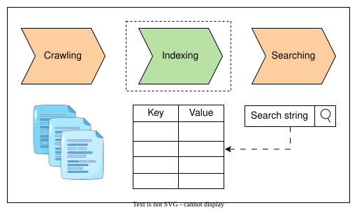

# Design_a_Distributed_Search_System_with_Scalable_Indexing

Source: https://www.educative.io/courses/system-design-interview-prep-crash-course/design-a-distributed-search

---

[Home](https://www.educative.io/)

[Courses](https://www.educative.io/search?tab=courses)

[System Design Interview: Fast-Track in 48 Hours](https://www.educative.io/courses/system-design-interview-prep-crash-course)

# Design a Distributed Search

Explore the design of a distributed search system, focusing on indexing techniques like inverted indexes and document partitioning. Understand scalability, high availability, and replication strategies to handle large datasets and fast search queries.

We'll cover the following...

- [What is a search system?](https://www.educative.io/courses/system-design-interview-prep-crash-course/design-a-distributed-search#What-is-a-search-system)
  - [Requirements](https://www.educative.io/courses/system-design-interview-prep-crash-course/design-a-distributed-search#Requirements)
    - [Functional requirements](https://www.educative.io/courses/system-design-interview-prep-crash-course/design-a-distributed-search#Functional-requirements)
    - [Non-functional requirements](https://www.educative.io/courses/system-design-interview-prep-crash-course/design-a-distributed-search#Non-functional-requirements)
  - [Building blocks we will use](https://www.educative.io/courses/system-design-interview-prep-crash-course/design-a-distributed-search#Building-blocks-we-will-use)
  - [Indexing](https://www.educative.io/courses/system-design-interview-prep-crash-course/design-a-distributed-search#Indexing)
    - [Inverted index](https://www.educative.io/courses/system-design-interview-prep-crash-course/design-a-distributed-search#Inverted-index)
    - [Searching from an inverted index](https://www.educative.io/courses/system-design-interview-prep-crash-course/design-a-distributed-search#Searching-from-an-inverted-index)
  - [Indexing on a centralized system](https://www.educative.io/courses/system-design-interview-prep-crash-course/design-a-distributed-search#Indexing-on-a-centralized-system)
  - [High-level design](https://www.educative.io/courses/system-design-interview-prep-crash-course/design-a-distributed-search#High-level-design)
  - [Detailed discussion](https://www.educative.io/courses/system-design-interview-prep-crash-course/design-a-distributed-search#Detailed-discussion)
    - [Distributed indexing and searching](https://www.educative.io/courses/system-design-interview-prep-crash-course/design-a-distributed-search#Distributed-indexing-and-searching)
    - [Replication](https://www.educative.io/courses/system-design-interview-prep-crash-course/design-a-distributed-search#Replication)
    - [Replication factor and replica distribution](https://www.educative.io/courses/system-design-interview-prep-crash-course/design-a-distributed-search#Replication-factor-and-replica-distribution)
      - [Indexing with replicas](https://www.educative.io/courses/system-design-interview-prep-crash-course/design-a-distributed-search#Indexing-with-replicas)
      - [Searching with replicas](https://www.educative.io/courses/system-design-interview-prep-crash-course/design-a-distributed-search#Searching-with-replicas)
  - [Scaling search and indexing](https://www.educative.io/courses/system-design-interview-prep-crash-course/design-a-distributed-search#Scaling-search-and-indexing)
    - [Problems](https://www.educative.io/courses/system-design-interview-prep-crash-course/design-a-distributed-search#Problems)
    - [Solutions](https://www.educative.io/courses/system-design-interview-prep-crash-course/design-a-distributed-search#Solutions)
  - [Ensure non-functional requirements are met](https://www.educative.io/courses/system-design-interview-prep-crash-course/design-a-distributed-search#Ensure-non-functional-requirements-are-met)
  - [Conclusion](https://www.educative.io/courses/system-design-interview-prep-crash-course/design-a-distributed-search#Conclusion)

## What is a search system?[#](https://www.educative.io/courses/system-design-interview-prep-crash-course/design-a-distributed-search#What-is-a-search-system)

Behind every search bar, there is a search system. A **search system** is a system that takes some text input, a search query, from the user and returns the relevant content in a few seconds or less. There are three main components of a search system, namely:

- A **crawler**, which fetches content and creates documents.
- An **indexer**, which builds a searchable index.
- A **searcher**, which responds to search queries by running the search query on the index created by the indexer.

The three phases of a search system

> **Note:** We have a separate lesson dedicated to the explanation of the [crawler](https://www.educative.io/courses/system-design-interview-prep-crash-course/design-a-web-crawler-15-minute-sprint) component. In this lesson, we’ll focus on indexing.

### Requirements[#](https://www.educative.io/courses/system-design-interview-prep-crash-course/design-a-distributed-search#Requirements)

Let’s go over the functional and non-functional requirements of a distributed search system.

#### Functional requirements[#](https://www.educative.io/courses/system-design-interview-prep-crash-course/design-a-distributed-search#Functional-requirements)

The following is a functional requirement of a distributed search system:

- **Search:** Users should get relevant content based on their search queries.

#### Non-functional requirements[#](https://www.educative.io/courses/system-design-interview-prep-crash-course/design-a-distributed-search#Non-functional-requirements)

Here are the non-functional requirements of a distributed search system:

- **Availability:** The system should be highly available to the users.
- **Scalability:** The system should have the ability to scale with the increasing amount of data. In other words, it should be able to index a large amount of data.
- **Fast search on big data:** The user should get the results quickly, no matter how much content they are searching.
- **Reduced cost:** The overall cost of building a search system should be low.

### Building blocks we will use[#](https://www.educative.io/courses/system-design-interview-prep-crash-course/design-a-distributed-search#Building-blocks-we-will-use)

We need a distributed storage in our design. Therefore, we can use the [blob store](https://www.educative.io/courses/system-design-interview-prep-crash-course/design-a-blob-store), a previously discussed building block, to store the data to be indexed and the index itself. We’ll use the generic term “distributed storage” instead of the specific term “blob store.”

Distributed storage: Blob store

### Indexing[#](https://www.educative.io/courses/system-design-interview-prep-crash-course/design-a-distributed-search#Indexing)

**Indexing** is the organization and manipulation of data that’s done to facilitate fast and accurate information retrieval. However, running search queries on billions of documents that are document-level indexed will be a slow process, which may take many minutes, or even hours. Therefore, we will employ an inverted index as explained below.

#### Inverted index[#](https://www.educative.io/courses/system-design-interview-prep-crash-course/design-a-distributed-search#Inverted-index)

An **inverted index** is a HashMap-like data structure that employs a document-term matrix. Instead of storing the complete document as it is, it splits the documents into individual words. After this, the document-term matrix identifies unique words and discards frequently occurring words like “to,” “they,” “the,” “is,” and so on. Frequently occurring words like those are called **terms**. The document-term matrix maintains a **term-level index** through this identification of unique words and deletion of unnecessary terms.

For each term, the index computes the following information:

- The list of documents in which the term appeared.
- The frequency with which the term appears in each document.
- The position of the term in each document.

## Inverted Index

|  |  |
| --- | --- |
| **Term** | **Mapping ( [doc], [freq], [[loc])** |
| elasticsearch | ( [1, 2, 3], [1, 1, 1], [[1], [1], [1]] ) |
| distributed | ( [1, 3], [1, 1], [[4], [4]] ) |
| restful | ( [1], [1], [[5]] ) |
| stack | ( [1], [1], [[16]] ) |

In the table above, the “Term” column contains all the unique terms that are extracted from all of the documents. Each entry in the “Mapping” column consists of three lists:

- A list of documents in which the term appeared.
- A list that counts the frequency with which the term appears in each document.
- A two-dimensional list that pinpoints the position of the term in each document. A term can appear multiple times in a single document, which is why a two-dimensional list is used.

> **Note:** Instead of lists, the mappings could also be in the form of tuples, such as doc, freq, and loc.

The inverted index is one of the most popular index mechanisms used in document retrieval. It enables efficient implementation of boolean, extended boolean, proximity, relevance, and many other types of search algorithms.

#### Searching from an inverted index[#](https://www.educative.io/courses/system-design-interview-prep-crash-course/design-a-distributed-search#Searching-from-an-inverted-index)

Consider a system that has the following mappings when we search for the word “search engine:”

## Mapping for "search engine"

|  |  |
| --- | --- |
| **Term** | **Mapping** |
| search | ( [1, 2, 3], [1, 1, 1], [[6], [4], [5]] ) |
| engine | ( [1, 2, 3], [1, 1, 1], [[9], [5], [8]] ) |

Both of these words are found in documents 1, 2, and 3. Both words appear once in each document.

The word “search” is located at position 6 in document 1, at position 4 in document 2, and position 5 in document 3. The word “engine” is located at position 9 in document 1, position 5 in document 2, and position 8 in document 3.

A single term can appear in millions of documents. So, the list of documents returned against a search query could be very long.

### Indexing on a centralized system[#](https://www.educative.io/courses/system-design-interview-prep-crash-course/design-a-distributed-search#Indexing-on-a-centralized-system)

In a **centralized search system**, all the search system components run on a single node, which is computationally quite capable. The architecture of a centralized search system is shown in the following illustration:

The architecture of a centralized search system

- The indexing process takes the documents as input and converts them into an inverted index, which is stored in the form of a binary file.
- The query processing or search process interprets the binary file that contains the inverted index. It also computes the intersection of the inverted lists for a given query to return the search results against the query.

These are the problems that come with the architecture of a centralized search system:

- **Single point of failure:** A centralized system is a single point of failure. If it’s dead, no search operation can be performed.
- **Server overload:** If numerous users perform queries and the queries are complicated, it stresses the server (node).
- **Large size of the index:** The size of the inverted index increases with the number of documents, placing resource demands on a single server. The bigger the computer system, the higher the cost and complexity of managing it.

### High-level design[#](https://www.educative.io/courses/system-design-interview-prep-crash-course/design-a-distributed-search#High-level-design)

Let’s shape the overall design of a distributed search system before getting into a detailed discussion. There are two phases of such a system, as shown in the illustration below. The **offline phase** involves data crawling and indexing in which the user has to do nothing. The **online phase** consists of searching for results against the search query by the user.

High-level design of a distributed search system

- The **crawler** collects content from the intended resource.
- The **indexer** fetches the documents from a distributed storage and indexes these documents using MapReduce, which runs on a distributed cluster of commodity machines. The indexer uses a distributed data processing system, like MapReduce, for parallel and distributed index construction. The constructed index table is stored in the distributed storage.
- Distributed storage is used to store the documents and the index.
- The user enters the search string that contains multiple words in the search bar.
- The **searcher** parses the search string, searches for the mappings from the index that are stored in the distributed storage, and returns the most matched results to the user.

### Detailed discussion[#](https://www.educative.io/courses/system-design-interview-prep-crash-course/design-a-distributed-search#Detailed-discussion)

Since the indexer is the core component in a search system, we discussed an indexing technique and the problems associated with centralized indexing in the previous section. In this section, we consider a distributed solution for indexing and searching.

#### Distributed indexing and searching[#](https://www.educative.io/courses/system-design-interview-prep-crash-course/design-a-distributed-search#Distributed-indexing-and-searching)

Let’s see how we can develop a distributed indexing and searching system. We understand that the input to an indexing system is the documents we created during crawling. To develop an index in a distributed fashion, we employ a large number of low-cost machines (nodes) and partition or divide the documents based on the resources they have. All the nodes are connected. A group of nodes is called a **cluster**.

We use numerous small nodes for indexing to achieve cost efficiency. This process requires us to partition or split the input data (documents) among these nodes. However, a key question needs to be addressed: How do we perform this partitioning?

The two most common techniques used for data partitioning in distributed indexing are those below:

- **Document partitioning:** In document partitioning, all the documents collected by the web crawler are partitioned into subsets of documents. Each node then performs indexing on a subset of documents that are assigned to it.
- **Term partitioning:** The dictionary of all terms is partitioned into subsets, with each subset residing at a single node. For example, a subset of documents is processed and indexed by a node containing the term “search.”

Types of data partitioning in a distributed search

In term partitioning, a search query is sent to the nodes that correspond to the query terms. This provides more concurrency because a stream of search queries with different query terms will be served by different nodes. However, term partitioning turns out to be a difficult task in practice. Multiword queries necessitate sending long mapping lists between groups of nodes for merging, which can be more expensive than the benefits from the increased concurrency.

In document partitioning, each query is distributed across all nodes, and the results from these nodes are merged before being shown to the user. This method of partitioning necessitates less inter-node communication. In our design, we use document partitioning.

Following document partitioning, let’s look into a distributed design for index construction and querying, which is shown in the illustration below. We use a cluster that consists of a number of low-cost nodes and a cluster manager. The cluster manager uses a MapReduce programming model to parallelize the index’s computation on each partition. MapReduce can work on significantly larger datasets that are difficult to be handled by a single large server.

Distributed indexing and searching in a parallel fashion on multiple nodes in a cluster of commodity machines

The system described above works as follows:

**Indexing**

- We have a document set already collected by the crawler.
- The **cluster manager** splits the input document set into NNN number of partitions, where NNN is equal to three in the illustration above. The size of each partition is decided by the cluster manager given the size of the data, the computation, memory limits, and the number of nodes in the cluster. All the nodes may not be available for various reasons. The cluster manager monitors the health of each node through periodic heartbeats. To assign a document to one of the NNN partitions, a **hashing function** can be utilized.
- After making partitions, the cluster manager runs indexing algorithms for all the NNN partitions simultaneously on the NNN number of nodes in a cluster. Each indexing process produces a tiny inverted index, which is stored on the node’s local storage. In this way, we produce NNN tiny inverted indices rather than one large inverted index.

**Searching**

- In the search phase, when a user query comes in, we run parallel searches on each tiny inverted index stored on the nodes’ local storage generating NNN queries.
- The search result from each inverted tiny index is a mapping list against the queried term (we assume a single word/term user query). The **merger** aggregates these mapping lists.
- After aggregating the mapping lists, the merger sorts the list of documents from the aggregated mapping list based on the frequency of the term in each document.
- The sorted list of documents is returned to the user as a search result. The documents are shown in sorted (ascending) order to the user.

> **Note:** We’ve designed a search system where we utilized a distributed system and parallelized the indexing and searching process. This helped us handle large datasets by working on the smaller partitions of documents. It should be noted that both searching and indexing are performed on the same node. We refer to this idea as **colocation**.

The proposed design works, and we can replicate it across the globe in various data centers to facilitate all users. Therefore, we can achieve the following advantages:

- Our design will not be subject to a single point of failure (SPOF).
- Latency for all users will remain small.
- Maintenance and upgrades in individual data centers will be possible.
- Scalability (serving more users per second) of our system will be improved.

#### Replication[#](https://www.educative.io/courses/system-design-interview-prep-crash-course/design-a-distributed-search#Replication)

We make replicas of the indexing nodes that produce inverted indexes for the assigned partitions. We can answer a query from several sets of nodes with replicas. The overall concept is simple. We continue to use the same architecture as before, but instead of having only one group of nodes, we have RRR groups of nodes to answer user queries. RRR is the number of replicas. The number of replicas can expand or shrink based on the number of requests, and each group of nodes has all the partitions required to answer each query.

Each group of nodes is hosted on different availability zones for better performance and availability of the system in case a datacenter fails.

> **Note:** A load balancer component is necessary to spread the queries across different groups of nodes and retry in case of any error.

#### Replication factor and replica distribution[#](https://www.educative.io/courses/system-design-interview-prep-crash-course/design-a-distributed-search#Replication-factor-and-replica-distribution)

Generally, a replication factor of three is enough. A replication factor of three means three nodes host the same partition and produce the index. One of the three nodes becomes the primary node, while the other two are replicas. Each of these nodes produces indexes in the same order to converge on the same state.

##### Indexing with replicas[#](https://www.educative.io/courses/system-design-interview-prep-crash-course/design-a-distributed-search#Indexing-with-replicas)

Let's assume that each partition is forwarded to each replica for index computation.This means that the same partition will be forwarded to all three replicas in both availability zones. Therefore, each node will compute the index simultaneously and reach the same state.

The advantage of this strategy is that the indexing operation will not suffer if the primary node fails.

##### Searching with replicas[#](https://www.educative.io/courses/system-design-interview-prep-crash-course/design-a-distributed-search#Searching-with-replicas)

We have three copies of each partition’s index. The load balancer chooses one of the three copies of each partition to perform the query. An increased number of copies improves the scalability and availability of the system. Now, the system can handle three times more queries in the same amount of time.

### Scaling search and indexing[#](https://www.educative.io/courses/system-design-interview-prep-crash-course/design-a-distributed-search#Scaling-search-and-indexing)

We will face two problems when scaling.

#### Problems[#](https://www.educative.io/courses/system-design-interview-prep-crash-course/design-a-distributed-search#Problems)

- **Colocated indexing and searching:** Searching and indexing are both resource-intensive operations. Both operations impact the performance of each other. Colocating both these operations on the same machine can lead to an imbalance, and it results in scalability issues.
- **Index recomputation:** Recomputing the same index over different replicas requires powerful machines. Instead, the logical approach is to compute the index once and replicate it across availability zones.

#### Solutions[#](https://www.educative.io/courses/system-design-interview-prep-crash-course/design-a-distributed-search#Solutions)

- Recent advancements in networking and virtualization allow for a strong separation between indexing and search without the negative consequence of indexing latency. These advancements allow for a strong separation between indexing and search without the negative consequence of indexing latency.

We’ll use these technologies to redesign our distributed indexing and searching system. There are three components involved in this search system design:

- **Indexer:** This consists of a group of nodes to compute the index. We can perform indexing with a MapReduce distributed model.
- **Distributed storage:** This system is used to store partitions and the computed index.
- **Searcher:** This consists of a number of nodes to perform searching.

The illustration below depicts the generation and transfer of an inverted index between an indexer and a searcher node:

The indexes produced by the indexing nodes are stored on the distributed storage, and the nodes involved in the search read indexes from the distributed storage to produce a result for the user's query

- Rather than recomputing the index on each replica, we compute the inverted index on the primary node only. Then, we simply communicate the inverted index (binary blob/file) to the replicas.

### Ensure non-functional requirements are met[#](https://www.educative.io/courses/system-design-interview-prep-crash-course/design-a-distributed-search#Ensure-non-functional-requirements-are-met)

Let’s evaluate our distributed search’s design with respect to its non-functional requirements:

**Availability:** By replicating the data across multiple regions and availability zones, the system can ensure that even if a failure occurs in one place, the requests can still be processed from another cluster. This helps to achieve high indexing and search availability.

**Scalability:** When more nodes are added to the indexing and search clusters and the number of partitions is increased, the system can scale in terms of data indexing and querying. This means that the system can handle more data and queries, which can improve availability.

You’re a software engineer for a rapidly growing e-commerce site aiming to redefine search with lightning-fast personalized results. Currently, user experience is suffering due to slow search response times, especially during peak loads.

Your task is to:

- Identify components of distributed search that can benefit from caching to improve performance.
- Identify the potential trade-offs to consider.

To get started, say “hello” to Ed in the widget below, and it will lead the way.

AI Powered

Saved

12 attempts left

Reset

You have 12 attempts to answer.

### Conclusion[#](https://www.educative.io/courses/system-design-interview-prep-crash-course/design-a-distributed-search#Conclusion)

A search system is required for almost every application. We have seen that it’s impossible to develop a search system that can run on a single node. We utilized a parallel computation framework and low-cost machines to build a search system that is available, scalable, and highly performant.

Design a Blob Store

Design a Distributed Logging Service

Ask

[What is a search system?](https://www.educative.io/courses/system-design-interview-prep-crash-course/design-a-distributed-search#What-is-a-search-system)

[Requirements](https://www.educative.io/courses/system-design-interview-prep-crash-course/design-a-distributed-search#Requirements)

[Functional requirements](https://www.educative.io/courses/system-design-interview-prep-crash-course/design-a-distributed-search#Functional-requirements)

[Non-functional requirements](https://www.educative.io/courses/system-design-interview-prep-crash-course/design-a-distributed-search#Non-functional-requirements)

[Building blocks we will use](https://www.educative.io/courses/system-design-interview-prep-crash-course/design-a-distributed-search#Building-blocks-we-will-use)

[Indexing](https://www.educative.io/courses/system-design-interview-prep-crash-course/design-a-distributed-search#Indexing)

[Inverted index](https://www.educative.io/courses/system-design-interview-prep-crash-course/design-a-distributed-search#Inverted-index)

[Searching from an inverted index](https://www.educative.io/courses/system-design-interview-prep-crash-course/design-a-distributed-search#Searching-from-an-inverted-index)

[Indexing on a centralized system](https://www.educative.io/courses/system-design-interview-prep-crash-course/design-a-distributed-search#Indexing-on-a-centralized-system)

[High-level design](https://www.educative.io/courses/system-design-interview-prep-crash-course/design-a-distributed-search#High-level-design)

[Detailed discussion](https://www.educative.io/courses/system-design-interview-prep-crash-course/design-a-distributed-search#Detailed-discussion)

[Distributed indexing and searching](https://www.educative.io/courses/system-design-interview-prep-crash-course/design-a-distributed-search#Distributed-indexing-and-searching)

[Replication](https://www.educative.io/courses/system-design-interview-prep-crash-course/design-a-distributed-search#Replication)

[Replication factor and replica distribution](https://www.educative.io/courses/system-design-interview-prep-crash-course/design-a-distributed-search#Replication-factor-and-replica-distribution)

[Indexing with replicas](https://www.educative.io/courses/system-design-interview-prep-crash-course/design-a-distributed-search#Indexing-with-replicas)

[Searching with replicas](https://www.educative.io/courses/system-design-interview-prep-crash-course/design-a-distributed-search#Searching-with-replicas)

[Scaling search and indexing](https://www.educative.io/courses/system-design-interview-prep-crash-course/design-a-distributed-search#Scaling-search-and-indexing)

[Problems](https://www.educative.io/courses/system-design-interview-prep-crash-course/design-a-distributed-search#Problems)

[Solutions](https://www.educative.io/courses/system-design-interview-prep-crash-course/design-a-distributed-search#Solutions)

[Ensure non-functional requirements are met](https://www.educative.io/courses/system-design-interview-prep-crash-course/design-a-distributed-search#Ensure-non-functional-requirements-are-met)

[Conclusion](https://www.educative.io/courses/system-design-interview-prep-crash-course/design-a-distributed-search#Conclusion)