# Designing_Scalable_Distributed_Task_Schedulers_for_Cloud_Systems

Source: https://www.educative.io/courses/system-design-interview-prep-crash-course/design-a-distributed-task-scheduler

---

[Home](https://www.educative.io/)

[Courses](https://www.educative.io/search?tab=courses)

[System Design Interview: Fast-Track in 48 Hours](https://www.educative.io/courses/system-design-interview-prep-crash-course)

# Design a Distributed Task Scheduler

Explore the design of a distributed task scheduler tailored for cloud environments with multiple tenants and dispersed resources. Learn to manage task dependencies, prioritization, resource allocation, fault tolerance, and scalability to build a reliable scheduling system that meets functional and non-functional requirements.

We'll cover the following...

- [What is a task scheduler?](https://www.educative.io/courses/system-design-interview-prep-crash-course/design-a-distributed-task-scheduler#What-is-a-task-scheduler)
- [Distributed task scheduling](https://www.educative.io/courses/system-design-interview-prep-crash-course/design-a-distributed-task-scheduler#Distributed-task-scheduling)
- [Requirements](https://www.educative.io/courses/system-design-interview-prep-crash-course/design-a-distributed-task-scheduler#Requirements)
  - [Functional requirements](https://www.educative.io/courses/system-design-interview-prep-crash-course/design-a-distributed-task-scheduler#Functional-requirements)
  - [Non-functional requirements](https://www.educative.io/courses/system-design-interview-prep-crash-course/design-a-distributed-task-scheduler#Non-functional-requirements)
- [Building blocks we will use](https://www.educative.io/courses/system-design-interview-prep-crash-course/design-a-distributed-task-scheduler#Building-blocks-we-will-use)
- [Components](https://www.educative.io/courses/system-design-interview-prep-crash-course/design-a-distributed-task-scheduler#Components)
- [Design](https://www.educative.io/courses/system-design-interview-prep-crash-course/design-a-distributed-task-scheduler#Design)
- [Task submitter](https://www.educative.io/courses/system-design-interview-prep-crash-course/design-a-distributed-task-scheduler#Task-submitter)
- [Design considerations](https://www.educative.io/courses/system-design-interview-prep-crash-course/design-a-distributed-task-scheduler#Design-considerations)
  - [Queueing](https://www.educative.io/courses/system-design-interview-prep-crash-course/design-a-distributed-task-scheduler#Queueing)
  - [Execution cap](https://www.educative.io/courses/system-design-interview-prep-crash-course/design-a-distributed-task-scheduler#Execution-cap)
- [Prioritization](https://www.educative.io/courses/system-design-interview-prep-crash-course/design-a-distributed-task-scheduler#Prioritization)
- [Task idempotency](https://www.educative.io/courses/system-design-interview-prep-crash-course/design-a-distributed-task-scheduler#Task-idempotency)
- [Ensure non-functional requirements are met](https://www.educative.io/courses/system-design-interview-prep-crash-course/design-a-distributed-task-scheduler#Ensure-non-functional-requirements-are-met)
- [Conclusion](https://www.educative.io/courses/system-design-interview-prep-crash-course/design-a-distributed-task-scheduler#Conclusion)

## What is a task scheduler?[#](https://www.educative.io/courses/system-design-interview-prep-crash-course/design-a-distributed-task-scheduler#What-is-a-task-scheduler)

A **task scheduler** is a critical component of a system for getting work done efficiently. For example, uploading a photo or a video on Facebook or Instagram consists of the following background tasks:

1. Encode the photo or video in multiple resolutions.
2. Validate the photo or video to check for content monetization, copyrights, and many more.

The successful execution of the tasks above makes the photo or video visible. It allows us to complete a large number of tasks using limited resources.

## Distributed task scheduling[#](https://www.educative.io/courses/system-design-interview-prep-crash-course/design-a-distributed-task-scheduler#Distributed-task-scheduling)

The process of deciding and assigning resources to the tasks in a timely manner is called **task scheduling**. The visual difference between an OS-level task scheduler and a datacenter-level task scheduler is shown in the following illustration:


An OS-level task scheduler vs. a data center-level task scheduler

The OS task scheduler schedules a node’s local tasks or processes on that node’s computational resources. At the same time, the datacenter’s task scheduler schedules billions of tasks coming from multiple tenants that use the datacenter’s resources.

Our goal is to design a task scheduler similar to the datacenter-level task scheduler where the following is considered:

- Tasks will come from many different sources, tenants, and subsystems.
- Many resources will be dispersed in a datacenter (or maybe across many datacenters).

The two requirements above make the task scheduling problem challenging. We’ll design a distributed task scheduler that can handle all these tasks by making it scalable, reliable, and fault tolerant.

## Requirements[#](https://www.educative.io/courses/system-design-interview-prep-crash-course/design-a-distributed-task-scheduler#Requirements)

Let’s start by going over the functional and non-functional requirements for designing a task scheduler.

### Functional requirements[#](https://www.educative.io/courses/system-design-interview-prep-crash-course/design-a-distributed-task-scheduler#Functional-requirements)

The functional requirements of the distributed task scheduler are as follows:

- **Submit tasks:** The system should allow the users to submit their tasks for execution.
- **Allocate resources:** The system should be able to allocate the required resources to each task.
- **Remove tasks:** The system should allow the users to cancel the submitted tasks.
- **Monitor task execution:** The task execution should be adequately monitored and rescheduled if the task fails to execute.
- **Efficient resource utilization:** The resources (CPU and memory) must be used efficiently in terms of time, cost, and fairness. Efficiency means that we do not waste resources.
- **Release resources:** After successfully executing a task, the system should take back the resources assigned to the task.
- **Show task status:** The system should show the users the current status of the task.

### Non-functional requirements[#](https://www.educative.io/courses/system-design-interview-prep-crash-course/design-a-distributed-task-scheduler#Non-functional-requirements)

The non-functional requirements of the distributed task scheduler are as follows:

- **Availability:** The system should be highly available to schedule and execute tasks.
- **Durability:** The tasks received by the system should be durable and should not be lost.
- **Scalability:** The system should be able to schedule and execute an ever-increasing number of tasks per day.
- **Fault tolerance:** The system must be fault tolerant by providing services uninterrupted despite faults in one or more of its components.
- **Bounded waiting time:** This is how long a task needs to wait before starting execution. We must not execute tasks much later than expected. Users shouldn’t be kept on waiting for an infinite time. If the waiting time for users crosses a certain threshold, they should be notified.

## Building blocks we will use[#](https://www.educative.io/courses/system-design-interview-prep-crash-course/design-a-distributed-task-scheduler#Building-blocks-we-will-use)

We’ll utilize the following building blocks in the design of our task scheduling system:

Building blocks of a task scheduler

- **A rate limiter** is required to limit the number of tasks so that our system is reliable.
- **A sequencer** is needed to uniquely identify tasks.
- **Database(s)** are used to store task information.
- **A distributed queue** is required to arrange tasks in the order of execution.
- **Monitoring** is essential to check the health of the resources and to detect failed tasks to provide reliable service to the users.

Let’s identify the components used in this design:

## Components[#](https://www.educative.io/courses/system-design-interview-prep-crash-course/design-a-distributed-task-scheduler#Components)

We can consider scheduling at many levels. We could be asked to design scheduling that is done internally by an organization to run tasks on their own cluster of machines. There, they have to find ample resources and need to decide which task to run first.

We could also be asked to design scheduling that a cloud provider uses to schedule tasks coming from multiple clients. Cloud providers need to decide which task to run first and which clients to handle first to provide appropriate isolation between different tenants.

So, in general, the big components of our system are:

- **Clients:** They initiate the task execution.
- **Resources:** The task is executed on these components.
- **Scheduler:** A scheduler performs processes between clients and resources and decides which task should get resources first.

Scheduler puts tasks into a queue for resource allocation

As shown in the illustration above, it’s necessary to put the incoming tasks into a queue. This is because of the following reasons:

- We might not have sufficient resources available right now.
- There is task dependency, and some tasks need to wait for others.
- We need to decouple the clients from the task execution so that they can hand off work to our system. Our system then queues it for execution.

Let’s design a task scheduling system that should be able to schedule any task. Often, many tasks are relatively short-lived—from seconds to minutes. For long-running tasks, we might need the ability of periodic checksumming and restoration at the application level to recover from possible failures.

Let’s assume that some single server in our fleet can meet the computational needs of each task. For tasks that need many servers, either the application would need to break them down into smaller tasks for our system or employ long-term resource acquisition from the cluster manager.

## Design[#](https://www.educative.io/courses/system-design-interview-prep-crash-course/design-a-distributed-task-scheduler#Design)

When a task comes for scheduling, it should contain the following information with it:

- **Resource requirements:** The requirements include the number of CPU cores it needs, how much RAM is required to execute this task, how much disk space is required, what should the disk access rate be (input/output rate per second or IOPS), and how many TCP ports the task needs for the execution, and so on.
- **Dependency:** Broadly, tasks can be of two types: dependent and independent.
  - **Dependent tasks** require executing one or more additional tasks for their complete execution. For a dependent task, the client should provide a list of the tasks on which a given task is dependent.
  - **Independent tasks** don’t depend on the execution of any other task. Independent tasks can run in parallel.
    We should know whether a task is dependent or independent. The dependency information helps to execute both dependent tasks in order and independent tasks in parallel for efficient utilization of resources.

The design of the task scheduler is shown in the following illustration:

The design of task scheduler

- **Clients:** The clients of the cloud providers are individuals or organizations from small to large businesses who want to execute their tasks.
- **Rate limiter:** The resources available for a client depend on the cost they pay. It’s important to limit the number of tasks for the reliability of our service.
- **Task submitter:** The task submitter admits the task if it successfully passes through the rate limiter. There isn’t a single task submitter. Instead, we have a cluster of nodes that admit the increasing number of tasks.
- **Unique ID generator:** It assigns unique IDs to the newly admitted tasks.
- **Database:** All of the tasks taken by the task submitter are stored in a distributed database. For each task, we have some attributes, and all of the attributes except one are stored in the relational database.

  - **Relational database (RDB):** A relational database stores task IDs, user IDs, required resources, execution caps, the total number of attempts made by the client, delay tolerance, and so on.
  - **Graph database (GDB):** This is a non-relational database that uses the graph data structure to store data. We use it to build and store a directed acyclic graph (DAG) of dependent tasks, topologically sorted by the task submitter, so that we can schedule tasks according to that DAG.
- **Batching and prioritization:** After we store the tasks in the RDB, the tasks are grouped into batches. Prioritization is based on the attributes of the tasks, such as delay tolerance or the tasks with short execution cap, and so on.
- **Distributed queue:** This consists of a queue and a queue manager. The queue manager adds, updates, or deletes tasks in the queue. It keeps track of the types of queues we use. It’s also responsible for keeping the task in the queue until it executes successfully. In case a task execution fails, that task is made visible in the queue again.
- **Queue manager:** The queue manager deletes a task from the queue if it executes successfully. It also makes the task visible if its previous execution failed. It retries for the allowed number of attempts for a task in case of a failed execution.
- **Resource manager:** The resource manager knows which of the resources are free. It pulls the tasks from the distributed queue and assigns them resources. The resource manager keeps track of the execution of each task and sends back their statuses to the queue manager. If a task goes beyond its promised or required resource use, that task will be terminated, and the status is sent back to the task submitter, which will notify the client about the termination of the task through an error message.
- **Monitoring service:** This is responsible for checking the health of the resource manager and the resources. If some resource fails, it alerts the administrators to repair the resource or add new resources if required. If resources are not being used, it alerts the administrators to remove them or power them off.

## Task submitter[#](https://www.educative.io/courses/system-design-interview-prep-crash-course/design-a-distributed-task-scheduler#Task-submitter)

As we have seen above, every component we use in the design of the distributed task scheduler is distributed and is therefore scalable and available. But, the task submitter could be a single point of failure. So, to handle this, we use a cluster of nodes. Each node must admit the tasks, send the tasks to a unique ID generator for ID assignment, and then store the task along with the task ID in the distributed database.

There is a cluster manager to which each node sends a heartbeat that indicates the node is working correctly. Each node updates the cluster manager about the admitted tasks. The cluster manager maintains a list of tasks and the node ID that admitted that task. If a node fails to execute a task, the cluster manager hands over that task to another node in the cluster. The cluster manager is itself replicated.

Above, we designed a task scheduling system. We’ll discuss the design considerations of our task scheduler in the next section.

## Design considerations[#](https://www.educative.io/courses/system-design-interview-prep-crash-course/design-a-distributed-task-scheduler#Design-considerations)

### Queueing[#](https://www.educative.io/courses/system-design-interview-prep-crash-course/design-a-distributed-task-scheduler#Queueing)

A distributed queue is a major building block used by a scheduler. The simplest scheduling approach is to push the task into the queue on a first-come, first-served basis. If there are 10,000 nodes (resources) in a cluster (cloud), the task scheduler quickly extracts tasks from the queue and schedules them on the nodes. But, if all the resources are currently busy, then tasks will need to wait in the queue, and small tasks might need to wait longer.

We can have the following three categories for our tasks:

- Tasks that can’t be delayed.
- Tasks that can be delayed.
- Tasks that need to be executed periodically (for example, every five minutes, or every hour, or every day).

Multiple queues based on the task categories

### Execution cap[#](https://www.educative.io/courses/system-design-interview-prep-crash-course/design-a-distributed-task-scheduler#Execution-cap)

Some tasks take very long to execute and occupy the resource blocking other tasks. The **execution cap** is an important parameter to consider while scheduling tasks. If we completely allocate a resource to a single task and wait for that task’s completion, some tasks might not halt because of a bug in the task script that doesn’t let it finish its execution. We let the clients set the execution cap for their tasks. After that specified time, we should stop task execution, release the resource, and allocate it to the next task in the queue.

## Prioritization[#](https://www.educative.io/courses/system-design-interview-prep-crash-course/design-a-distributed-task-scheduler#Prioritization)

There are tasks that need urgent execution. For example, in a social application like on Facebook, users can mark themselves safe during an emergency situation, such as an earthquake.

To prioritize the tasks, the task scheduler maintains a delay tolerance parameter for each task and executes the task close to its delay tolerance. **Delay tolerance** is the maximum amount of time a task execution could be delayed. The task that has the shortest delay tolerance time is executed first. By using a delay tolerance parameter, we can postpone the tasks with longer delay tolerance values to make room for urgent tasks during peak times.

## Task idempotency[#](https://www.educative.io/courses/system-design-interview-prep-crash-course/design-a-distributed-task-scheduler#Task-idempotency)

If the task executes successfully, but for some reason the machine fails to send an acknowledgement, the scheduler will schedule the task again. The task is executed again, and we end up with the wrong result, which means the task was non-idempotent. An example of non-idempotence is shown in the following illustration:

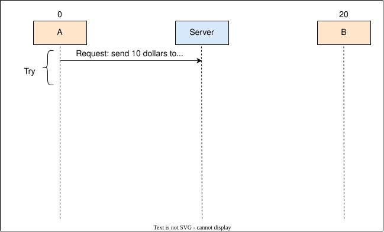

1 / 11

A has 20 dollars. It makes a request to send 10 dollars to B, which has 0 dollars. A is the sender, and B is the receiver

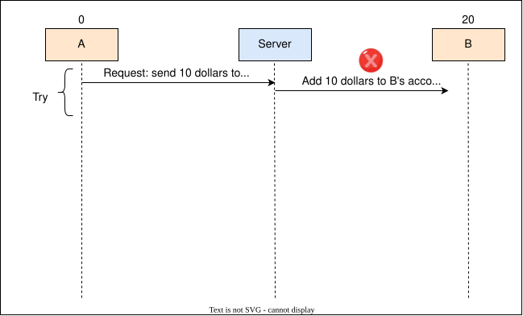

1 / 11

The server starts the operation of adding 10 dollars to B’s account, which doesn’t execute successfully

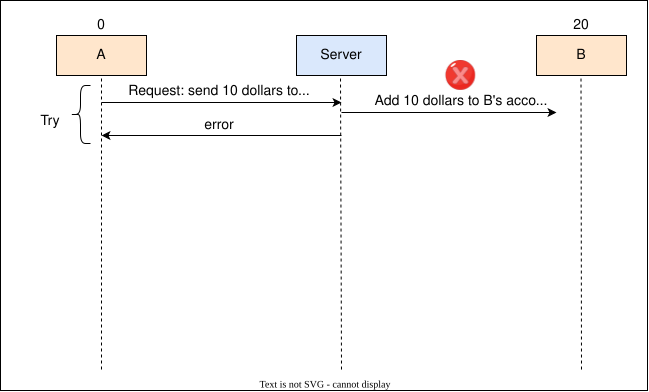

1 / 11

The server sends an error message to A

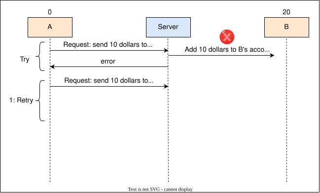

1 / 11

A retries the transaction

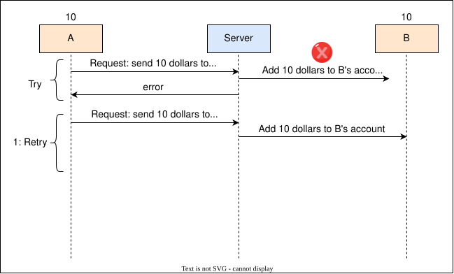

1 / 11

The server starts the operation of adding 10 dollars to B’s account

We don’t want the final result to change when executing the task again. This is critical in financial applications while transferring money. We require that tasks are idempotent. An idempotent task produces the same result, no matter how many times we execute it. The execution of an idempotent task is shown in the following illustration:

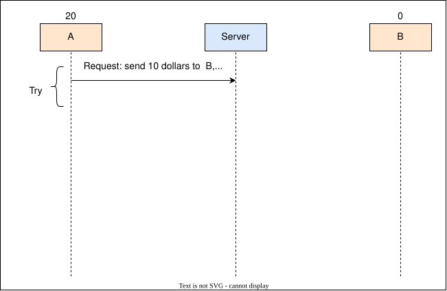

1 / 10

A makes a request to send 10 dollars to B with the idempotence key that is added by the application

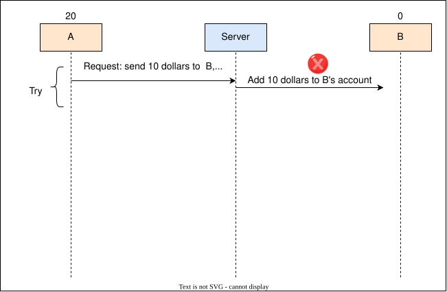

1 / 10

The server starts the operation of adding 10 dollars to B’s account, which doesn’t execute successfully

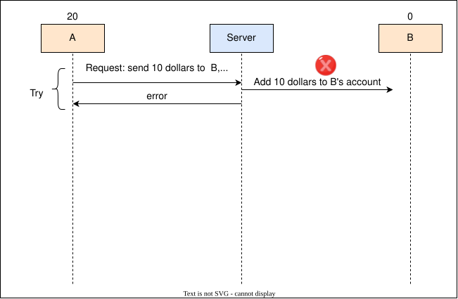

1 / 10

The server sends an error message to A

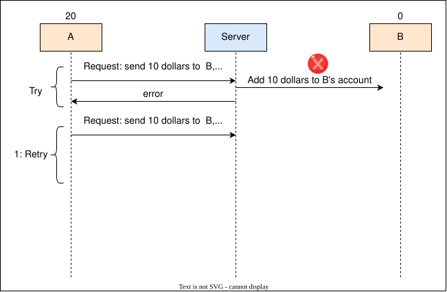

1 / 10

A retries the transaction, and the same idempotence key is attached with the retried request

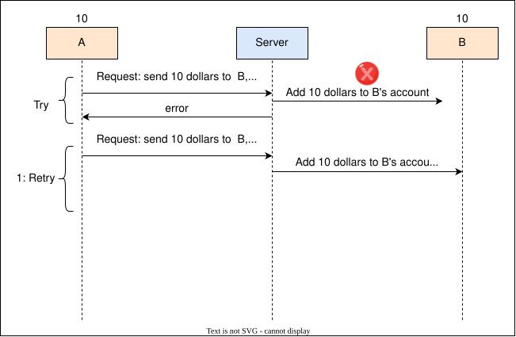

1 / 10

The server starts the operation of adding 10 dollars to B’s account

Let’s make the task of uploading a video to the database an idempotent operation. We don’t want the video to be duplicated in the database in case the uploader didn’t receive the acknowledgment. Idempotency ensures that the video is not duplicated. This property is added in the implementation by the developers where they identify the video by something (for example, its name) and overwrite the old one. This way, no matter how many times someone uploads it, the final result is the same. Idempotency enables us to simply re-execute a failed task.

With this, we have completed the design of the task scheduler. Let’s see how our proposed design meets the non-functional requirements.

## Ensure non-functional requirements are met[#](https://www.educative.io/courses/system-design-interview-prep-crash-course/design-a-distributed-task-scheduler#Ensure-non-functional-requirements-are-met)

Let’s evaluate the design of our distributed task scheduler with respect to its non-functional requirements:

- **Availability:** Our design ensures high availability by replicating the rate limiter, distributing task submissions across multiple nodes, and distributing the task queue. Continuous resource monitoring ensures that resources are always available, and each component’s distribution helps to make the overall system available.
- **Durability:** We store the tasks in a persistent distributed database and push the tasks into the queue near their execution time. Once a task is submitted, it’s in the database until its execution.
- **Scalability:** Our task scheduler provides scalability because the task submitter is distributed in our design. We can add more nodes to the cluster to submit an increasing number of tasks. The tasks are then saved into a distributed relational database, which is also scalable. The tasks from RDB are then pushed to a distributed queue, which can scale with an increasing number of tasks. We can add more queues for different types of tasks. We can also add more resources, depending on the resource-to-demand ratio.
- **Fault tolerance:**
  A task is not removed from the queue the first time it’s sent for execution. If the execution fails, we retry for the maximum number of allowed attempts. If the task contains an infinite loop, we kill the task after some specified time and notify the user.
- **Bounded waiting time:** We don’t let the users wait for an infinite time. We have a limit on the maximum waiting time. If the limit is reached and we are unable to schedule the task for some reason, we notify the user and ask them to try again.

You’re designing a task scheduler for a cloud-based photo-sharing app with millions of daily uploads. After a photo is uploaded, tasks like thumbnail generation, content moderation, metadata indexing, and watermarking must be processed. These tasks are *independent* but must follow a *specific order*. Critical tasks (e.g., moderation) should be prioritized. If a task fails, it should be retried up to three times; after that, the user must be notified.

**Questions:**

- How would you design the task scheduler to handle priorities, dependencies, and resource allocation?
- How would you manage task failures and retries?
- How would you ensure scalability and high availability?

Say “Hi” to Edward in the widget below to attempt a solution.

AI Powered

Saved

12 attempts left

Reset

You have 12 attempts to answer.

## Conclusion[#](https://www.educative.io/courses/system-design-interview-prep-crash-course/design-a-distributed-task-scheduler#Conclusion)

We discussed the difference between an OS-level task scheduler and a datacenter-level task scheduler. We explained that the datacenter-level task scheduling needs a distributed solution because of multiple tenants and dispersed resources. Further, we discussed the detailed design of the task scheduler and explained different design considerations. We also shed light on how our proposed design meets the non-functional requirements.

Design a Distributed Logging Service

Design Sharded Counters

Ask

[What is a task scheduler?](https://www.educative.io/courses/system-design-interview-prep-crash-course/design-a-distributed-task-scheduler#What-is-a-task-scheduler)

[Distributed task scheduling](https://www.educative.io/courses/system-design-interview-prep-crash-course/design-a-distributed-task-scheduler#Distributed-task-scheduling)

[Requirements](https://www.educative.io/courses/system-design-interview-prep-crash-course/design-a-distributed-task-scheduler#Requirements)

[Functional requirements](https://www.educative.io/courses/system-design-interview-prep-crash-course/design-a-distributed-task-scheduler#Functional-requirements)

[Non-functional requirements](https://www.educative.io/courses/system-design-interview-prep-crash-course/design-a-distributed-task-scheduler#Non-functional-requirements)

[Building blocks we will use](https://www.educative.io/courses/system-design-interview-prep-crash-course/design-a-distributed-task-scheduler#Building-blocks-we-will-use)

[Components](https://www.educative.io/courses/system-design-interview-prep-crash-course/design-a-distributed-task-scheduler#Components)

[Design](https://www.educative.io/courses/system-design-interview-prep-crash-course/design-a-distributed-task-scheduler#Design)

[Task submitter](https://www.educative.io/courses/system-design-interview-prep-crash-course/design-a-distributed-task-scheduler#Task-submitter)

[Design considerations](https://www.educative.io/courses/system-design-interview-prep-crash-course/design-a-distributed-task-scheduler#Design-considerations)

[Queueing](https://www.educative.io/courses/system-design-interview-prep-crash-course/design-a-distributed-task-scheduler#Queueing)

[Execution cap](https://www.educative.io/courses/system-design-interview-prep-crash-course/design-a-distributed-task-scheduler#Execution-cap)

[Prioritization](https://www.educative.io/courses/system-design-interview-prep-crash-course/design-a-distributed-task-scheduler#Prioritization)

[Task idempotency](https://www.educative.io/courses/system-design-interview-prep-crash-course/design-a-distributed-task-scheduler#Task-idempotency)

[Ensure non-functional requirements are met](https://www.educative.io/courses/system-design-interview-prep-crash-course/design-a-distributed-task-scheduler#Ensure-non-functional-requirements-are-met)

[Conclusion](https://www.educative.io/courses/system-design-interview-prep-crash-course/design-a-distributed-task-scheduler#Conclusion)