# Designing_Sharded_Counters_for_Scalable_Systems

Source: https://www.educative.io/courses/system-design-interview-prep-crash-course/design-sharded-counters

---

[Home](https://www.educative.io/)

[Courses](https://www.educative.io/search?tab=courses)

[System Design Interview: Fast-Track in 48 Hours](https://www.educative.io/courses/system-design-interview-prep-crash-course)

# Design Sharded Counters

Explore the design of sharded counters to efficiently manage high-volume write and read requests in systems like Twitter. Understand shard creation, write distribution strategies, read aggregation, and how this approach solves contention and scalability challenges while enabling high availability and reliability in large-scale applications.

We'll cover the following...

- [High-level solution sketch](https://www.educative.io/courses/system-design-interview-prep-crash-course/design-sharded-counters#High-level-solution-sketch)
- [Detailed design](https://www.educative.io/courses/system-design-interview-prep-crash-course/design-sharded-counters#Detailed-design)
  - [Sharded counter creation](https://www.educative.io/courses/system-design-interview-prep-crash-course/design-sharded-counters#Sharded-counter-creation)
  - [Burst of writes requests](https://www.educative.io/courses/system-design-interview-prep-crash-course/design-sharded-counters#Burst-of-writes-requests)
    - [Round-robin selection](https://www.educative.io/courses/system-design-interview-prep-crash-course/design-sharded-counters#Round-robin-selection)
    - [Random selection](https://www.educative.io/courses/system-design-interview-prep-crash-course/design-sharded-counters#Random-selection)
    - [Metrics-based selection](https://www.educative.io/courses/system-design-interview-prep-crash-course/design-sharded-counters#Metrics-based-selection)
  - [Manage read requests](https://www.educative.io/courses/system-design-interview-prep-crash-course/design-sharded-counters#Manage-read-requests)
- [Using sharded counters for the Top K problem](https://www.educative.io/courses/system-design-interview-prep-crash-course/design-sharded-counters#Using-sharded-counters-for-the-Top-K-problem)
- [Placement of sharded counters](https://www.educative.io/courses/system-design-interview-prep-crash-course/design-sharded-counters#Placement-of-sharded-counters)
- [Evaluation of the sharded counters](https://www.educative.io/courses/system-design-interview-prep-crash-course/design-sharded-counters#Evaluation-of-the-sharded-counters)
  - [Availability](https://www.educative.io/courses/system-design-interview-prep-crash-course/design-sharded-counters#Availability)
  - [Scalability](https://www.educative.io/courses/system-design-interview-prep-crash-course/design-sharded-counters#Scalability)
  - [Reliability](https://www.educative.io/courses/system-design-interview-prep-crash-course/design-sharded-counters#Reliability)
- [Conclusion](https://www.educative.io/courses/system-design-interview-prep-crash-course/design-sharded-counters#Conclusion)

## High-level solution sketch[#](https://www.educative.io/courses/system-design-interview-prep-crash-course/design-sharded-counters#High-level-solution-sketch)

Managing millions of Tweet likes requires many counters operating on many nodes. To manage these counters, we need an efficient system that can provide high performance and scalability as the number of users grows.

What will happen when a single Tweet on Twitter gets a million likes, and the application server receives a write request against each like to increment the relevant counter? These millions of requests are eventually serialized in a queue for data consistency. Such serialization is one way to deal with concurrent activity, though at the expense of added delay. Real-time applications want to keep the quality of experience high by providing as minimum as possible latency for the end user.

Let’s see the illustration below to help us understand this problem:


Celebrity vs. common people tweet

A single counter for each Tweet posted by a celebrity is not enough to handle millions of users. The solution to this problem is a **sharded counter**, also known as a distributed counter, where each counter has a specified number of shards as needed. These shards run on different computational units in parallel. We can improve performance and reduce contention by balancing the millions of write requests across shards.

First, a write request is forwarded to the specified Tweet counter when the user likes that Tweet. Then, the system chooses an available shard of the specified Tweet counter to increment the like count. Let’s look at the illustration below to see sharded counters having specified shards:

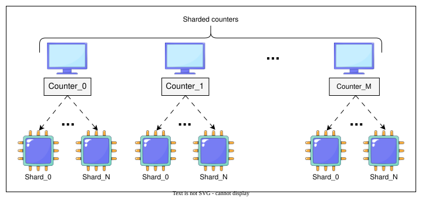

Counters and their shards working on different computational units

In the illustration above, the total number of shards per counter is (N+1)(N+1)(N+1). We’ll use an appropriate value for NNN according to our needs. Let’s discuss an example to understand how sharded counters handle millions of write and read requests for a single post.

Let’s assume that a famous YouTube channel with millions of subscribers uploads a new video. The server receives a burst of write requests for video views from worldwide users. First, a new counter initiates for a newly uploaded video. The server forwards the request to the corresponding counter, and our system chooses the shard randomly and updates the shard value, which is initially zero. In contrast, when the server receives read requests, it adds the values of all the shards of a counter to get the current total.

We can use a sharded counter for every scenario where we need scalable counting (such as Facebook posts and YouTube videos).

## Detailed design[#](https://www.educative.io/courses/system-design-interview-prep-crash-course/design-sharded-counters#Detailed-design)

We’ll now discuss the three primary functionalities of the sharded counter—creation, write, and read—in detail. We’ll answer many important questions by using Twitter as an example. These questions include:

- How many shards should be created against each new Tweet?
- How will the shard value be incremented for a specific Tweet?
- What will happen in the system when read requests come from the end users?

### Sharded counter creation[#](https://www.educative.io/courses/system-design-interview-prep-crash-course/design-sharded-counters#Sharded-counter-creation)

The system creates multiple counters for each newly created post by the user. The following is the list of main counters created against each new Tweet:

- Tweet like counter
- Tweet reply counter
- Tweet retweet counter
- Tweet view counter in case a Tweet contains video

Now, the question is how does the system decide the number of shards in each counter? The number of shards is critical for good performance. If the shard count is small for a specific write workload, we face high write contention, which results in slow writes. On the other hand, if the shard count is too high for a particular write profile, we encounter a higher overhead on the read operation. The reason for slower reads is because of the collection of values from different shards that might reside on different nodes inside geographically distributed datacenters. The reading cost of a counter value rises linearly with the number of shards because the values of all shards of a respective counter are added. The writes scale linearly as we add new shards due to increasing requests. Therefore, there is a trade-off between making writes quick versus read performance. We’ll discuss how we can improve read performance later.

The decision about the number of shards depends on many factors that collectively try to predict the write load on a specific counter in the short term. For Tweets, these factors include follower count. The Tweet of a user with millions of followers on Twitter gets more shards than that of a user with fewer followers. This is because there is a possibility that the Tweets of the user with millions of followers will get many, often millions, of likes. Sometimes, a celebrity Tweet includes one or more hashtags. The system also creates the sharded counter for this hashtag because it has a high chance of being marked as a trend.

1.

What happens when a user with just a few followers has a post go viral on Twitter?

Show Answer

Did you find this helpful?

Many human-centered activities often have a long-tailed activity pattern, where many people are concentrated on a relatively small set of activities. Perhaps shortened attention spans might be playing a role here. It means that after some time, the flurry of likes will die down, and we might not need as many shards now for a counter as were once needed. Similarly, our initial prediction for future writes might turn out to be wrong, and we might need more shards to handle write requests. We require that our system can dynamically expand or shrink the number of shards based on the current need.   
  
We need to monitor the write load for all the shards to appropriately route requests to specific shards, possibly using load balancers. Such a feedback mechanism can also help us decide when to close down some of the shards for a counter and when to add additional shards. This process not only provides good performance for the end user but also utilizes our resources at near-optimal levels.

### Burst of writes requests[#](https://www.educative.io/courses/system-design-interview-prep-crash-course/design-sharded-counters#Burst-of-writes-requests)

As we mentioned earlier, millions of users interact with our example celebrity’s Tweet, which eventually sends a burst of write requests to the system. The system assigns each write request to the available shards of the specified counter of the particular Tweet. How does the system select these shards operating on different computational units (nodes) to assign the write requests? We can use three approaches to do this:

#### Round-robin selection[#](https://www.educative.io/courses/system-design-interview-prep-crash-course/design-sharded-counters#Round-robin-selection)

One way to solve the problem above is to use a round-robin selection of shards. For example, let’s assume the number of shards is 100. The system starts with shard\_1, then shard\_2, and continues until it reaches shard\_100. Usually, round-robin work allocation either overloads or underutilizes resources because scheduling is done without considering the current load conditions. However, if each request is similar (and roughly needs the same time to serve), a round-robin approach can be used and is attractive for its simplicity.

In the following illustrations, we assume that user requests are first handed out to an appropriate server by the load balancer. Then, each such server uses its own round-robin scheduling to use a shard:

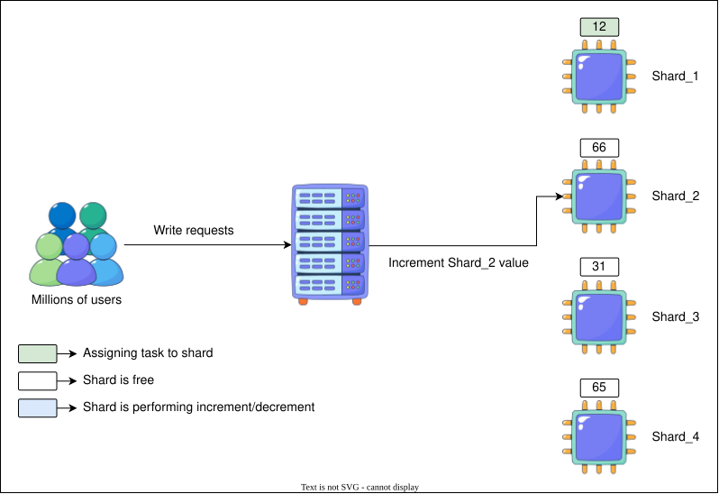

1 / 5

The server assigns a write request to the first free shard, shard\_1, with a counter value of 12, but shard\_1 has not yet fulfilled its previous request, and it will increment its counter once the request is completely processed.

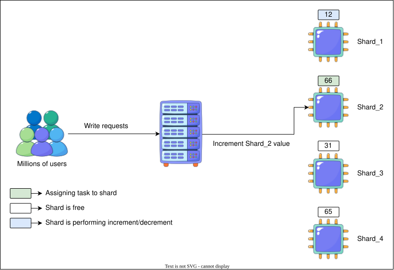

1 / 5

The server assigns another write request to the next free shard, shard\_2, with counter value 66, but shard\_2 has not yet fulfilled its previous request, and it will increment its counter once the request is completely processed.

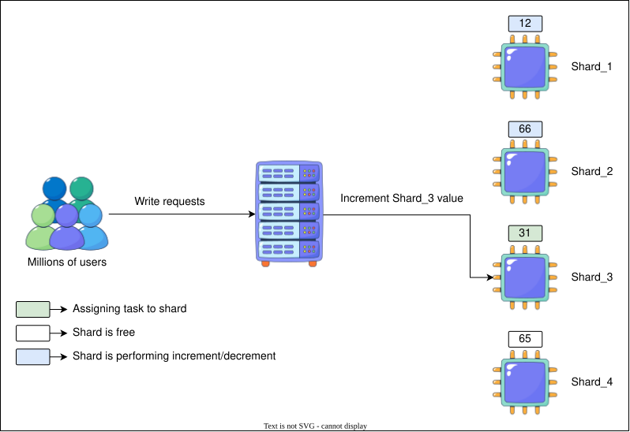

1 / 5

The server assigns another write request to the next free shard, shard\_3, with counter value 31, but shard\_3 has not yet fulfilled its previous request, and it will increment its counter once the request is completely processed.

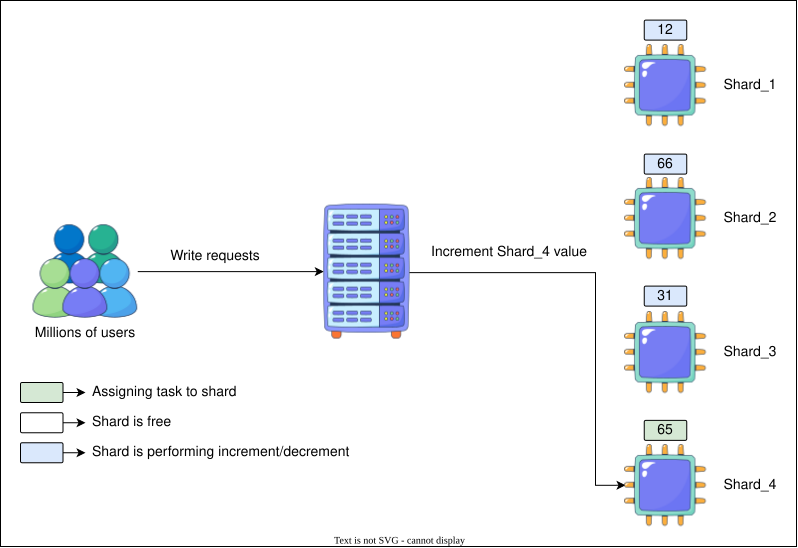

1 / 5

The server assigns another write request to the next free shard, shard\_4, with counter value 65, but shard\_4 has not yet fulfilled its previous request, and it will increment its counter once the request is completely processed.

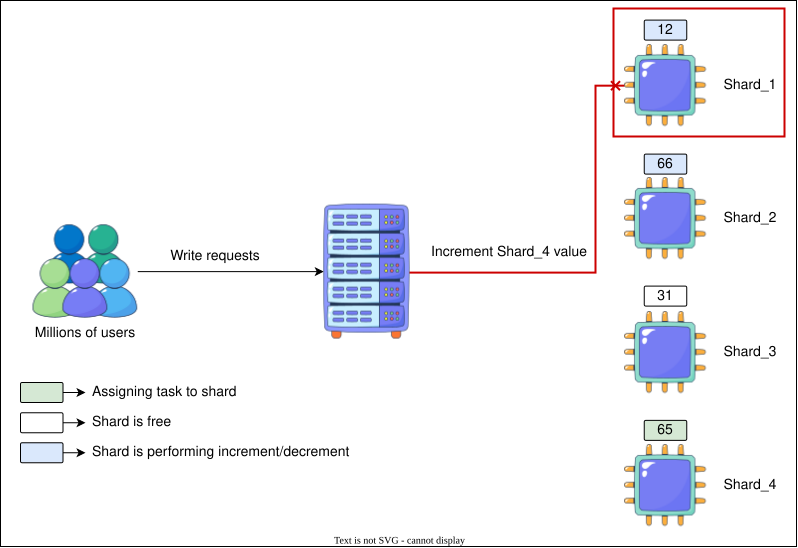

1 / 5

The server can’t perform the next write request until shard\_1 is busy; though shard\_3 is done with incrementing its counter and is free, we can’t utilize it because of the round-robin pattern that we’re following here.

#### Random selection[#](https://www.educative.io/courses/system-design-interview-prep-crash-course/design-sharded-counters#Random-selection)

Another simple approach can be to uniformly and randomly select a shard for writing. The challenge with both round-robin selection and random selection is with variable load changes on the nodes (where shards are hosted). It’s hard to appropriately distribute the load on available shards. Load variability on nodes is common because a physical node is often being used for multiple purposes.

#### Metrics-based selection[#](https://www.educative.io/courses/system-design-interview-prep-crash-course/design-sharded-counters#Metrics-based-selection)

The third approach is shard selection based on specific metrics. For example, a dedicated node (load balancer) manages the selection of the shards by reading the shards’ status. The slides below go over how sharded counters are created:

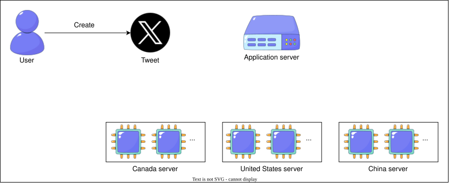

1 / 4

The user creates a tweet.

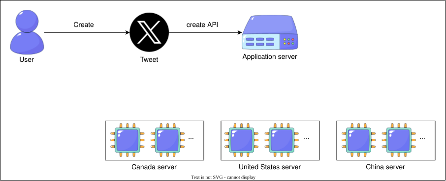

1 / 4

The user requests a counter using the create API.

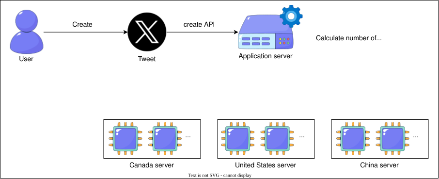

1 / 4

The application server calculates the number of shards based on some metrics.

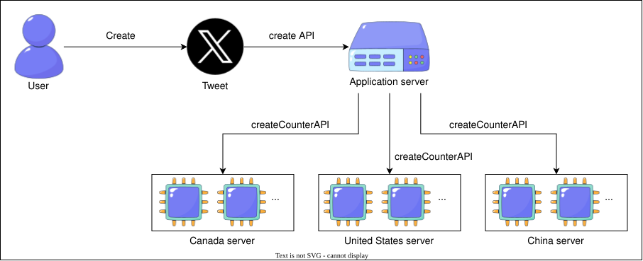

1 / 4

Requests to create shards for a specified counter using createCounter API are dispatched to geographically dispersed servers.

### Manage read requests[#](https://www.educative.io/courses/system-design-interview-prep-crash-course/design-sharded-counters#Manage-read-requests)

When the user sends the read request, the system will aggregate the value of all shards of the specified counter to return the total count of the feature (such as like or reply). Accumulating values from all the shards on each read request will result in low read throughput and high read latency.

The decision of when the system will sum all shards values is also very critical. If there is high write traffic along with reads, it might be virtually impossible to get a real current value because by the time we report a read value to the client, it will have already changed. So, periodically reading all the shards of a counter and caching it should serve most of the use cases. By reducing the accumulation period, we can increase the accuracy of read values.

1.

Can you think of a use case where sharded counters with the consistency model mentioned above might not be suitable?

Show Answer

Did you find this helpful?

## Using sharded counters for the Top K problem[#](https://www.educative.io/courses/system-design-interview-prep-crash-course/design-sharded-counters#Using-sharded-counters-for-the-Top-K-problem)

This section will discuss how we can use sharded counters to solve a real-world problem known as the **Top K** problem. We’ll continue to use the real-time application Twitter as an example, where calculating trends is one of the Top K problems for Twitter. Here, KKK represents the number of top trends. Many users use various hashtags in their Tweets. It’s a huge challenge to manage millions of hashtags’ counts to show them in individual users’ trends timelines based on their locality.

The sharded counter is the key to the problem above. As discussed earlier, on Twitter, the system creates the counters for each hashtag and decides the shard count according to the user’s followers who used the hashtag in the Tweet. When users on Twitter use the same hashtag again in their Tweet, the count maintains the same counter created initially on the first use of that hashtag.

Twitter shows trends primarily based on the popularity of the specific hashtag in a user’s region. Twitter will maintain a separate counter for each discussed metric with a global hashtag counter. Let’s discuss each of the metrics below:

- **Region-wise hashtag count** indicates the number of Tweets with the same hashtag used within a specific geographical region. For example, thousands of Tweets with the same tags from New York City suggest that users in the New York area may see this hashtag in their trends timeline.
- A **time window** indicates the amount of time during which Tweets with specific tags are posted.

The system calculates the 24-hour count of the specified hashtag

Below is more detail on the illustration above:

- The **global hashtag counter** represents the total of all location-based counters.
- **Location-based counters** represent their current count when the system reaches the set threshold in a specified time and the hashtag becomes a trend for some users. For example, Twitter sets 10,000 as a threshold. When location-based hashtag counts reach 10,000, Twitter shows these hashtags in the trends timeline of the users of the respective country where the hashtag is being used. The specified hashtag may be displayed worldwide if counts increase in all countries.

Next, we’ll discuss Top K Tweets in a user’s homepage timeline. The Top K Tweets include accounts the user is following, Tweets the user has liked, and retweets of accounts the user follows. Tweets get priority in Top K problems based on follower count and time. Twitter also shows promoted Tweets and some Tweets of accounts the user doesn’t follow in the user’s home timeline, depending on the Tweet’s popularity and location.

> **Note:** Twitter also uses other metrics to optimize Top K selection, but we’ve discussed the leading metrics here.

## Placement of sharded counters[#](https://www.educative.io/courses/system-design-interview-prep-crash-course/design-sharded-counters#Placement-of-sharded-counters)

An important concern is where we should place shared counters. Should they reside on the same nodes as application servers, in separate nodes in the data center, in nodes of CDN at the edge of a network near the end users? The exact answer to this question depends on our specific use case. For Twitter, we can compute counts by placing sharded counters near the user, which can also help to handle heavy hitter and Top K problems efficiently.

1.

Should we lock all shards of a counter before accumulating their values?

Show Answer

Did you find this helpful?

Reads can store counter values in appropriate data stores and rely on the respective data stores for read scalability. The Cassandra store can be used to maintain views, likes, comments, and many more counts of the users in the specified region. These counts represent the last computed sum of all shards of a particular counter.

When users generate a timeline, read requests are forwarded to the nearest servers, and then the persisted values in the store can be used to respond. This storage also helps to show the Top K trends by the region. The list of local Top K trends is sent to the application server, and then the application server sorts all the lists to make a list of global Top K trends. Eventually, the application server sends all counters’ details to the cache.

We also need storage for the sharded counters, which store all information about them with their metadata. The Redis or Memcache servers can play a vital role here. For example, each Tweet’s unique ID can become the key, and the value of this key can be a counter ID or a list of counters’ IDs (like counter, reply counter, and so on). Furthermore, each counter ID has its own key-value store where the counter (for example, a likes counter) ID is a key and the value is a list of assigned shards.

The job of identifying the relevant counter and mapping all write requests to the appropriate counter in sharded counters can be done in parallel. We map the all-write request to the appropriate counter, and then each counter chooses a shard randomly based on metrics to do increments and decrements. In contrast, we reduce periodically to aggregate the value of all shards of the particular counter. Then, these counter values can be stored in the Cassandra store. The slides below help illustrate these points:

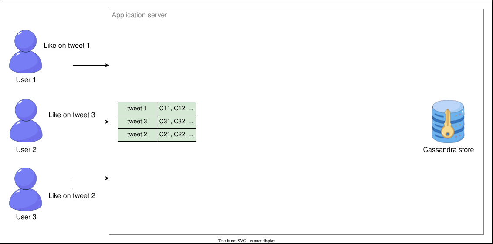

1 / 6

The users send write requests to the application server.

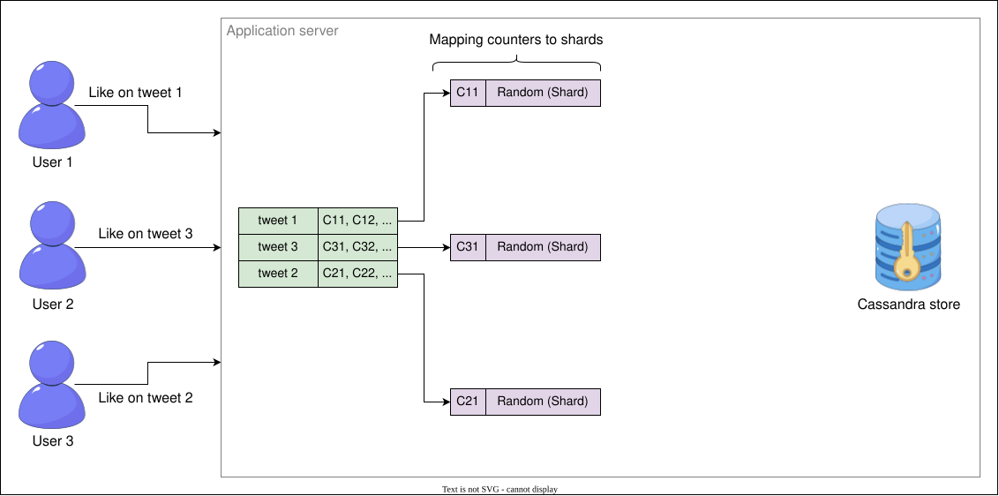

1 / 6

The application server identifies the appropriate counters against tweets in the Redis key-value store.

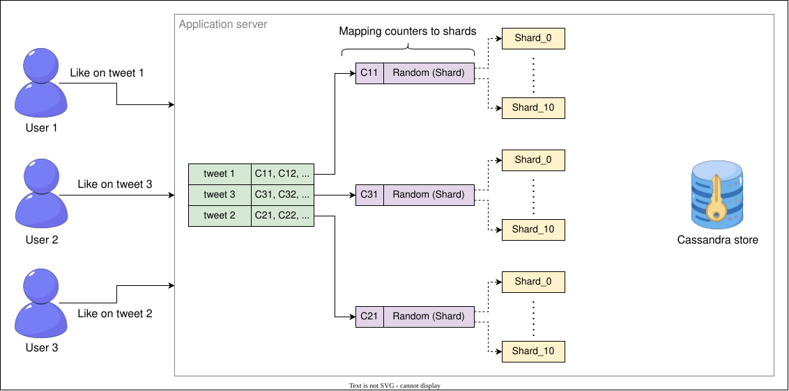

1 / 6

The application server randomly chooses the shards against counters in the Redis key-value store.

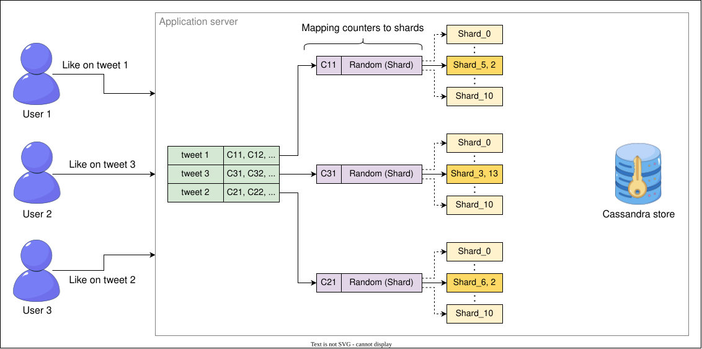

1 / 6

The selected shards are highlighted.

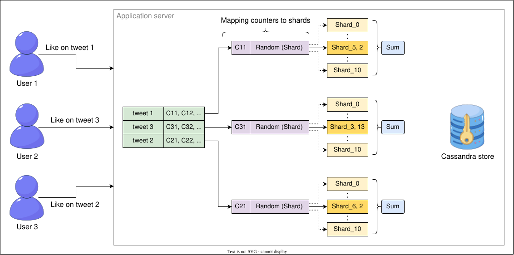

1 / 6

The sum of the values of all shards is computed.

## Evaluation of the sharded counters[#](https://www.educative.io/courses/system-design-interview-prep-crash-course/design-sharded-counters#Evaluation-of-the-sharded-counters)

This section will evaluate the sharded counters and explain how sharded counters will increase performance by providing high availability and scalability.

### Availability[#](https://www.educative.io/courses/system-design-interview-prep-crash-course/design-sharded-counters#Availability)

A single counter for any feature (such as like, view, or reply) has a high risk of a single point of failure. Sharded counters eliminate a single point of failure by running many shards for a particular counter. The system remains available even if some shards go down or suffer a fault. This way, sharded counters provide high availability.

### Scalability[#](https://www.educative.io/courses/system-design-interview-prep-crash-course/design-sharded-counters#Scalability)

Sharded counters allow high horizontal scaling as needed. Shards running on additional nodes can be easily added to the system to scale up our operation capacity. Eventually, these additional shards also increase the system’s performance.

### Reliability[#](https://www.educative.io/courses/system-design-interview-prep-crash-course/design-sharded-counters#Reliability)

Another primary purpose of the sharded counters is to reduce the massive write request by mapping each write request to a particular shard. Each write request is handled when it comes, and there is no request waiting in the queue. Due to this, the hit ratio increases, and the system’s reliability also increases. Furthermore, the system periodically saves the computed counts in stable storage—Cassandra, in this case.

## Conclusion[#](https://www.educative.io/courses/system-design-interview-prep-crash-course/design-sharded-counters#Conclusion)

Nowadays, sharded counters are a key player in improving the overall performance of giant services. They provide high scalability, availability, and reliability. Sharded counters solved significant issues, including the heavy hitters and Top K problems, that are very common in large-scale applications.

Design a Distributed Task Scheduler

Distributed Cache Exercise

Ask

[High-level solution sketch](https://www.educative.io/courses/system-design-interview-prep-crash-course/design-sharded-counters#High-level-solution-sketch)

[Detailed design](https://www.educative.io/courses/system-design-interview-prep-crash-course/design-sharded-counters#Detailed-design)

[Sharded counter creation](https://www.educative.io/courses/system-design-interview-prep-crash-course/design-sharded-counters#Sharded-counter-creation)

[Burst of writes requests](https://www.educative.io/courses/system-design-interview-prep-crash-course/design-sharded-counters#Burst-of-writes-requests)

[Round-robin selection](https://www.educative.io/courses/system-design-interview-prep-crash-course/design-sharded-counters#Round-robin-selection)

[Random selection](https://www.educative.io/courses/system-design-interview-prep-crash-course/design-sharded-counters#Random-selection)

[Metrics-based selection](https://www.educative.io/courses/system-design-interview-prep-crash-course/design-sharded-counters#Metrics-based-selection)

[Manage read requests](https://www.educative.io/courses/system-design-interview-prep-crash-course/design-sharded-counters#Manage-read-requests)

[Using sharded counters for the Top K problem](https://www.educative.io/courses/system-design-interview-prep-crash-course/design-sharded-counters#Using-sharded-counters-for-the-Top-K-problem)

[Placement of sharded counters](https://www.educative.io/courses/system-design-interview-prep-crash-course/design-sharded-counters#Placement-of-sharded-counters)

[Evaluation of the sharded counters](https://www.educative.io/courses/system-design-interview-prep-crash-course/design-sharded-counters#Evaluation-of-the-sharded-counters)

[Availability](https://www.educative.io/courses/system-design-interview-prep-crash-course/design-sharded-counters#Availability)

[Scalability](https://www.educative.io/courses/system-design-interview-prep-crash-course/design-sharded-counters#Scalability)

[Reliability](https://www.educative.io/courses/system-design-interview-prep-crash-course/design-sharded-counters#Reliability)

[Conclusion](https://www.educative.io/courses/system-design-interview-prep-crash-course/design-sharded-counters#Conclusion)