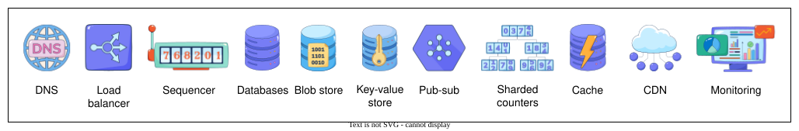
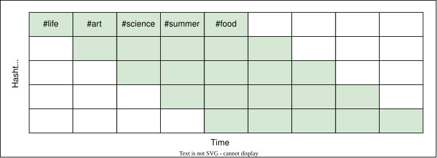
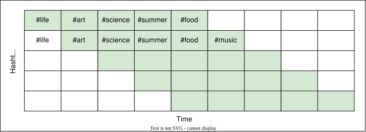
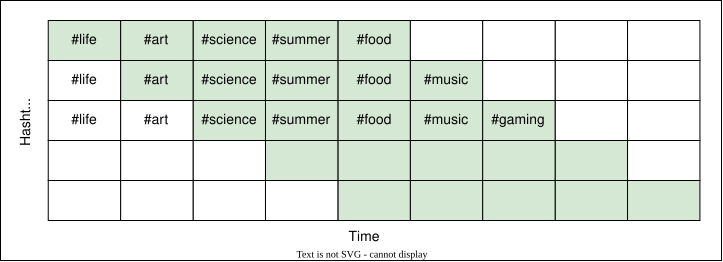
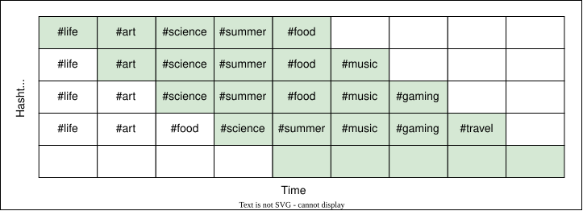
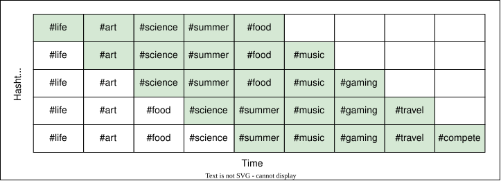

# System_Design_of_Twitter_with_Load_Balancing_and_Sharded_Counters

Source: https://www.educative.io/courses/system-design-interview-prep-crash-course/design-twitter-15-minute-sprint

---

[Home](https://www.educative.io/)

[Courses](https://www.educative.io/search?tab=courses)

[System Design Interview: Fast-Track in 48 Hours](https://www.educative.io/courses/system-design-interview-prep-crash-course)

# Design Twitter -15 Minute Sprint

Understand Twitter's system design by analyzing its functional and non-functional requirements, core components like DNS, load balancers, databases, and caches. Learn how sharded counters solve high load problems and how Twitter uses client-side load balancing techniques to distribute requests fairly and efficiently, preparing you for advanced system design interviews.

We'll cover the following...

- [Overview](https://www.educative.io/courses/system-design-interview-prep-crash-course/design-twitter-15-minute-sprint#Overview)
- [Requirements](https://www.educative.io/courses/system-design-interview-prep-crash-course/design-twitter-15-minute-sprint#Requirements)
  - [Functional requirements](https://www.educative.io/courses/system-design-interview-prep-crash-course/design-twitter-15-minute-sprint#Functional-requirements)
  - [Non-functional requirements](https://www.educative.io/courses/system-design-interview-prep-crash-course/design-twitter-15-minute-sprint#Non-functional-requirements)
- [Building blocks we will use](https://www.educative.io/courses/system-design-interview-prep-crash-course/design-twitter-15-minute-sprint#Building-blocks-we-will-use)
- [High-level design](https://www.educative.io/courses/system-design-interview-prep-crash-course/design-twitter-15-minute-sprint#High-level-design)
  - [Storage system](https://www.educative.io/courses/system-design-interview-prep-crash-course/design-twitter-15-minute-sprint#Storage-system)
  - [Cache](https://www.educative.io/courses/system-design-interview-prep-crash-course/design-twitter-15-minute-sprint#Cache)
  - [Real-world complex problems](https://www.educative.io/courses/system-design-interview-prep-crash-course/design-twitter-15-minute-sprint#Real-world-complex-problems)
  - [The complete design overview](https://www.educative.io/courses/system-design-interview-prep-crash-course/design-twitter-15-minute-sprint#The-complete-design-overview)
- [Client-side load balancing in Twitter](https://www.educative.io/courses/system-design-interview-prep-crash-course/design-twitter-15-minute-sprint#Client-side-load-balancing-in-Twitter)
  - [Request distribution using P2C](https://www.educative.io/courses/system-design-interview-prep-crash-course/design-twitter-15-minute-sprint#Request-distribution-using-P2C)
  - [Session distribution](https://www.educative.io/courses/system-design-interview-prep-crash-course/design-twitter-15-minute-sprint#Session-distribution)
- [Conclusion](https://www.educative.io/courses/system-design-interview-prep-crash-course/design-twitter-15-minute-sprint#Conclusion)

## Overview[#](https://www.educative.io/courses/system-design-interview-prep-crash-course/design-twitter-15-minute-sprint#Overview)

**Twitter** is a free microblogging social network with 397 million users as of 2021. One of the main reasons for Twitter’s popularity is the vast sharing of breaking news on the platform.

In this lesson, we will describe the functional and non-functional requirements of Twitter. Then we’ll look deeper into its API design and identify the different components of the Twitter architecture. In addition, we will discuss how to manage the Top K problem, such as Tweets liked or viewed by millions of users on Twitter. Finally, we’ll also explain how Twitter performs load balancing for its microservices system to manage billions of requests between the various service instances.

## Requirements[#](https://www.educative.io/courses/system-design-interview-prep-crash-course/design-twitter-15-minute-sprint#Requirements)

Let’s go over the functional and non-functional requirements below.

### Functional requirements[#](https://www.educative.io/courses/system-design-interview-prep-crash-course/design-twitter-15-minute-sprint#Functional-requirements)

- Registered users can post and delete one or more Tweets on Twitter.
- They can like, dislike, and reply to Tweets.
- Users can search tweets by using keywords, hashtags, or usernames.
- Users can follow or unfollow other users.
- Users can view other users’ timelines with their Tweets or their own home timelines with the Tweets of users they follow.

### Non-functional requirements[#](https://www.educative.io/courses/system-design-interview-prep-crash-course/design-twitter-15-minute-sprint#Non-functional-requirements)

- **Availability:** Twitter’s service needs to be highly available.
- **Latency:** The latency of the distribution of Tweets to followers must be low.
- **Scalability:** Twitter’s workload is read-heavy with around a 1:1000 read-to-write ratio. So high storage capacity is needed to store and deliver Tweets posted by public figures to their millions of followers.
- **Reliability:** Twitter needs to be highly reliable, and no uploaded content should get deleted or damaged.
- **Consistency:** An effective technique is needed to offer rapid feedback to the user (who liked someone’s post), then to other specified users in the same region, and finally to all worldwide users linked to the Tweet.

## Building blocks we will use[#](https://www.educative.io/courses/system-design-interview-prep-crash-course/design-twitter-15-minute-sprint#Building-blocks-we-will-use)

We will use the following building blocks in the Twitter design.

Building blocks used in Twitter design

- **The DNS** is the service that maps human-friendly Twitter domain names to machine-readable IP addresses.
- **Load balancers** distribute the read/write requests among the respective services.
- **Sequencers** generate the unique IDs for the Tweets.
- **Databases** store the metadata of Tweets and users.
- **Blob stores** store the images and video clips attached with the Tweets.
- **Key-value stores** are used for multiple purposes, such as indexing, identifying the specified counter to update its value, identifying the Tweets of a particular user, and so on.
- **Pub-sub** is used for real-time processing, such as the elimination of redundant data, organizing data, and so on.
- **Sharded counters** help to handle the count of multiple features, such as viewing, liking, Retweeting, and so on, of the accounts with millions of followers.
- **A cache** is used to store the most requested and recent data in RAM to give users a quick response.
- **A CDN** helps end users access the data with low latency.
- **Monitoring** analyzes all outgoing and incoming traffic, identifies the redundancy in the storage system, figures out the failed node, and so on.

## High-level design[#](https://www.educative.io/courses/system-design-interview-prep-crash-course/design-twitter-15-minute-sprint#High-level-design)

Let’s begin with the high-level design of our Twitter system.

- **Users** post Tweets delivered to the server through the load balancer. Then, the system stores it in persistent storage.
- The **DNS** provides the specified IP address to the end user to start communication with the requested service.
- The **CDN** is situated near the users to provide requested data with low latency. When users search for a specified term or tag, the system first searches in the CDN proxy servers containing the most frequently requested content.
- The **load balancer** chooses the operational application server based on the traffic load on the available servers and the user requests.
- The **storage system** represents the various types of storage (SQL-based and NoSQL-based) in the illustration above. We’ll discuss significant storage systems later in this chapter.
- **Application servers** provide various services and have business logic to orchestrate between different components to meet our functional requirements.

Twitter components

### Storage system[#](https://www.educative.io/courses/system-design-interview-prep-crash-course/design-twitter-15-minute-sprint#Storage-system)

Twitter uses various storage models for different services to take full advantage of each model.

- **Google Cloud:** In 2018, Twitter shifted data from Hadoop clusters to Google Cloud to better analyze and manage the data. This shift is called a partly cloudy strategy. The big data is stored in BigQuery (Google Cloud service), a fully managed and highly scalable serverless data warehouse.
- **Manhattan:** In April 2014, Twitter launched its general-purpose real-time distributed key-value store, called Manhattan, and deprecated Cassandra, which was first used because of increased throughput requirements.

Twitter's data move to the Manhattan database

- **Blobstore:** Around 2012, Twitter built the Blobstore storage system to store photos attached to Tweets.
- **SQL-based databases:** Twitter uses MySQL and PostgreSQL, where it needs strong consistency, ads exchange, and managing ad campaigns. Around 2012, Twitter also built the Gizzard framework on top of MySQL for sharding, which is done by partitioning and replication.
- **Kafka:** Twitter evaluates around 400 billion real-time events and generates petabytes of data every day. For this, it processes events using Kafka on-premise and uses Google Dataflow jobs to handle deduping and real-time aggregation on Google Cloud. After aggregation, the results are stored for ad hoc analysis in BigQuery (data warehouse) and the serving system to Bigtable (NoSQL database). Twitter converts Kafka topics into cloud pub-sub topics using an event processor, which helps avoid data loss and provides more scalability.

Real-time processing of billions of requests

- **FlockDB:** A relationship refers to a user’s followers, who the user follows, whose notifications the user receives, and so on. Twitter stores this relationship in the form of a graph. Twitter used FlockDB, a graph database tuned for huge adjacency lists, rapid reads and writes, and so on, along with graph-traversal operations.
- **Apache Lucene:** Twitter constructed a search service that indexes about a trillion records and responds to requests within 100 ms. Around 2019, Twitter’s search engine had an indexing latency (time to index the new tweets) of roughly 15 seconds. For a real-time search, Twitter uses Apache Lucene, which uses an inverted index. Twitter stores a real-time index (recent Tweets during the past week) in RAM for low latency and quick updates. The full index is a hundred times larger than the real-time index. However, Twitter performs batch processing for the full indexes.

### Cache[#](https://www.educative.io/courses/system-design-interview-prep-crash-course/design-twitter-15-minute-sprint#Cache)

Twitter uses the Pelikan cache. This cache gives high throughput and low latency. Pelikan uses many types of back-end servers, such as the `peliken_twemcache` replacement of Twitter’s Twemcache server, the `peliken_slimcache` replacement of Twitter’s Memcached/Redis server, and so on. We have a detailed chapter on an [in-memory cache](https://www.educative.io/courses/system-design-interview-prep-crash-course/design-a-distributed-cache) if you’d like to know more.
Let’s look at the illustration below, representing the relationship of application servers with distributed Pelikan cache.

Distributed Pelikan cache

### Real-world complex problems[#](https://www.educative.io/courses/system-design-interview-prep-crash-course/design-twitter-15-minute-sprint#Real-world-complex-problems)

Twitter has millions of accounts, and some accounts (like those of public figures) have millions of followers. When these accounts post Tweets, millions of followers of the account engage with the Tweets in a short time. This becomes a big problem when the system handles the billions of interactions (such as views and likes) on these Tweets. This problem is also known as the **heavy hitter** problem. For this, we need millions of counters to count various operations on Tweets.

Moreover, a single counter for each specific operation on the particular Tweet is not enough. It’s challenging to handle millions of increments or decrements requests against a particular Tweet in a single counter. Therefore, we need multiple distributed counters to manage burst write requests (increments or decrements) against various interactions on Tweets from accounts with many followers. Each counter has several shards working on different computational units.
These distributed counters are known as sharded counters. These counters also help in another real-time problem named the Top K problem. Let’s discuss an example of Twitter’s Top K problems: trends and timelines.

- **Trends:** Twitter shows Top K trends (hashtags or keywords) locally and globally. Here, “locally” refers to when a topic or hashtag is used within the exact location where the requested user is active. Alternatively, “globally” refers to when a particular hashtag is used worldwide. There’s a possibility that users from some regions are not using a specific hashtag in their Tweets but get this hashtag in their trends timeline. Hashtags with the maximum frequency (counts) become local and global trends. Furthermore, Twitter shows various promoted trends (known as “paid trends”) in specified regions under trends. The slides below represent hashtags in the sliding window selected as Top K trends over time.

1 / 5

Top-k trends in a specified time frame

1 / 5

Dropped #life hashtag and showing next top-k trends in a specified time frame

1 / 5

Dropped #life and #art hashtags and showing next top-k trends in a specified time frame

1 / 5

Dropped #life, #art, and #food hashtags and showing next top-k trends in a specified time frame

1 / 5

Dropped #life, #art, #food, and #science hashtags and showing next top-k trends in a specified time frame

- **Timeline:** Twitter shows two types of timelines: home and user timelines. Here, we’ll discuss the home timeline that displays a stream of Tweets posted by followed accounts. The decision to show Top K Tweets in the timeline includes Tweets from followed accounts and Tweets that are liked or Retweeted by followed accounts. There’s also another category of promoted Tweets displayed in the home timeline.

Sharded counters efficiently solve the problems discussed. We can also place shards of the specified counter near the user to reduce latency and increase overall performance, like the CDN.

### The complete design overview[#](https://www.educative.io/courses/system-design-interview-prep-crash-course/design-twitter-15-minute-sprint#The-complete-design-overview)

This section will discuss what happens in the backend system when the end users generate multiple requests. The following are the steps:

1. First, end users get the address of the nearest load balancer from the local DNS.
2. The load balancer routes end users’ requests to the appropriate servers according to the requested services. Here, we’ll discuss the Tweet, timeline, and search services.

   - **Tweet service:** When end users perform any operation, such as posting a Tweet or liking other Tweets, the load balancers forward these requests to the server handling the Tweet service. Consider an example where users post Tweets on Twitter using the `/postTweet` API. The server (Tweet service) receives the requests and performs multiple operations. It identifies the Tweet’s attachments (image or video) and stores them in the Blobstore. Text in the Tweets, user information, and all metadata are stored in the different databases (Manhattan, MySQL, PostgreSQL, or Vertica). Meanwhile, real-time processing, such as pulling Tweets, user interaction data, and many other metrics from the real-time streams and client logs, is achieved in Apache Kafka.

     Later, the data is moved to the cloud pub-sub through an event processor. Next, data is transferred for deduping and aggregation to the BigQuery through Cloud Dataflow. Finally, data is stored in the Google Cloud Bigtable, which is fully managed, easily scalable, and sorted keys.
   - **Timeline service:** Assume the user sends a home timeline request using the `/viewHome_timeline` API. In this case, the request is forwarded to the nearest CDN containing static data. If the requested data is not found, the request is sent to the server that’s providing timeline services. This service fetches data from different databases or stores and returns the Top K Tweets. This service collects various interaction counts of Tweets from different sharded counters to decide the Top K Tweets. Similarly, we will obtain the Top K trends attached in the response to the timeline request.
   - **Search service:** When users type any keywords in the search bar on Twitter, the search request is forwarded to the respective server using the `/searchTweet` API. It first looks into the RAM in Apache Lucene to get real-time Tweets (Tweets that have been published recently). Then, this server looks up in the index server and finds all Tweets that contain the requested keywords. Next, it considers multiple factors, such as time or location, to rank the discovered Tweets. Finally, it returns the top Tweets.
3. We can use the Zipkin tracing system that performs sampling on requests. Moreover, we can use ZooKeeper to maintain different data, including configuration information, distributed synchronization, naming registry, and so on.

Twitter design overview

## Client-side load balancing in Twitter[#](https://www.educative.io/courses/system-design-interview-prep-crash-course/design-twitter-15-minute-sprint#Client-side-load-balancing-in-Twitter)

Twitter uses a client-side load balancer called **deterministic****aperture** that is part of a larger RPC framework called Finagle. **Finagle** is a protocol-agnostic, open-source, and asynchronous RPC library.

> **Note:** Consider the following question. What does the client-side load balancer of Twitter balance on? That is, what parameters are used to fairly balance the load across different servers?

Twitter primarily uses two distributions to measure the effectiveness of a load balancer:

1. The distribution of requests (OSI layer 7)
2. The distribution of sessions (OSI layer 5)

Although requests are the key metric, sessions are an important attribute for achieving a fair distribution. Therefore, we’ll develop techniques for fair distribution of requests as well as sessions. Let’s start with the simple technique of Power of Two Random Choices (P2C) for request distribution first.

### Request distribution using P2C[#](https://www.educative.io/courses/system-design-interview-prep-crash-course/design-twitter-15-minute-sprint#Request-distribution-using-P2C)

The **P2C technique** for request distribution gives uniform request distribution as long as sessions are uniformly distributed. In P2C, the system randomly picks two unique instances (servers) against each request, and selects the one with the least amount of load. Let’s look at the illustration below to understand P2C.

Power of two random choices

P2C is based on the simple idea that comparison between two randomly selected nodes provides load distribution that is exponentially better than random selection

Now that we’ve established how to distribute requests fairly, let’s explore different techniques of session distribution.

### Session distribution[#](https://www.educative.io/courses/system-design-interview-prep-crash-course/design-twitter-15-minute-sprint#Session-distribution)

**Solution 1:** For session distribution, Twitter uses a strategy called **random aperture**. This technique randomly chooses a subset of servers for session establishment.

Random aperture

Of course, random selection will reduce the number of established sessions as we can see in the diagram above. However, the question is, how many servers will be chosen randomly? This is not an easy question to answer and the answer varies, depending on the request concurrency of a client.

To answer the question above, Twitter installed a **feedback controller** inside the random aperture that decides the subset size based on the client’s load. As a result, we’re able to reduce the session load and ensure scalability. However, this solution isn’t fair. We can see the imbalance in the illustration above such that **Server 4** has no session, whereas **Server 0** has three sessions.

This imbalance creates problems such as idle servers, high load on a few servers, and so on. Therefore, we need a solution that is both fair and scalable.

**Solution 2**: We learned from solution 2 that we can scale by subsetting the number of session establishments. However, we failed to do the session distribution fairly. To resolve the problem, Twitter came up with a **deterministic aperture** solution. The key benefits of this approach are:

- Little coordination is required between clients and servers to converge on a solution.
- Minimal disruption occurs if there are any changes in the number of clients or server instances for whatever reason.

For this solution, we represent clients and servers in a ring with equally distanced intervals, where each object on the ring represents the node or server labeled with a number. The illustration below shows what Twitter refers to as the discrete ring coordinates (that is, a specific point on the ring).

Ring coordinates

Now, we compose client and server rings to derive a relationship between them. We’ve also defined an aperture size of 3. Each client will create a session with three servers in the ring. Clients select a server by circulating clockwise in the ring. This approach is similar to consistent hashing, except that here we guarantee equal distribution of servers across the ring. Let’s see the illustration below where clients have sessions with servers chosen from the given list of servers, respectively.

Merge client and server ring coordinates

In the diagram above, client 0 establishes sessions with servers 4, 5, and 0. Client 1 establishes sessions with servers 0, 1, and 2, whereas Client 2 establishes sessions with servers 2, 3, and 4. When the aperture rotates or moves in the given subset of arrays of the same size, each client’s service has new servers available to create sessions. The number of sessions established per server is shown in the figure below.

Number of sessions established per server

We can see that there’s no idle server or server with a high load in the histogram graph above. Thus, we achieved a fair distribution for the clients belonging to the same service. It’s clear that we’ve half resolved the problem by improving the session distribution among servers as compared to the random aperture (solution 01). However, the problem of unfair distribution can escalate as the number of clients grows. In that case, some servers will get crowded when more than one client (service) talks to the back-end servers. Let’s see the illustration below to understand the problem.

Two different clients creating session with backend servers

The illustration above depicts that the problem compounded as we increased the number of clients (services). The solution is continuous ring coordinates where we derive relationships between clients and servers using overlapping ring slices, rather than specific points on the rings. The important thing here is that the overlapping of rings can be partial since servers on the ring may not have enough instances to divide among the clients equally. Let’s look at the illustration below.

Overlapping among clients' services and servers

The illustration above shows that clients 0 and 1 (symmetrically) share the same server (server 1). It means that there is fractional overlapping concerning the ring coordinates. However, this overlapping can lead to asymmetric sharing as well. Symmetric or asymmetric, the load balancing can be done through P2C. For instance, in the diagram above, servers 1 and 3 will receive half the load that server 2 gets. This means that a server can receive more or less load, depending on its overlapped slice size with a client.

Now, we know how to map clients to the subset of the servers. We’ll use P2C with continuous ring coordinates. The client will pick points (coordinations) in its range instead of picking the instance of the server. The selection process of clients to create sessions with backend servers are as follows:

1. Pick two coordinates (offset, offset + width) within its range and map these coordinates to the discrete instances (servers).
2. Select the one instance with the most negligible load from two chosen instances (P2C) by its degree of intersection.

> **Note:** Continuous aperture is scalable and fair at the cost of an additional session over boundary node due to partial overlapping. It is also able to achieve little coordination and minimal disruption.

Can you describe a real-world scenario where a client-side load-balancing approach would offer significant advantages over other load-balancing methods? Justify your answer with reasoning.

AI Powered

Saved

7 attempts left

Reset

You have 7 attempts to answer.

## Conclusion[#](https://www.educative.io/courses/system-design-interview-prep-crash-course/design-twitter-15-minute-sprint#Conclusion)

This design problem highlights that tweaking the performance of common building blocks and utilizing the right (rich) combination of them is necessary for real-world services. Our needs from one service to the next will dictate which design point we choose in our solution space. In this lesson, we saw examples of how Twitter uses a combination of data stores and custom algorithms for load balancing.

Design Uber -15 Minute Sprint

Design a Newsfeed -15 Minute Sprint

Ask

[Overview](https://www.educative.io/courses/system-design-interview-prep-crash-course/design-twitter-15-minute-sprint#Overview)

[Requirements](https://www.educative.io/courses/system-design-interview-prep-crash-course/design-twitter-15-minute-sprint#Requirements)

[Functional requirements](https://www.educative.io/courses/system-design-interview-prep-crash-course/design-twitter-15-minute-sprint#Functional-requirements)

[Non-functional requirements](https://www.educative.io/courses/system-design-interview-prep-crash-course/design-twitter-15-minute-sprint#Non-functional-requirements)

[Building blocks we will use](https://www.educative.io/courses/system-design-interview-prep-crash-course/design-twitter-15-minute-sprint#Building-blocks-we-will-use)

[High-level design](https://www.educative.io/courses/system-design-interview-prep-crash-course/design-twitter-15-minute-sprint#High-level-design)

[Storage system](https://www.educative.io/courses/system-design-interview-prep-crash-course/design-twitter-15-minute-sprint#Storage-system)

[Cache](https://www.educative.io/courses/system-design-interview-prep-crash-course/design-twitter-15-minute-sprint#Cache)

[Real-world complex problems](https://www.educative.io/courses/system-design-interview-prep-crash-course/design-twitter-15-minute-sprint#Real-world-complex-problems)

[The complete design overview](https://www.educative.io/courses/system-design-interview-prep-crash-course/design-twitter-15-minute-sprint#The-complete-design-overview)

[Client-side load balancing in Twitter](https://www.educative.io/courses/system-design-interview-prep-crash-course/design-twitter-15-minute-sprint#Client-side-load-balancing-in-Twitter)

[Request distribution using P2C](https://www.educative.io/courses/system-design-interview-prep-crash-course/design-twitter-15-minute-sprint#Request-distribution-using-P2C)

[Session distribution](https://www.educative.io/courses/system-design-interview-prep-crash-course/design-twitter-15-minute-sprint#Session-distribution)

[Conclusion](https://www.educative.io/courses/system-design-interview-prep-crash-course/design-twitter-15-minute-sprint#Conclusion)