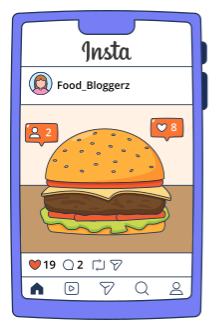
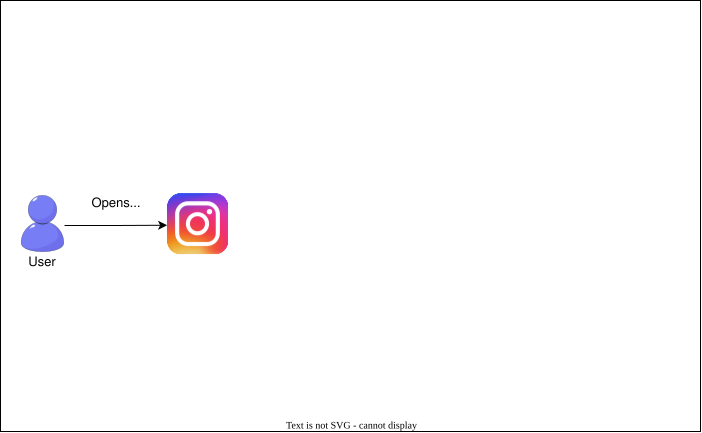
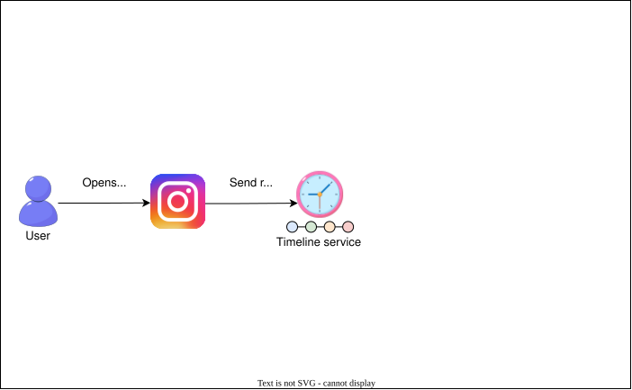
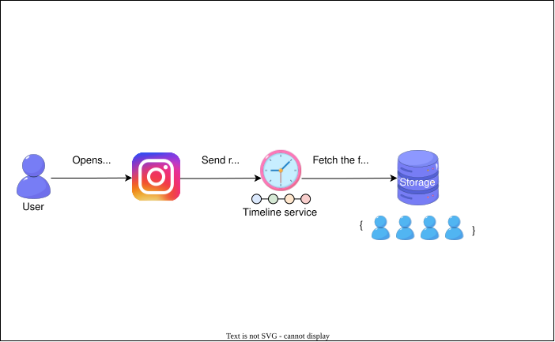
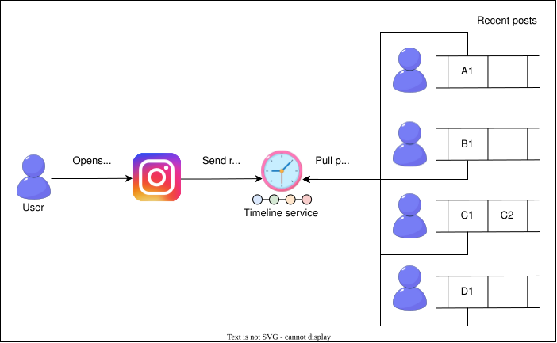
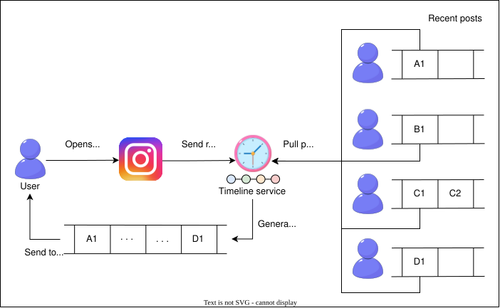

# Designing_Instagram_for_Scalability_and_Efficiency

Source: https://www.educative.io/courses/system-design-interview-prep-crash-course/design-instagram-15-minute-sprint

---

[Home](https://www.educative.io/)

[Courses](https://www.educative.io/search?tab=courses)

[System Design Interview: Fast-Track in 48 Hours](https://www.educative.io/courses/system-design-interview-prep-crash-course)

# Design Instagram -15 Minute Sprint

Explore the key system design components of Instagram, including handling photo and video uploads, user interactions, and timeline generation. Understand functional and non-functional requirements such as scalability, availability, and latency. Learn about database choices, load balancing, caching, CDN usage, and the hybrid approach to timeline construction to build an efficient, reliable social media platform.

We'll cover the following...

- [Instagram](https://www.educative.io/courses/system-design-interview-prep-crash-course/design-instagram-15-minute-sprint#Instagram)
- [Requirements](https://www.educative.io/courses/system-design-interview-prep-crash-course/design-instagram-15-minute-sprint#Requirements)
  - [Functional requirements](https://www.educative.io/courses/system-design-interview-prep-crash-course/design-instagram-15-minute-sprint#Functional-requirements)
  - [Non-functional requirements](https://www.educative.io/courses/system-design-interview-prep-crash-course/design-instagram-15-minute-sprint#Non-functional-requirements)
- [Building blocks we will use](https://www.educative.io/courses/system-design-interview-prep-crash-course/design-instagram-15-minute-sprint#Building-blocks-we-will-use)
  - [High-level design](https://www.educative.io/courses/system-design-interview-prep-crash-course/design-instagram-15-minute-sprint#High-level-design)
  - [Storage schema](https://www.educative.io/courses/system-design-interview-prep-crash-course/design-instagram-15-minute-sprint#Storage-schema)
    - [Relational or non-relational database](https://www.educative.io/courses/system-design-interview-prep-crash-course/design-instagram-15-minute-sprint#Relational-or-non-relational-database)
    - [Define tables](https://www.educative.io/courses/system-design-interview-prep-crash-course/design-instagram-15-minute-sprint#Define-tables)
  - [Detailed design of Instagram](https://www.educative.io/courses/system-design-interview-prep-crash-course/design-instagram-15-minute-sprint#Detailed-design-of-Instagram)
  - [Upload, view, and search a photo](https://www.educative.io/courses/system-design-interview-prep-crash-course/design-instagram-15-minute-sprint#Upload-view-and-search-a-photo)
  - [Generate a timeline](https://www.educative.io/courses/system-design-interview-prep-crash-course/design-instagram-15-minute-sprint#Generate-a-timeline)
    - [The pull approach](https://www.educative.io/courses/system-design-interview-prep-crash-course/design-instagram-15-minute-sprint#The-pull-approach)
    - [The push approach](https://www.educative.io/courses/system-design-interview-prep-crash-course/design-instagram-15-minute-sprint#The-push-approach)
    - [Hybrid approach](https://www.educative.io/courses/system-design-interview-prep-crash-course/design-instagram-15-minute-sprint#Hybrid-approach)
  - [Finalized design](https://www.educative.io/courses/system-design-interview-prep-crash-course/design-instagram-15-minute-sprint#Finalized-design)
  - [Ensure non-functional requirements are met](https://www.educative.io/courses/system-design-interview-prep-crash-course/design-instagram-15-minute-sprint#Ensure-non-functional-requirements-are-met)
  - [Conclusion](https://www.educative.io/courses/system-design-interview-prep-crash-course/design-instagram-15-minute-sprint#Conclusion)

## Instagram[#](https://www.educative.io/courses/system-design-interview-prep-crash-course/design-instagram-15-minute-sprint#Instagram)

**Instagram** is a free social networking application that allows users to post photos and short videos. Users can add a caption for each post and utilize hashtags or location-based geotags to index posts and make them searchable within the application.

A user’s Instagram posts display in their followers’ feeds and can be seen by the general public if they are tagged with hashtags or geotags. Alternatively, users can choose to make their profile private, which limits access to those who have chosen to follow them.

## Requirements[#](https://www.educative.io/courses/system-design-interview-prep-crash-course/design-instagram-15-minute-sprint#Requirements)

We’ll concentrate on some important Instagram features to simplify this design. Let’s list down the requirements for our system.

### Functional requirements[#](https://www.educative.io/courses/system-design-interview-prep-crash-course/design-instagram-15-minute-sprint#Functional-requirements)

- **Post photos and videos:** The users can post photos and videos on Instagram.
- **Follow and unfollow users:** The users can follow and unfollow other users on Instagram.
- **Like or dislike posts:** The users can like or dislike posts of the accounts they follow.
- **Search photos and videos:** The users can search photos and videos based on captions and location.
- **Generate newsfeed:** The users can view the newsfeed consisting of the photos and videos in chronological order from all the users they follow. Users can also view suggested and promoted photos in their newsfeeds.

### Non-functional requirements[#](https://www.educative.io/courses/system-design-interview-prep-crash-course/design-instagram-15-minute-sprint#Non-functional-requirements)

- **Scalability:** The system should be scalable to handle millions of users in terms of computational resources and storage.
- **Latency:** The latency to generate a newsfeed should be low.
- **Availability:** The system should be highly available.
- **Durability:** Any uploaded content (photos and videos) should never get lost.
- **Consistency:** We can compromise a little on consistency. It’s acceptable if the content (photos or videos) takes time to show in followers’ feeds located in a distant region.
- **Reliability:** The system must be able to tolerate hardware and software failures.

Having understood the requirements of Instagram’s design, answer the following question:

Suppose we wanted to implement a time-based expiration feature for the content on Instagram (like Snapchat). What functional requirements would we need to add or remove to reflect this feature?

AI Powered

Saved

7 attempts left

Reset

You have 7 attempts to answer.

## Building blocks we will use[#](https://www.educative.io/courses/system-design-interview-prep-crash-course/design-instagram-15-minute-sprint#Building-blocks-we-will-use)

The Instagram design utilizes the following building blocks discussed in the elementary design problems.

Building blocks used in Instagram design

- A **load balancer** at various layers will ensure smooth requests distribution among available servers.
- A **database** is used to store the user and accounts metadata and relationship among them.
- **Blob storage** is needed to store the various types of content, such as photos, videos, and so on.
- A **task scheduler** schedules the events on the database, such as removing the entries whose time to live exceeds the limit.
- A **cache** stores the most frequent content related requests.
- **CDN** is used to effectively deliver content to end users, which reduces delay and burden on end-servers.

Let's start with the high-level design of the Instagram system.

### High-level design[#](https://www.educative.io/courses/system-design-interview-prep-crash-course/design-instagram-15-minute-sprint#High-level-design)

Our system should allow us to upload, view, and search images and videos at a high level. To upload images and videos, we need to store them, and upon fetching, we need to retrieve the data from the storage. Moreover, the users should also be allowed to follow each other.

The high-level design of Instagram

### Storage schema[#](https://www.educative.io/courses/system-design-interview-prep-crash-course/design-instagram-15-minute-sprint#Storage-schema)

Let’s define our data model now.

#### Relational or non-relational database[#](https://www.educative.io/courses/system-design-interview-prep-crash-course/design-instagram-15-minute-sprint#Relational-or-non-relational-database)

It is essential to choose the right kind of database for our Instagram system, but which is the right choice—SQL or NoSQL? Our data is inherently relational, and we need an order for the data (posts should appear in chronological order) and no data loss, even in case of failures (data durability). Moreover, in our case, we would benefit from relational queries, like fetching followers or images based on a user ID. SQL-based databases fulfill these requirements.

So, we’ll opt for a relational database and store our relevant data in that database.

#### Define tables[#](https://www.educative.io/courses/system-design-interview-prep-crash-course/design-instagram-15-minute-sprint#Define-tables)

On a basic level, we need the following tables:

- **Users:** This stores all user-related data, such as ID, name, email, bio, location, date of account creation, time of the last login, and so on.
- **Followers:** This stores the relations of users. In Instagram, we have a unidirectional relationship, for example, if user A accepts a follow request from user B, user B can view user A’s post, but vice versa is not valid.
- **Photo:** This stores all photo-related information, such as ID, location, caption, time of creation, and so on. We also need to keep the user ID to determine which photo belongs to which user. The user ID is a foreign key from the Users table.
- **Video**: This stores all video-related information, such as ID, location, caption, time of creation, and so on. We also need to keep the user ID to determine which video belongs to which user. The user ID is a foreign key from the Users table.

> **Note:** We’ll store the photos and videos in a blob store (like S3) and save the path of the photo or video in the table because it efficiently saves larger data in distributed storage.

The following illustration shows the data model:

The data model of Instagram

> **Note:** Most modern services use both SQL and NoSQL stores. Instagram officially uses a combination of SQL (PostgreSQL) and NoSQL (Cassandra) databases. The loosely structured data, like timeline generation, is usually stored in NoSQL storage, while relational data is saved in SQL-based storage.

We have set the background for the detailed design of Instagram. Let’s start with it.

### Detailed design of Instagram[#](https://www.educative.io/courses/system-design-interview-prep-crash-course/design-instagram-15-minute-sprint#Detailed-design-of-Instagram)

Let’s add a few more components to our high-level design:

- **Load balancer:** To balance the load of the end user’s requests.
- **Application servers:** To host our service to the end users.
- **Relational database:** To store our data.
- **Blob storage:** To store the photos and videos the users upload.

Adding components to the design

### Upload, view, and search a photo[#](https://www.educative.io/courses/system-design-interview-prep-crash-course/design-instagram-15-minute-sprint#Upload-view-and-search-a-photo)

The client requests to upload the photo, and the load balancer passes the request to any of the application servers, which adds an entry to the database. An update that the photo is stored successfully is sent to the user. If an error is encountered, the user is also informed of it.

The photo-viewing process is also similar to the flow mentioned above. The client requests to view a photo, and an appropriate photo that matches the request is fetched from the database and shown to the user. The client can also provide a keyword to search for a specific image.

There are more read requests than write requests, and uploading the content in the system takes time. It’s efficient if we separate the write (uploads) and read services. The multiple services operated by many servers handle the relevant requests. The read service performs the tasks of fetching the required content for the user, while the write service helps upload content to the system.

We also need to cache the data to handle millions of reads. It improves the user experience by making the fetching process fast. We’ll also opt for lazy loading, which minimizes the client’s waiting time. It allows us to load the content when the user scrolls, save the bandwidth, and focus on loading the content the user is viewing. It improves the latency to viewing or searching a particular photo or video on Instagram.

The updated design is as follows:

Various operations on photos

### Generate a timeline[#](https://www.educative.io/courses/system-design-interview-prep-crash-course/design-instagram-15-minute-sprint#Generate-a-timeline)

Now, our task is to generate a user-specific timeline. Let’s explore various approaches and the advantages and disadvantages to opt for the appropriate strategy.

#### The pull approach[#](https://www.educative.io/courses/system-design-interview-prep-crash-course/design-instagram-15-minute-sprint#The-pull-approach)

With the **pull approach**, when a user opens Instagram, we send a request for timeline generation. First, we fetch the list of people the user follows, get the photos they recently posted, store them in queues, and display them to the user. But this approach is slow to respond because we generate a timeline every time the user opens Instagram.

We can substantially reduce user-perceived latency by generating the timeline offline. For example, we define a service that fetches the relevant data for the user before they open Instagram. As the person opens Instagram, it displays the timeline. This decreases the latency rate to show the timeline. Let’s take a look at the slides below to understand the problem and its solution.

1 / 5

A user opens Instagram

1 / 5

A request to generate a timeline is sent to the timeline service

1 / 5

The timeline service fetches the list of followers for that user from the storage

1 / 5

The timeline service fetches the recent posts of the followers

1 / 5

Display the fetched photos on the user's timeline

The shortcoming of using only the pull approach is that Instagram is a read-heavy system. Many people don’t post any photos and instead view others’ posts. So, the calls we make to fetch the recent posts from every follower will usually return nothing. So, we should remember that it isn’t a write-heavy system and develop a possible solution to cater to it.

#### The push approach[#](https://www.educative.io/courses/system-design-interview-prep-crash-course/design-instagram-15-minute-sprint#The-push-approach)

In a **push approach**, every user is responsible for pushing the content they posted to their followers’ timelines. In the previous approach, we pulled the post from each follower, but in the current approach, we push the post to each follower.

Now we only need to fetch the data that is pushed toward that particular user to generate the timeline. The push approach has stopped a lot of requests that return empty results when followed users have no post in a specified time.

Push-based approach

To understand the shortcomings of using the push-based approach only, consider an account that belongs to a celebrity like Cristiano Ronaldo, who has over 400 million followers. So if he posts a photo or a video, we will push the links of the photo/video to 400 million+ users, which is inefficient.

#### Hybrid approach[#](https://www.educative.io/courses/system-design-interview-prep-crash-course/design-instagram-15-minute-sprint#Hybrid-approach)

Let’s split our users into two categories:

- **Push-based users:** The users who have a followers count of hundreds or thousands.
- **Pull-based users:** The users who have a followers count of a hundred thousand or millions.

The timeline service pulls the data from pull-based followers and adds it to the user’s timeline. The push-based users push their posts to the timeline service of their followers so the timeline service can add the posts to the user’s timeline.

Hybrid approach

We have used the method that generates the timeline, but where do we store the timeline? We store a user’s timeline against a `userID` in a key-value store. We fetch the data from the key-value store and show it to the user upon request. The key is `userID`, while the value is timeline content (links to photos and videos). Because the storage size of the value is often limited to a few megabytes, we can store the timeline data in a blob and put the link to the blob in the value of the key as we approach the size limit.

### Finalized design[#](https://www.educative.io/courses/system-design-interview-prep-crash-course/design-instagram-15-minute-sprint#Finalized-design)

Our design will also use a CDN, as explained in the earlier lesson, [Design Content Delivery Network](https://www.educative.io/courses/system-design-interview-prep-crash-course/design-a-content-delivery-network-cdn). We can keep images and videos of celebrities and users with many followers in a CDN, making it easier for followers to fetch them. The load balancer first routes the read request to the nearest CDN. If the requested content isn’t available there, then it forwards the request to the particular read application server. The CDN helps our system to be available to millions of concurrent users and minimizes latency.

The final design is given below:

The final design of Instagram

### Ensure non-functional requirements are met[#](https://www.educative.io/courses/system-design-interview-prep-crash-course/design-instagram-15-minute-sprint#Ensure-non-functional-requirements-are-met)

Let’s evaluate the Instagram design with respect to its non-functional requirements:

- **Scalability:** We can add more servers to application service layers to improve scalability and handle numerous client requests. We can also increase the number of databases to store the growing users’ data.
- **Latency:** The use of cache and CDNs has reduced the content fetching time.
- **Availability:** We have made the system available to the users by using the storage and databases that are replicated across the globe.
- **Durability:** We have persistent storage that maintains the backup of the data so any uploaded content (photos and videos) never gets lost.
- **Consistency:** We have used storage like blob stores and databases to keep our data consistent globally.
- **Reliability:** Our databases handle replication and redundancy, so our system stays reliable, and data is not lost. The load balancing layer routes requests around failed servers.

### Conclusion[#](https://www.educative.io/courses/system-design-interview-prep-crash-course/design-instagram-15-minute-sprint#Conclusion)

This design problem highlights that we can provide major services by connecting our building blocks appropriately. The scalable and fault-tolerant building blocks enable us to concentrate on use case-specific issues (such as the efficient formation of timelines).

Design a Newsfeed -15 Minute Sprint

Design a URL Shortening Service/TinyURL -15 Minute Sprint

Ask

[Instagram](https://www.educative.io/courses/system-design-interview-prep-crash-course/design-instagram-15-minute-sprint#Instagram)

[Requirements](https://www.educative.io/courses/system-design-interview-prep-crash-course/design-instagram-15-minute-sprint#Requirements)

[Functional requirements](https://www.educative.io/courses/system-design-interview-prep-crash-course/design-instagram-15-minute-sprint#Functional-requirements)

[Non-functional requirements](https://www.educative.io/courses/system-design-interview-prep-crash-course/design-instagram-15-minute-sprint#Non-functional-requirements)

[Building blocks we will use](https://www.educative.io/courses/system-design-interview-prep-crash-course/design-instagram-15-minute-sprint#Building-blocks-we-will-use)

[High-level design](https://www.educative.io/courses/system-design-interview-prep-crash-course/design-instagram-15-minute-sprint#High-level-design)

[Storage schema](https://www.educative.io/courses/system-design-interview-prep-crash-course/design-instagram-15-minute-sprint#Storage-schema)

[Relational or non-relational database](https://www.educative.io/courses/system-design-interview-prep-crash-course/design-instagram-15-minute-sprint#Relational-or-non-relational-database)

[Define tables](https://www.educative.io/courses/system-design-interview-prep-crash-course/design-instagram-15-minute-sprint#Define-tables)

[Detailed design of Instagram](https://www.educative.io/courses/system-design-interview-prep-crash-course/design-instagram-15-minute-sprint#Detailed-design-of-Instagram)

[Upload, view, and search a photo](https://www.educative.io/courses/system-design-interview-prep-crash-course/design-instagram-15-minute-sprint#Upload-view-and-search-a-photo)

[Generate a timeline](https://www.educative.io/courses/system-design-interview-prep-crash-course/design-instagram-15-minute-sprint#Generate-a-timeline)

[The pull approach](https://www.educative.io/courses/system-design-interview-prep-crash-course/design-instagram-15-minute-sprint#The-pull-approach)

[The push approach](https://www.educative.io/courses/system-design-interview-prep-crash-course/design-instagram-15-minute-sprint#The-push-approach)

[Hybrid approach](https://www.educative.io/courses/system-design-interview-prep-crash-course/design-instagram-15-minute-sprint#Hybrid-approach)

[Finalized design](https://www.educative.io/courses/system-design-interview-prep-crash-course/design-instagram-15-minute-sprint#Finalized-design)

[Ensure non-functional requirements are met](https://www.educative.io/courses/system-design-interview-prep-crash-course/design-instagram-15-minute-sprint#Ensure-non-functional-requirements-are-met)

[Conclusion](https://www.educative.io/courses/system-design-interview-prep-crash-course/design-instagram-15-minute-sprint#Conclusion)