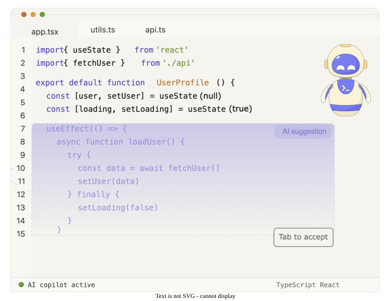

# Designing_AI-Powered_Code_Assistants_for_Real-Time_Developer_Support

Source: https://www.educative.io/courses/system-design-interview-prep-crash-course/design-an-ai-powered-code-assistant-15-minute-sprint

---

[Home](https://www.educative.io/)

[Courses](https://www.educative.io/search?tab=courses)

[System Design Interview: Fast-Track in 48 Hours](https://www.educative.io/courses/system-design-interview-prep-crash-course)

# Design an AI-Powered Code Assistant - 15 Minute Sprint

Explore how to design an AI-powered code assistant that enhances developer productivity by offering real-time, context-aware code suggestions. Understand both functional and nonfunctional requirements, including latency, scalability, and security. Learn to architect distributed systems with components like load balancers, caching, and telemetry pipelines to support millions of developers while maintaining cost efficiency and continuous improvement through user feedback.

We'll cover the following...

- [What is a code assistant?](https://www.educative.io/courses/system-design-interview-prep-crash-course/design-an-ai-powered-code-assistant-15-minute-sprint#What-is-a-code-assistant)
- [Requirements](https://www.educative.io/courses/system-design-interview-prep-crash-course/design-an-ai-powered-code-assistant-15-minute-sprint#Requirements)
- [Functional requirements](https://www.educative.io/courses/system-design-interview-prep-crash-course/design-an-ai-powered-code-assistant-15-minute-sprint#Functional-requirements)
- [Nonfunctional requirements](https://www.educative.io/courses/system-design-interview-prep-crash-course/design-an-ai-powered-code-assistant-15-minute-sprint#Nonfunctional-requirements)
- [Building blocks](https://www.educative.io/courses/system-design-interview-prep-crash-course/design-an-ai-powered-code-assistant-15-minute-sprint#Building-blocks)
- [High-level design of the code assistant](https://www.educative.io/courses/system-design-interview-prep-crash-course/design-an-ai-powered-code-assistant-15-minute-sprint#High-level-design-of-the-code-assistant)
- [Detailed design of a code assistant](https://www.educative.io/courses/system-design-interview-prep-crash-course/design-an-ai-powered-code-assistant-15-minute-sprint#Detailed-design-of-a-code-assistant)
  - [Inference path](https://www.educative.io/courses/system-design-interview-prep-crash-course/design-an-ai-powered-code-assistant-15-minute-sprint#Inference-path)
  - [Telemetry path](https://www.educative.io/courses/system-design-interview-prep-crash-course/design-an-ai-powered-code-assistant-15-minute-sprint#Telemetry-path)
- [Requirements compliance](https://www.educative.io/courses/system-design-interview-prep-crash-course/design-an-ai-powered-code-assistant-15-minute-sprint#Requirements-compliance)
- [Conclusion](https://www.educative.io/courses/system-design-interview-prep-crash-course/design-an-ai-powered-code-assistant-15-minute-sprint#Conclusion)

Developers spend a significant portion of their time on repetitive tasks such as writing boilerplate code, navigating documentation, and fixing minor syntax errors. These tasks are frequent but low-cognitive-value, which makes them ideal candidates for automation. **AI-powered code assistants** attempt to reduce this friction by embedding large language model (LLM) inference directly into the developer’s IDE and generating suggestions in real time as code is written.

Industry reports and developer surveys indicate that AI-assisted coding improves perceived productivity, while controlled studies report mixed results in actual task-completion time.

This tension frames a real design constraint. This lesson focuses on understanding the problem space, defining requirements, and estimating resources to prepare for the full system architecture in the next lesson.

## What is a code assistant?[#](https://www.educative.io/courses/system-design-interview-prep-crash-course/design-an-ai-powered-code-assistant-15-minute-sprint#What-is-a-code-assistant)

A **code assistant**, often called Copilot, is an AI-powered tool embedded in a developer’s IDE (Integrated Development Environment) that provides real-time code suggestions, completions, and generation based on natural language prompts and surrounding code context.

The core capabilities of a modern code assistant span several categories:

- **Inline code completion:** The system predicts and suggests the next few tokens or lines as the developer types.
- **Multi-line function generation:** Given a function signature or partial implementation, the system generates a complete function body.
- **Natural language to code translation:** A developer writes a comment like `// sort array in descending order`, and the system produces the corresponding code.
- **Code editing and refactoring:** The system can modify existing code blocks, for example, rewriting a loop for efficiency or converting synchronous code into asynchronous patterns.
- **Code explanation and documentation:** The system can describe what a selected code block does in plain English.
- **Context-aware suggestions:** Completions are informed by the current file, open tabs, imported modules, project structure, and other signals that are assembled into a structured context window before being sent to the LLM.

An example of an AI code assistant

Unlike traditional autocomplete systems that rely on symbol tables and static analysis, Copilot uses deep learning models trained on vast code corpora to predict semantically meaningful code blocks. To provide context-aware suggestions, the system uses a *context extractor* within the IDE to truncate and rank relevant snippets (for example, using Jaccard similarity or BM25) before sending them to the LLM. Sending entire files would exceed context windows and increase latency.

Because this system must support millions of concurrent developers, it becomes a distributed systems problem that requires low-latency inference, high availability, and effective context management. Given this workflow, the next step is to define the system’s functional and nonfunctional requirements.

## Requirements[#](https://www.educative.io/courses/system-design-interview-prep-crash-course/design-an-ai-powered-code-assistant-15-minute-sprint#Requirements)

Clearly scoping requirements (functional and nonfunctional) is one of the most critical steps in any system design interview. These will inform both the resource estimation later in this lesson and the architectural choices explored in the next lesson.

## Functional requirements[#](https://www.educative.io/courses/system-design-interview-prep-crash-course/design-an-ai-powered-code-assistant-15-minute-sprint#Functional-requirements)

The functional requirements define what the code assistant must do from the user’s perspective.

- **Real-time code completion:** The system should generate and return code suggestions within a strict latency budget of under 300 ms as the developer types, ensuring that suggestions arrive before the developer’s attention moves on.
- **Context-aware suggestions:** The system must accept and process contextual signals, including current file content, cursor position, open files, project structure, and programming language, to produce relevant completions rather than generic ones.
- **Multi-language support:** The system should support popular programming languages such as Python, JavaScript, TypeScript, Java, Go, and C++, requiring the underlying model to handle diverse syntax and semantics.
- **Natural language to code:** The system should translate developer comments or prompts written in natural language into functional code snippets, requiring an instruction-tuned LLM.
- **Code explanation and documentation:** The system should explain selected code blocks in natural language, helping developers understand unfamiliar codebases.
- **Streaming responses:** For longer generations, the system should support streaming tokens back to the IDE incrementally using mechanisms such as server-sent events (SSE), WebSockets, or streaming APIs.
- **User feedback loop:** The system should capture accept/reject signals from developers to build a telemetry pipeline for model fine-tuning over time.

The following table summarizes these requirements alongside their design implications.

|  |  |  |  |
| --- | --- | --- | --- |
| **Requirement** | **Description** | **Example** | **Design Implication** |
| Real-time code completion | Generate suggestions under 300ms | The developer types a function signature and gets the body | Requires low-latency inference and caching |
| Context-aware suggestions | Process file and project context | Uses imports and variable names to tailor output | Needs a context preprocessing pipeline |
| Multi-language support | Handle 10+ programming languages | Python, JS, Go, Java | The model must be trained on multilingual corpora |
| Natural language to code | Convert comments to code | "// sort array in descending order" generates sorting logic | Requires instruction-tuned LLM |
| Streaming responses | Incremental token delivery | Long function generation streams line by line | Needs server-sent events or WebSocket support |
| User feedback loop | Capture accept/reject signals | The developer dismisses a suggestion | Telemetry pipeline for model fine-tuning |

These functional requirements tell us what the system does. Equally important is defining how well it must perform under real-world conditions.

## Nonfunctional requirements[#](https://www.educative.io/courses/system-design-interview-prep-crash-course/design-an-ai-powered-code-assistant-15-minute-sprint#Nonfunctional-requirements)

Nonfunctional requirements define the quality attributes that determine whether the system is viable at production scale.

- **Low latency:** Developers typically type 40–80 words per minute, which means that suggestions must appear within a few hundred milliseconds (time to first token, or TTFT) to remain relevant before the user continues typing.
- **High availability:** The system should target 99.9%+ uptime because developers rely on it continuously during active coding sessions. Downtime directly disrupts productivity.
- **Scalability:** The system must scale horizontally to handle millions of concurrent developers across global regions, with traffic patterns that spike during business hours in different time zones.
- **Fault tolerance:** Failures in the inference layer should degrade gracefully by returning no suggestion rather than crashing the IDE plugin or displaying error messages.
- **Security and privacy:** Code context sent to the backend may contain proprietary source code. Data must be encrypted in transit using TLS and at rest, with options for enterprise customers to restrict data retention entirely.

  - **Safety and compliance:** Generated code should pass security and license checks to avoid introducing vulnerabilities or incompatible code into repositories.
- **Suggestion relevance:** Generated code should be syntactically valid and contextually relevant to minimize developer correction effort.
- **Cost efficiency:** LLM inference is GPU-intensive, so the system must optimize compute costs through techniques like model quantization, response caching, and batched inference.

Functional and non-functional requirements of an LLM-powered code assistant

> **Note:** AWS research identifies a review and QA bottleneck in which AI-generated code increases output volume faster than teams can review and validate it. This quality-assurance concern is a real nonfunctional consideration that affects how the system’s success is measured beyond raw throughput.

The next step is identifying the distributed system building blocks that will form the architecture.

## Building blocks[#](https://www.educative.io/courses/system-design-interview-prep-crash-course/design-an-ai-powered-code-assistant-15-minute-sprint#Building-blocks)

Designing a code assistant at this scale requires composing several well-known distributed system components. The building blocks that will form the architecture in the next lesson include the following:

- **Load balancers** distribute inference requests across GPU server clusters and handle regional traffic routing.
- **Vector databases** or embedding stores retrieve semantically relevant code snippets from the repository to enrich the model context.
- **Key-value stores** such as Redis cache frequent completions and session context, reducing redundant inference calls.
- **Pub-sub systems or message queues** handle asynchronous telemetry ingestion for accept/reject signals and usage logs without blocking the inference path.
- **Blob storage** reliably stores and versions model weights and training artifacts.
- **CDNs and edge nodes** minimize latency by serving cached responses closer to developers in each region.
- **Monitoring services** track inference latency, error rates, GPU utilization, and model quality metrics such as suggestion acceptance rate.

Building blocks required to design a system for an LLM-powered code assistant

> **Note:** None of these components is unique to AI systems. The challenge lies in how these components are composed to meet strict latency, availability, and cost constraints for real-time LLM inference workloads.

These building blocks will be assembled into a complete system architecture in the next lesson. Before moving on, test your ability to apply the concepts from this lesson to a realistic design scenario.

AI Powered

Saved

12 attempts left

Reset

AI Code Assistant Design Challenge

Hi, I'm Ed! Let's work through this design challenge together. You are a system design engineer at a company planning to launch an AI code assistant for 2 million internal developers across 3 global regions. The company's primary concerns are keeping inline suggestion latency under 200ms, ensuring code privacy since developers work on proprietary codebases, and managing GPU infrastructure costs. Identify which functional and non-functional requirements from this lesson are most critical given these constraints and explain why?

You have 12 attempts to answer.

Now, let’s examine the high-level design of the code assistant.

## High-level design of the code assistant[#](https://www.educative.io/courses/system-design-interview-prep-crash-course/design-an-ai-powered-code-assistant-15-minute-sprint#High-level-design-of-the-code-assistant)

The high-level workflow is as follows: A developer enters code or a comment. The IDE plugin captures the context, including the cursor position, open files, and language metadata. The IDE plugin sends a request through an API gateway that handles authentication, rate limiting, and routing before forwarding it to the orchestration service. The backend orchestration service preprocesses context, applies safety filters, and routes the request to an LLM inference cluster. The model generates candidate completions, and the results return to the IDE with minimal latency.

The following diagram illustrates this end-to-end request flow, from the developer’s keystroke to the rendered suggestion.

Code assistant request lifecycle showing the complete round-trip from the IDE to the inference service

Regional deployment is essential. Load balancers distribute traffic across GPU clusters deployed in multiple geographic regions, keeping requests close to developers and meeting both latency and availability targets. The cache layer can reduce GPU load for repeated prompt hashes from identical or highly similar contexts. Even modest cache hit rates (for example, 10–20%) can significantly reduce GPU inference load at scale.

> **Note:** The cache hit rate directly impacts cost efficiency. Even a five percent improvement in cache hits can eliminate thousands of GPU-hours per month at scale.

With the high-level architecture established, we can now examine how these components interact in detail during both the inference and telemetry workflows.

## Detailed design of a code assistant[#](https://www.educative.io/courses/system-design-interview-prep-crash-course/design-an-ai-powered-code-assistant-15-minute-sprint#Detailed-design-of-a-code-assistant)

The system’s behavior is best understood by tracing two parallel paths: the inference path, which generates suggestions, and the telemetry path, which captures feedback for continuous improvement.

### Inference path[#](https://www.educative.io/courses/system-design-interview-prep-crash-course/design-an-ai-powered-code-assistant-15-minute-sprint#Inference-path)

When a developer types in the IDE, the plugin sends a request through the API gateway, which handles authentication, rate limiting, and routing. The request is then passed to the context aggregation service, where relevant signals, such as the current file, cursor position, open tabs, and language metadata, are assembled into a prompt. This prompt is truncated to fit within the model’s context window.

To improve relevance, the system may enrich this prompt using a **retrieval layer**, which queries a vector database of repository embeddings and adds semantically related code snippets. This is especially useful for large codebases, where important context may not be present in the currently open files.

Before invoking the model, the orchestration layer performs a cache lookup using a hash of the assembled prompt:

- On a **cache hit**, the stored completion is streamed back immediately.
- On a **cache miss**, the request is forwarded to the inference cluster.

The request then reaches the GPU inference cluster, where a model serving framework such as vLLM performs batched inference. By grouping multiple requests into a single GPU execution and leveraging KV cache optimization, the system improves throughput while keeping latency low.

As soon as generation begins, tokens are streamed back to the IDE using SSE. This reduces time to first token (TTFT), even if full response generation takes longer. Once generation completes, the response is cached for reuse.

The following illustration highlights the real-time flow of the inference layer:

Real-time flow from IDE through context processing, caching, and GPU inference to deliver streamed code suggestions

### Telemetry path[#](https://www.educative.io/courses/system-design-interview-prep-crash-course/design-an-ai-powered-code-assistant-15-minute-sprint#Telemetry-path)

While the inference path is latency-critical, the telemetry path is designed to be fully asynchronous, ensuring that it never impacts the developer experience. When a developer interacts with a suggestion, the IDE sends feedback signals such as accepted, rejected, or modified. These events are published to a message queue (e.g., Kafka), which decouples ingestion from downstream processing. A telemetry consumer service then processes these events and writes them to a columnar data store optimized for large-scale analytical queries.

Over time, aggregation jobs compute key metrics, including:

- Acceptance rates per model version
- Latency distributions
- Performance across languages or repositories

These aggregated signals feed into fine-tuning pipelines, evaluation systems, and monitoring dashboards. Together, these components form a continuous feedback loop that improves model quality and relevance over time without impacting real-time inference performance.

One industry-observed risk is a review and QA bottleneck, where AI-generated code volume outpaces a team’s review capacity and stalls overall delivery speed. The monitoring service must therefore track not just throughput and latency, but also suggestion acceptance rates and downstream code quality metrics to detect this pattern early.

The following diagram illustrates this complete architecture with all major components and their interactions:

End-to-end system combining inference, telemetry, and ML pipelines for scalable code generation and continuous improvement

Supporting this system at scale requires careful infrastructure design. The GPU inference layer uses techniques such as model quantization (e.g., INT8) to reduce memory usage and improve throughput where supported. Auto-scaling policies dynamically adjust GPU capacity based on regional traffic patterns.

From a reliability perspective, the system follows a graceful degradation model:

- If inference fails or exceeds latency thresholds, the system returns no suggestion instead of an error.
- Cached responses provide a partial fallback for frequently seen requests.

This ensures that even under failure conditions, the IDE remains responsive, and the developer workflow is not disrupted. With the detailed design in place, we now verify systematically that all requirements from the previous lesson are addressed.

## Requirements compliance[#](https://www.educative.io/courses/system-design-interview-prep-crash-course/design-an-ai-powered-code-assistant-15-minute-sprint#Requirements-compliance)

To ensure that the proposed architecture satisfies the system goals defined in the previous lesson, we map each requirement to the architectural components responsible for implementing it. This verification step confirms that every functional capability and operational constraint is explicitly supported by the design.

|  |  |  |
| --- | --- | --- |
| **Functional Requirement** | **Architectural Component** | **How the Architecture Satisfies It** |
| Real-time code completion | GPU inference cluster + streaming API | The inference service generates suggestions and streams tokens to the IDE, ensuring the first token arrives within the sub-300 ms latency target. |
| Context-aware suggestions | Context aggregation service | The orchestration layer assembles prompts using signals such as the current file, cursor position, open tabs, and language metadata before sending them to the model. |
| Multi-language support | Polyglot LLM (or specialized model set) | The inference cluster hosts models trained on diverse programming languages, enabling suggestions across ecosystems like Python, JavaScript, Java, Go, and C++. |
| Natural language to code | Instruction-tuned prompting in inference service | Developer comments are translated into executable code using prompts optimized for instruction-following behavior. |
| Code explanation and documentation | explainCode  API + inference cluster | Selected code blocks are sent to the model with explanation prompts, returning natural-language descriptions to the IDE. |
| Streaming responses | SSE streaming pipeline | Tokens are streamed incrementally using Server-Sent Events, so developers see suggestions immediately while generation continues. |
| User feedback loop | Pub-sub telemetry pipeline | Feedback signals from the IDE are asynchronously published to a message queue and later aggregated for quality monitoring and model improvement. |

Beyond supporting core features, the architecture must also satisfy strict operational constraints. The following table shows how the System Design addresses each nonfunctional requirement.

|  |  |  |
| --- | --- | --- |
| **Nonfunctional Requirement** | **Architectural Component** | **How the Architecture Satisfies It** |
| Low latency | Regional deployment + Redis cache + batched inference | Requests are routed to the nearest region, cached completions bypass GPU inference, and batching improves GPU throughput. |
| High availability | Multi-region deployment + load balancers | Traffic can be routed across regions, ensuring service continuity during regional disruptions. |
| Scalability | Horizontally scalable GPU clusters + auto-scaling policies | GPU nodes are added or removed dynamically based on traffic patterns across time zones. |
| Fault tolerance | Graceful degradation + cache fallback | If inference fails, the system returns an empty suggestion while maintaining IDE responsiveness. |
| Security and privacy | API gateway authentication + TLS + data retention controls | Requests are authenticated, encrypted in transit, and subject to enterprise data governance policies. |
| Cost efficiency | Model quantization + prompt caching + auto-scaling | Quantized models reduce GPU memory usage, caching avoids redundant inference, and capacity scales with demand. |

While infrastructure metrics ensure that the system operates reliably, the architecture also tracks developer-centric quality signals to evaluate real-world effectiveness. Monitoring services collect metrics such as:

- Suggestion acceptance rate
- Edit distance between the suggested code and the final code
- Time-to-first-token latency
- Model performance by language or repository type

Tracking these signals helps detect issues such as the review and QA bottleneck, where AI-generated code volume grows faster than teams can review it.

Research into the perception gap suggests that developers often believe AI assistance makes them faster, yet empirical data sometimes shows no measurable improvement. This reinforces why the monitoring service must track actual developer productivity metrics, such as acceptance rates, edit distances on accepted suggestions, and deployment frequency, rather than relying solely on raw suggestion throughput.

To test your ability to apply these design principles under pressure, consider the following scenario.

AI Powered

Saved

10 attempts left

Reset

AI Code Assistant Performance Crisis

Hi, I'm Ed! Let's work through this design challenge together. First question: A company is deploying an internal code assistant for 50,000 developers across three regions. During peak hours, the GPU inference cluster in one region becomes overloaded, cache hit rates drop to 15%, and p99 latency spikes to 800ms. Identify at least three architectural changes or optimizations that could address this situation, explain the trade-offs of each change, and describe how the monitoring service should be configured to detect and respond to this scenario before it impacts developers

You have 10 attempts to answer.

## Conclusion[#](https://www.educative.io/courses/system-design-interview-prep-crash-course/design-an-ai-powered-code-assistant-15-minute-sprint#Conclusion)

In this chapter, we explored how AI-powered code assistants evolve from a developer productivity problem into a large-scale, latency-sensitive distributed system. We began by defining the problem space, key capabilities, and strict requirements, particularly the need for real-time, context-aware suggestions under tight latency constraints. We then translated those requirements into a concrete architecture, showing how components like API gateways, context aggregation services, GPU inference clusters, caching layers, and telemetry pipelines work together to meet these demands at scale.

Designing such systems goes beyond enabling code generation and requires balancing competing constraints, including low latency, high availability, cost-efficient GPU utilization, and continuous improvement via feedback loops. The success of a code assistant depends not only on system performance but also on the quality and usefulness of its suggestions within the developer workflow.

Design LLM-Powered Customer Support Bot System - 15 Minute Sprint

Spotify System Design

Ask

[What is a code assistant?](https://www.educative.io/courses/system-design-interview-prep-crash-course/design-an-ai-powered-code-assistant-15-minute-sprint#What-is-a-code-assistant)

[Requirements](https://www.educative.io/courses/system-design-interview-prep-crash-course/design-an-ai-powered-code-assistant-15-minute-sprint#Requirements)

[Functional requirements](https://www.educative.io/courses/system-design-interview-prep-crash-course/design-an-ai-powered-code-assistant-15-minute-sprint#Functional-requirements)

[Nonfunctional requirements](https://www.educative.io/courses/system-design-interview-prep-crash-course/design-an-ai-powered-code-assistant-15-minute-sprint#Nonfunctional-requirements)

[Building blocks](https://www.educative.io/courses/system-design-interview-prep-crash-course/design-an-ai-powered-code-assistant-15-minute-sprint#Building-blocks)

[High-level design of the code assistant](https://www.educative.io/courses/system-design-interview-prep-crash-course/design-an-ai-powered-code-assistant-15-minute-sprint#High-level-design-of-the-code-assistant)

[Detailed design of a code assistant](https://www.educative.io/courses/system-design-interview-prep-crash-course/design-an-ai-powered-code-assistant-15-minute-sprint#Detailed-design-of-a-code-assistant)

[Inference path](https://www.educative.io/courses/system-design-interview-prep-crash-course/design-an-ai-powered-code-assistant-15-minute-sprint#Inference-path)

[Telemetry path](https://www.educative.io/courses/system-design-interview-prep-crash-course/design-an-ai-powered-code-assistant-15-minute-sprint#Telemetry-path)

[Requirements compliance](https://www.educative.io/courses/system-design-interview-prep-crash-course/design-an-ai-powered-code-assistant-15-minute-sprint#Requirements-compliance)

[Conclusion](https://www.educative.io/courses/system-design-interview-prep-crash-course/design-an-ai-powered-code-assistant-15-minute-sprint#Conclusion)