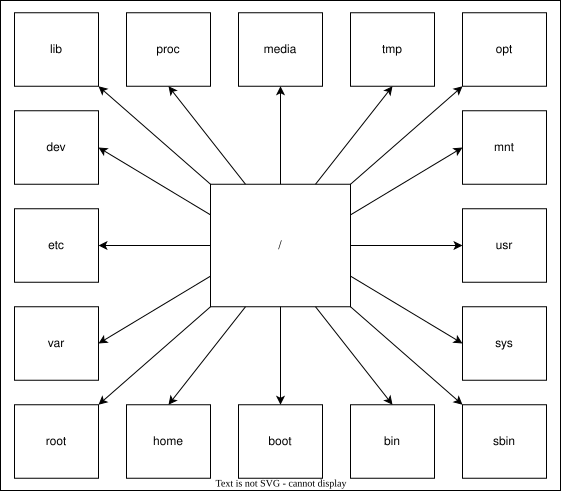

# Understanding_Linux_File_System_Structure_for_Security

Source: https://www.educative.io/courses/web-application-penetration-testing/linux-file-system

---

[Home](https://www.educative.io/)

[Courses](https://www.educative.io/search?tab=courses)

[Web Application Penetration Testing](https://www.educative.io/courses/web-application-penetration-testing)

# Linux File System

Explore the Linux file system structure to understand key directories and files. Gain insights into how file systems differ across Linux distributions, enhancing your ability to locate important files and evaluate system integrity during penetration testing.

We'll cover the following...

- [Importance of file system structure](https://www.educative.io/courses/web-application-penetration-testing/linux-file-system#Importance-of-file-system-structure)
- [A detailed look at the basic file system structure](https://www.educative.io/courses/web-application-penetration-testing/linux-file-system#A-detailed-look-at-the-basic-file-system-structure)

## Importance of file system structure[#](https://www.educative.io/courses/web-application-penetration-testing/linux-file-system#Importance-of-file-system-structure)

Every OS has its basic file system structure. Being familiar with that file system structure is important because we can then quickly tell what is still set as default, what is untampered, and where to find important files (like the `shadow` and `passwd` files we mentioned earlier).

The Linux file system

> **Note:** There may be differences between all the many distros available out there.

## A detailed look at the basic file system structure[#](https://www.educative.io/courses/web-application-penetration-testing/linux-file-system#A-detailed-look-at-the-basic-file-system-structure)

The Linux OS family has a fundamental file system structure that’s almost always largely the same across all the operating systems under its umbrella. Of course, there’ll be some differences between Kali’s and Ubuntu’s file system structures, and that’s due to their intended purposes. Knowing the differences between them is key to knowing where to look and what we could do to a system once we’ve compromised it.

Let’s consult the table below to see brief descriptions of the roles played by each directory in the file system. We may find that some directories (and files) are missing from one OS and present in another.

## Linux File System Structure

|  |  |
| --- | --- |
| **Directory** | **Description** |
| `/` | This is the beginning of the file system in Linux. It's also called the root directory. |
| `/boot` | This directory contains the kernel and the boot modules. We don't touch the contents unless we know what we're doing. |
| `/etc` | This directory has the system configuration files and here are some of its contents:     - `/fstab`:This is a configuration file used to define how disk partitions, remote file systems, and other storage devices should be mounted into the file system hierarchy.      - `/hosts`:This file has information regarding the network hostnames and IP addresses that are known to the system.      - `/init.d`:This directory has different scripts that are used to initialize various system devices during boot time. |
| `/bin`   `/usr/bin` | This directory has the essential programs that the system requires to operate or work efficiently.    `/usr/bin` has the applications that have been installed and provided for users. |
| `/sbin`   `/usr/sbin` | These directories contain system administration programs that are mostly used by the superuser within the Linux system. |
| `/usr` | This directory gives support to the user applications. Some of its contents are discussed below:     - `/share/X11`: This file offers support for the X Window System within the operating system in Linux.      - `/share/dict`: This file offers dictionaries that help spell checkers within the Linux operating system.      - `/share/doc`: This file provides documentation services in a variety of file formats.      - `/share/man`: The man page provides guidelines on using the different applications and services.      - `/usr/local`: This directory facilitates the installation of programs in the user systems. |
| `/var` | This directory contains the logging file system. Here are some of its contents:     - `/log`: This is the log file directory, and it is often updated while the system is working.      - `/spool`: The directory contains files that help in the queuing process or resource allocation for proper functioning. |
| `/lib` | This directory contains the shared libraries in the Linux operating system. |
| `/home` | This is the directory for users' personal information and data in the Linux system. It is where most users operate from in the Linux system. |
| `/tmp` | This is a directory that holds temporary files for the different running programs within the operating system. |
| `/dev` | This directory contains devices that have been mounted onto the system and are available for use. This includes floppy drives, hard disks, flash drives, and others. |
| `/proc` | This directory is entirely virtual, and it contains little information about the kernel itself. |
| `/media` | This directory helps in promoting automatic mounting mechanisms for the different devices found in the latest Linux operating system. |
| `/opt` | This is usually where the files and folders of software we build from source land. |
| `/mnt` | This is a now deprecated directory, but it is still important to know since we'll often find systems running old versions of Linux distros. We manually mount storage devices or partitions here. |
| `/sys` | This is a virtual directory that contains information about and from devices connected to our computer. |
| `/root` | This is the home directory of the superuser. |

Linux Commands

Text Manipulation

Ask

[Importance of file system structure](https://www.educative.io/courses/web-application-penetration-testing/linux-file-system#Importance-of-file-system-structure)

[A detailed look at the basic file system structure](https://www.educative.io/courses/web-application-penetration-testing/linux-file-system#A-detailed-look-at-the-basic-file-system-structure)