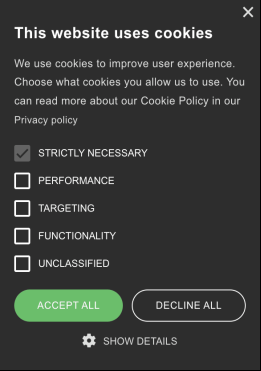

# Understanding_Cookies_in_Web_and_Server_Technology

Source: https://www.educative.io/courses/web-application-penetration-testing/cookies

---

[Home](https://www.educative.io/)

[Courses](https://www.educative.io/search?tab=courses)

[Web Application Penetration Testing](https://www.educative.io/courses/web-application-penetration-testing)

# Cookies

Explore the role of cookies in web applications, including how they store user preferences and metadata. Understand the difference between first-party and third-party cookies, their use in tracking and advertising, and how to view cookies in browser developer tools to enhance security awareness.

We'll cover the following...

- [Introduction to cookies](https://www.educative.io/courses/web-application-penetration-testing/cookies#Introduction-to-cookies)
  - [Application of cookies](https://www.educative.io/courses/web-application-penetration-testing/cookies#Application-of-cookies)
  - [Third-party cookies](https://www.educative.io/courses/web-application-penetration-testing/cookies#Third-party-cookies)
- [Cookies in the browser](https://www.educative.io/courses/web-application-penetration-testing/cookies#Cookies-in-the-browser)

## Introduction to cookies[#](https://www.educative.io/courses/web-application-penetration-testing/cookies#Introduction-to-cookies)

The HTTP protocol is stateless and does not store information about different users on a website. This led to the development of cookies.

**Cookies** are documents that contain information, largely preferences, about the user browsing a website. For instance, when we’re viewing a website that’s in a foreign language and we change it to a language we understand, that information is saved to a cookie in the local machine. So the next time we visit the same website, it’ll read the cookie that it had saved earlier, and we’ll see that the language being used is the same as the one we’d previously selected. If you’ve ever faced a prompt like the one shown below, then you’ve interacted with cookies and are probably familiar with the type of information they’re allowed to store:

A cookie prompt upon the first visit to a website

Since the introduction of cookies, their use has exploded—they’re used on almost every website—and they’ve evolved into more complex documents that have become an essential part of the internet. Nowadays, cookies have even been found to store information about what graphics processing unit (GPU) is being used by the user’s system.

This has led to cookies being used to track users’ browsing history as well. This is especially prevalent when it comes to advertisements. You’ll have noticed that when you search Google for a certain product, you’ll see ads for similar products on other websites later. This is a privacy nightmare, but that’s a conversation for another time.

### Application of cookies[#](https://www.educative.io/courses/web-application-penetration-testing/cookies#Application-of-cookies)

A cookie is not just limited to what we do on a website. It can also have useful metadata that can be used by a hacker. This metadata includes the time of visiting the website, items the user has added to a shopping cart, all the links we click on a given website, and also how much time we actively spend and stay idle on a website.

The information that’s saved to a cookie is up to the creator of the website. Developers give users’ cookies unique identifiers that are used to present their websites according to the users’ preferences. Over time, developers realized that they could ask for and store whatever information they wanted from users, and so they did just that. This eventually led to the development of third-party cookies.

### Third-party cookies[#](https://www.educative.io/courses/web-application-penetration-testing/cookies#Third-party-cookies)

**Third-party cookies** are the ones that are placed on a user’s hard disk by a website from a domain other than the one currently being visited by the user. This means that if a user visits [abc.com](http://abc.com), which has third-party cookies from [xyz.com](http://xyz.com), then the latter can also access the cookies saved by the former. In essence, this is how the previous example of cookies for advertisements works. Another example would be if a person is accessing a blog page that’s embedded with Google Ads or the “Like” button from the Facebook API. This embedding allows Google and Facebook to track the person’s browsing activity and this in turn helps set the user as a target for advertisements.

Consult the diagram below for a visual on how all of this works.

This is how we get specific ads when visiting a news site

## Cookies in the browser[#](https://www.educative.io/courses/web-application-penetration-testing/cookies#Cookies-in-the-browser)

Let’s take a look at how we can access the cookies a website saves for us right in Chrome. Launch the playground below and navigate to [https://educative.io](https://www.educative.io/courses/web-application-penetration-testing/cookies). Next:

1. Click the vertical triple-dot menu on the top right.
2. Go to “More Tools,” and then click the “Developer tools” option.
3. Click the “Application” tab. We may have to look for it by clicking the “>>” symbol.
4. In the list to the left, we’ll see “Storage,” under which we’ll find “Cookies.” Expanding it will reveal the cookies we’ve saved for you. Also note the data saved for third-party use by sites such as Google, LinkedIn, and Twitter.

Running Google Chrome once again

Web Encoding

Proxies

Ask

[Introduction to cookies](https://www.educative.io/courses/web-application-penetration-testing/cookies#Introduction-to-cookies)

[Application of cookies](https://www.educative.io/courses/web-application-penetration-testing/cookies#Application-of-cookies)

[Third-party cookies](https://www.educative.io/courses/web-application-penetration-testing/cookies#Third-party-cookies)

[Cookies in the browser](https://www.educative.io/courses/web-application-penetration-testing/cookies#Cookies-in-the-browser)