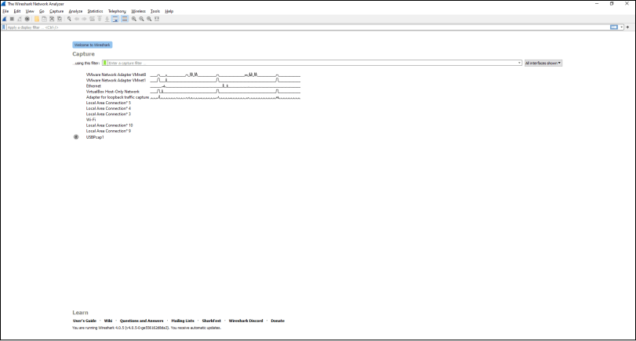

# Wireshark_Network_Analysis_Tool_for_Packet_Inspection

Source: https://www.educative.io/courses/web-application-penetration-testing/wireshark

---

[Home](https://www.educative.io/)

[Courses](https://www.educative.io/search?tab=courses)

[Web Application Penetration Testing](https://www.educative.io/courses/web-application-penetration-testing)

# Wireshark

Explore the use of Wireshark to capture and analyze network traffic. Learn how to filter packets, interpret the TCP three-way handshake, and capture HTTP protocol data. Understand Wireshark's interface and how to use it for security assessment and troubleshooting in network management.

We'll cover the following...

- [Introduction to Wireshark](https://www.educative.io/courses/web-application-penetration-testing/wireshark#Introduction-to-Wireshark)
- [Wireshark interface](https://www.educative.io/courses/web-application-penetration-testing/wireshark#Wireshark-interface)
- [Basic network analysis](https://www.educative.io/courses/web-application-penetration-testing/wireshark#Basic-network-analysis)
- [Web application HTTP protocol capture and filtration](https://www.educative.io/courses/web-application-penetration-testing/wireshark#Web-application-HTTP-protocol-capture-and-filtration)

## Introduction to Wireshark[#](https://www.educative.io/courses/web-application-penetration-testing/wireshark#Introduction-to-Wireshark)

**Wireshark** is a software used in network packet analysis by network engineers, system administrators, and hackers. It’s used to monitor and inspect outgoing and incoming packets for security and troubleshooting purposes. The application not only allows users to monitor the traffic in real time, but it also allows users to save the captured traffic for further or future analysis.

Perhaps Wireshark’s greatest benefit is the fact that it’s an open-source tool with a large community of developers that contribute to its improvements, thus enhancing its capabilities in the network analysis process. It also has a CLI equivalent called TShark, which can also prove useful in certain scenarios.

Let’s now get familiar with Wireshark’s GUI. Launching it on our platform will reveal the following greeting:

Wireshark's Welcome screen

From the image above, we can see a list of interfaces. A quick glance shows that Wireshark is indicating that there’s activity on the `eth0` and `lo` interfaces. This is because the machine on which Wireshark is running is constantly communicating with our platform’s server.

## Wireshark interface[#](https://www.educative.io/courses/web-application-penetration-testing/wireshark#Wireshark-interface)

New users tend to get overwhelmed by Wireshark’s interface, so it’s important that we break down the essentials for easy understanding.

Clicking “eth0” will take us to a screen where we can see all the packets communicating through that network interface. The user interface has the “Menu” bar and “Toolbar” for navigation and issuing commands, respectively. In our case, the list of packets will keep populating; therefore, we need to click the red button to stop the capturing of traffic. (The button right next to it will start a new capture session, by the way.)

The “Filter” toolbar is used to filter through packets by specific details. For example, if we wanted to look at all the packets related to mail servers, we could use the filter `tcp.port eq 25` since SMTP traffic generally passes through there. The “Packet list” pane is, of course, for showing the flow of traffic. It provides us a timeline for when packets are sent and received, where they’re from and where they go, the protocols being used, and other general information. The “Packet details” pane gives us further details about each individual packet. Finally, the “Packet bytes” pane shows us how the packet is transmitted over the network via the exact bytes used.

")

A view of eth0 with the capturing stopped (which is why the red button is not red)

Let’s now dive into the “Packet list” and figure out what information is presented to us in the different default columns:

## Packet List Information

|  |  |
| --- | --- |
| **Column Type** | **Description** |
| No. | This is the ordering in which the packets are sent or received. |
| Time | This is used to show the specific time when a packet was captured. |
| Source | This is where the traffic is coming from. |
| Destination | This is where the given particular captured traffic was going. |
| Protocol | This refers to the protocol through which a packet has been captured. |
| Length | This represents packet sizes as they've been captured. |
| Info | This shows a summary of the packet contents. |

## Basic network analysis[#](https://www.educative.io/courses/web-application-penetration-testing/wireshark#Basic-network-analysis)

We’re going to use Wireshark to observe the Transport Control Protocol (TCP) three-way handshake, i.e., the SYNchronize, SYNchronize-ACKnowledge, and ACKnowledge (SYN, SYN-ACK, ACK) signals.

Let’s first click “View” in the “Menu” bar and navigate to “Coloring rules.” Click it so that we can specify the color coding for the packets that we want to analyze. On the “Coloring rules” dialogue box, click the “+” (plus) symbol, and type the name of the protocol as `TCP SYN`. For its filter, enter `tcp.flags.syn == 1` for coloring both the SYN and ACK signals.

On the background button, select the green color and click the “OK” button. Click the refresh button on the “Toolbar” to configure the instructions.

In Wireshark below, configure the application as just described, and then capture some packets. After that, if we enter `tcp.flags.syn == 1`, we’ll get a view similar to the one in the image below.

Running Wireshark

 initiating the three-way handshake with a SYN and Packet 173 sees a SYN-ACK response from our browser (10.128.0.147) ")

Packet 172 details our machine (172.17.0.2) initiating the three-way handshake with a SYN and Packet 173 sees a SYN-ACK response from our browser (10.128.0.147)

## Web application HTTP protocol capture and filtration[#](https://www.educative.io/courses/web-application-penetration-testing/wireshark#Web-application-HTTP-protocol-capture-and-filtration)

Web application protocols like HTTP can also be captured using Wireshark. To capture interesting information from websites still using only HTTP, we have to adopt the following general approach:

1. Click “Run” to launch the playground. Wireshark and Chrome will launch. We may need move the windows of the software around.
2. Double-click “eth0” in Wireshark.
3. Navigate to the Chrome browser and visit the <http://testphp.vulnweb.com/> website. Browse around for a bit, and then stop capturing in Wireshark. We’ll then filter the packets using `http && ip.addr == <site's IP>`. If we click the relevant packets, we’ll find information being transmitted in plaintext. This can be tested by trying to log in with “test” as the username and password on the website.

Running Wireshark and Chrome

The red underlined values show the username and password to whoever is willing to sniff for them

We can save captures in a file for later analysis as well. Industry professionals often train new hires by handing them captures and asking them to answer scenario-based questions. There’s also a rather large [archive of sample captures](https://gitlab.com/wireshark/wireshark/-/wikis/SampleCaptures) that you can use for practice. It’s highly recommended that you do so.

Modification of Domain Name System

Quiz Yourself on Network Management and Analysis

Ask

[Introduction to Wireshark](https://www.educative.io/courses/web-application-penetration-testing/wireshark#Introduction-to-Wireshark)

[Wireshark interface](https://www.educative.io/courses/web-application-penetration-testing/wireshark#Wireshark-interface)

[Basic network analysis](https://www.educative.io/courses/web-application-penetration-testing/wireshark#Basic-network-analysis)

[Web application HTTP protocol capture and filtration](https://www.educative.io/courses/web-application-penetration-testing/wireshark#Web-application-HTTP-protocol-capture-and-filtration)