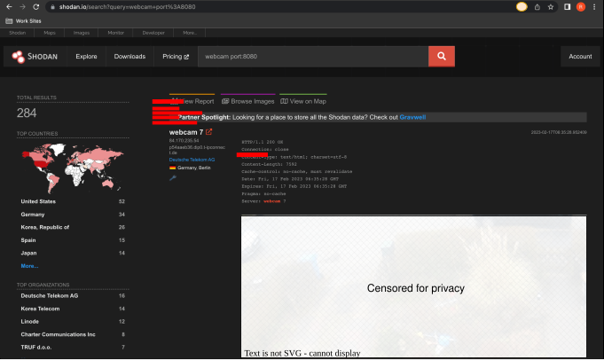

# Using_Shodan_for_Open-Source_Intelligence_in_Penetration_Testing

Source: https://www.educative.io/courses/web-application-penetration-testing/shodan

---

[Home](https://www.educative.io/)

[Courses](https://www.educative.io/search?tab=courses)

[Web Application Penetration Testing](https://www.educative.io/courses/web-application-penetration-testing)

# Shodan

Explore how Shodan indexes internet-connected devices and can be used for open-source intelligence during web application penetration testing. Learn to perform targeted searches using filters, identify default credentials, analyze server metadata, and employ the Shodan CLI with API access. Understand best practices for safely gathering and utilizing this information to assess security risks and improve configurations.

We'll cover the following...

- [Introduction to Shodan](https://www.educative.io/courses/web-application-penetration-testing/shodan#Introduction-to-Shodan)
- [Using Shodan in pentesting](https://www.educative.io/courses/web-application-penetration-testing/shodan#Using-Shodan-in-pentesting)

## Introduction to Shodan[#](https://www.educative.io/courses/web-application-penetration-testing/shodan#Introduction-to-Shodan)

[Shodan](https://www.shodan.io/) is a web application search engine that indexes nearly every device directly connected to the internet. Therefore, it’s a no-brainer that it’s used also as an OSINT tool in the penetration of web application frameworks. Shodan works like other search engines, such as Google, that help in indexing information that’s searched by different users across the internet. However, Shodan scans for every available port on the internet instead of just scanning for websites. This means it looks for every available IP address trying to identify whether it’s open and available. It can be used to check for open webcams, vulnerable websites, insecure satellites, and much more.

> **Note:** For extensive use of Shodan, both in the pentesting field and in practice, it’s always good to use a VPN and exercise caution. There are numerous honeypots waiting to trap beginners.

## Using Shodan in pentesting[#](https://www.educative.io/courses/web-application-penetration-testing/shodan#Using-Shodan-in-pentesting)

As already mentioned, Shodan is very powerful, and the website is very simple to use. We have to create an account, and then we can use the service’s various filters. There’s also an official Python library for use on the CLI but that requires an API key to use, which can only be gained by signing up for an account. We’ll see Shodan in action both ways.

First, let’s see how easy it is to gain viewing access to random people’s open webcams. Beware that this may be illegal depending on where you live.

At the time of writing, we went to Shodan’s homepage and searched for `webcam port:8080` (the port part is a filter; we’ll need to create an account). The default port for webcams is `80`, but extra services being installed may result in shifting the port to `8080`. In our case, we found an open webcam without any effort. Some webcams may require credentials; these can usually be gained access to by looking up the model’s default credentials and trying them out. Gaining access may also prove fruitful in further exploiting the target’s network.

In the same vein, if we were to search `default password`, we’d find a number of servers that haven’t been configured past the default settings. Exploiting most of them is, again, as easy as trying out default credentials. Furthermore, if we wanted to search for Apache servers of a certain version running in Spain, then we’d use a query such as `country:"Spain" Apache 2.4.49`. This version of Apache is vulnerable to both path traversal and remote code execution attacks.

Next up, we’ll use the CLI version of Shodan. While it is a bit intimidating, it’s less restrictive than the website, especially when the free tier account is all we have. After signing up for an account at Shodan, please enter your API in the field above the terminal to try out the queries we’ll describe in a bit.

Let’s first try querying the IP address for [example.com](http://example.com). The command would be `shodan host <IP of example.com>`. It’ll tell us that the server is hosted in Culver City, which is in California, right beside Marina del Ray. Since `shodan` doesn’t directly accept domain scans (it requires credits), we need to first grab the website’s IP address using `dig` and pass it as an argument to `shodan`.

This code requires the following environment variables to execute:

shodan\_api

Terminal 1

Terminal

Loading...

The queries that we tried earlier on the website can also be performed on the CLI. Unfortunately, though, the free API key is very limited, and queries often pose the dilemma of “Do I really need to use this filter?” since the use of filters costs credits.

When tasked with pentesting a web application, the Shodan information gathering approach is to use queries with the `domain` and `host` tags. We analyze whether the metadata information present in the response banner is greater than what’s necessary. If it is, we need to ensure that this information stays hidden or is at least spoofed. We also ensure that default configurations have not been used and update the technologies used to the latest version in order to stay on top of exploits.

Google Hacking

Quiz Yourself on Open-Source Intelligence

Ask

[Introduction to Shodan](https://www.educative.io/courses/web-application-penetration-testing/shodan#Introduction-to-Shodan)

[Using Shodan in pentesting](https://www.educative.io/courses/web-application-penetration-testing/shodan#Using-Shodan-in-pentesting)