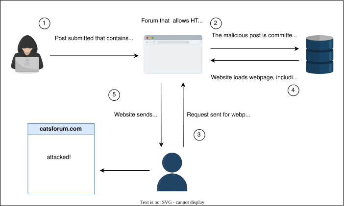

# Introduction_to_Cross-Site_Scripting_Attacks_and_Defenses

Source: https://www.educative.io/courses/web-application-penetration-testing/cross-site-scripting-basics

---

[Home](https://www.educative.io/)

[Courses](https://www.educative.io/search?tab=courses)

[Web Application Penetration Testing](https://www.educative.io/courses/web-application-penetration-testing)

# Cross-Site Scripting Basics

Explore the fundamentals of cross-site scripting (XSS), a common web vulnerability. Understand different types such as reflected, stored, and DOM-based XSS, how attackers exploit them, and learn techniques to identify and prevent these attacks to secure web applications.

We'll cover the following...

- [Overview](https://www.educative.io/courses/web-application-penetration-testing/cross-site-scripting-basics#Overview)
- [Cross-site scripting](https://www.educative.io/courses/web-application-penetration-testing/cross-site-scripting-basics#Cross-site-scripting)
- [Types of XSS attacks](https://www.educative.io/courses/web-application-penetration-testing/cross-site-scripting-basics#Types-of-XSS-attacks)
  - [Reflected XSS](https://www.educative.io/courses/web-application-penetration-testing/cross-site-scripting-basics#Reflected-XSS)
  - [Stored XSS](https://www.educative.io/courses/web-application-penetration-testing/cross-site-scripting-basics#Stored-XSS)
  - [Document Object Model (DOM) XSS](https://www.educative.io/courses/web-application-penetration-testing/cross-site-scripting-basics#Document-Object--Model-DOM-XSS)

## Overview[#](https://www.educative.io/courses/web-application-penetration-testing/cross-site-scripting-basics#Overview)

Modern technological advancement has led to the development of websites that users can freely interact with daily. This has come with a lot of advantages because developers can get feedback from users on how they’re interacting with their web applications. However, these advantages also gave rise to some unfortunate disadvantages, of which cross-site scripting (XSS) is a prime example. This vulnerability allows adversaries to plant their code in a web application to get its users’ data. Sounds quite scary, doesn’t it?

## Cross-site scripting[#](https://www.educative.io/courses/web-application-penetration-testing/cross-site-scripting-basics#Cross-site-scripting)

XSS is a client-server attack where the adversary injects malicious code into a web application and executes it. These attacks generally occur with unvalidated input and shoddy design choices. XSS allows adversaries to steal cookies and data, impersonate individual targets, and a lot more without (typically) directly exposing themselves.

## Types of XSS attacks[#](https://www.educative.io/courses/web-application-penetration-testing/cross-site-scripting-basics#Types-of-XSS-attacks)

There’s a large variety of XSS attacks. Some of them can get so complex or feel so functionally the same as other types that new learners generally have a hard time trying to figure out which type of attack is which. Let’s look at the types together.

### Reflected XSS[#](https://www.educative.io/courses/web-application-penetration-testing/cross-site-scripting-basics#Reflected-XSS)

Reflected XSS is the most common type of attack. In this, the attacker’s payload is a script and has to be part of a request sent to the web server and reflected in such a way that the response includes the payload from the request. Because the payload is not stored within the web application itself, it’s nonpersistent; therefore, social engineering techniques are needed to get users to fall for the attack.

In the wild, XSS attacks are generally accomplished with phishing emails and unsolicited messages promising rewards or warnings. This means the attacker lures the victim into inadvertently requesting the server that contains the XSS payload, and then their browser trusts the payload and executes it without worry.

### Stored XSS[#](https://www.educative.io/courses/web-application-penetration-testing/cross-site-scripting-basics#Stored-XSS)

Stored XSS is the most damaging type because the adversary injects malicious code directly into the database, which is then permanently stored on the target web application. For example, an attacker can perform a stored XSS attack through a comment section on a blog or a forum post by using the `` HTML tag. This image may point to some malicious website. When a victim navigates to the affected web page, the XSS payload will be loaded as part of the web page, just like the rest of the legitimate code available on the website. This means the victim will unknowingly execute the malicious script once the page is loaded.

A simple stored XSS example

### Document Object Model (DOM) XSS[#](https://www.educative.io/courses/web-application-penetration-testing/cross-site-scripting-basics#Document-Object--Model-DOM-XSS)

This is an advanced XSS attack that happens when the web application uses the provided data for the **Document Object Model**, or **DOM** for short. DOM is the structural format used to represent documents in a browser. The data from the DOM is subsequently read by the web application and an output is given to the browser. This means that if care is not taken, an adversary can inject a malicious code that will be stored as part of the DOM and then executed when the data is read back from it.

A simple DOM XSS example

We should keep in mind that most modern browsers and frameworks automatically mitigate the basic examples shown above. Adversaries either have to get crafty or developers have to have been unaware of or unprepared for the danger in order for adversaries to pull off XSS attacks. Unfortunately, the latter is extremely common.

Quiz Yourself on Open-Source Intelligence

XSS Exploitation

Ask

[Overview](https://www.educative.io/courses/web-application-penetration-testing/cross-site-scripting-basics#Overview)

[Cross-site scripting](https://www.educative.io/courses/web-application-penetration-testing/cross-site-scripting-basics#Cross-site-scripting)

[Types of XSS attacks](https://www.educative.io/courses/web-application-penetration-testing/cross-site-scripting-basics#Types-of-XSS-attacks)

[Reflected XSS](https://www.educative.io/courses/web-application-penetration-testing/cross-site-scripting-basics#Reflected-XSS)

[Stored XSS](https://www.educative.io/courses/web-application-penetration-testing/cross-site-scripting-basics#Stored-XSS)

[Document Object Model (DOM) XSS](https://www.educative.io/courses/web-application-penetration-testing/cross-site-scripting-basics#Document-Object--Model-DOM-XSS)