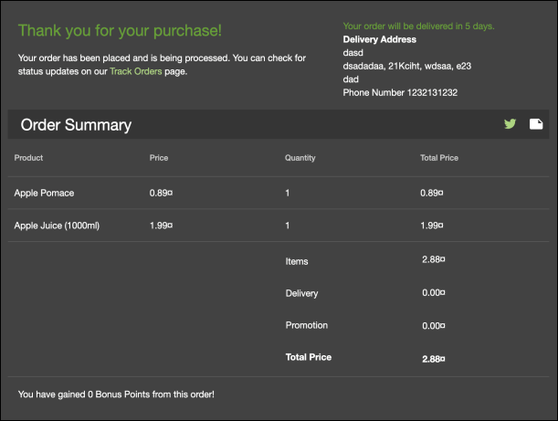

# XSS_Exploitation_Techniques_for_Web_Application_Security

Source: https://www.educative.io/courses/web-application-penetration-testing/xss-exploitation

---

[Home](https://www.educative.io/)

[Courses](https://www.educative.io/search?tab=courses)

[Web Application Penetration Testing](https://www.educative.io/courses/web-application-penetration-testing)

# XSS Exploitation

Explore how to detect and exploit cross-site scripting vulnerabilities in web applications. Understand reflected, DOM, and stored XSS attacks through practical examples and learn how these exploits compromise security. Gain hands-on experience using JavaScript injection methods to identify security flaws and improve web app defenses.

We'll cover the following...

- [Overview](https://www.educative.io/courses/web-application-penetration-testing/xss-exploitation#Overview)
- [Exploiting XSS vulnerabilities](https://www.educative.io/courses/web-application-penetration-testing/xss-exploitation#Exploiting-XSS-vulnerabilities)
  - [Reflected XSS](https://www.educative.io/courses/web-application-penetration-testing/xss-exploitation#Reflected-XSS)
  - [DOM XSS](https://www.educative.io/courses/web-application-penetration-testing/xss-exploitation#DOM-XSS)
  - [Stored XSS](https://www.educative.io/courses/web-application-penetration-testing/xss-exploitation#Stored-XSS)

## Overview[#](https://www.educative.io/courses/web-application-penetration-testing/xss-exploitation#Overview)

Considering the different types of XSS attacks we’ve discussed, it’s fair to assume that the overall process of finding such vulnerabilities is not all that difficult. Despite modern browsers and frameworks having simplified web application development, sometimes a developer has to actually make an effort to add security bugs to their application. Nevertheless, it’s still quite important to know how these vulnerabilities are exploited before delegating the task to an automated tool or service.

## Exploiting XSS vulnerabilities[#](https://www.educative.io/courses/web-application-penetration-testing/xss-exploitation#Exploiting-XSS-vulnerabilities)

Websites are rendered on the browser (alongside site business logic) as a combination of HTML, CSS, and JavaScript. This means that as long as the browser trusts the sources of the code, JavaScript especially, it will have no problem in executing it.

JavaScript is largely just like any other programming language, although with a few eccentricities. The same goes for HTML. As such, we can use the `<script></script>` tags to probe for basic vulnerabilities. For example, if a website has a form or a search bar, we can type `<script> alert("Hello, World")</script>` in the search bar or the form. This code prompts the users with a dialogue box with the message `Hello World`. This alerting methodology is the one most commonly used by pentesters because it’s both a simple yet brutal indicator of XSS vulnerabilities.

When a vulnerability is discovered, the adversary will often perform recon to see what’s the most they can get away with without getting caught.

Let’s look at more examples. A JavaScript element like `document.documentElement.innerHTML` contains all the HTML code of the web page. Changing this element to point to an empty string leads to a loss of the web page. The JavaScript code is injected into the webpage as `<script>document.documentElement.innerHTML = ''</script>`.

Other tags can also be used in the exploitation process. Let’s look at some below:

- `<body onload=alert('Hello World')>`: This will result in the prompt automatically popping up whenever a user opens up a page.
- `<p onclick=alert('Hello!')>Click me for a surprise!</p>`: This will result in a prompt being displayed whenever a user clicks on the element.

Now let’s look at each XSS vulnerability type with a practical example.

### Reflected XSS[#](https://www.educative.io/courses/web-application-penetration-testing/xss-exploitation#Reflected-XSS)

For reflected XSS, the biggest tell is usually the parameters in the URL. If you notice a value in the URL that is then displayed on the web page, you can start poking around there. Let’s confirm this with [OWASP Juice Shop](https://owasp.org/www-project-juice-shop/) below:

1. Click the “Run” button for the playground to load. After a while, we’ll see a message that says that the application is ready at port `3000`.
2. Click on the playground’s URL. The vulnerable web application will load in a new tab.
3. Create a new account. Use bogus details.
4. Log in using the new account.
5. Add a number of items to the basket.
6. Go to the basket, and provide an address and then payment details. Again, provide fake details.
7. We’ll get a confirmation that our order has been placed.



What we should see at step 7

8. Click the “Track Orders” button. A page will open where our order ID is displayed. Notice that this ID is the same as what’s in the URL. Is this a possible reflected XSS vulnerability?
9. Paste the following as the ID of the URL:

```
<iframe src="javascript:alert(`Reflected!`)">
```

10. Refresh the page. We’ll see a prompt and challenge success message.

Playground with Juice Shop

### DOM XSS[#](https://www.educative.io/courses/web-application-penetration-testing/xss-exploitation#DOM-XSS)

This exploit is rather simple. With the previous exploit, hopefully you’ve had enough time to play around with the website. Poking around for DOM XSS vulnerabilities also largely follows the same approach as reflected XSS, so they’re also difficult to spot.

Let’s check out another example below:

1. Open up the playground (the one up above), and access the web application.
2. Play around with the search bar, and note how elements of the page change depending on the search query. What if we try some JavaScript here?
3. Enter the following line in the search bar:

```
</img>
```

4. If we click on the image, we’ll see the alert prompt.

On the surface, this feels very similar to the reflected attack from earlier, doesn’t it? In a fair number of cases, this is how it is; without knowledge of what’s going on in the code, we can’t really confirm.

### Stored XSS[#](https://www.educative.io/courses/web-application-penetration-testing/xss-exploitation#Stored-XSS)

Juice Shop has a number of stored XSS issues; we’ll address one, and we can then take a shot at the rest.

If we visit the “About Us” page, we’ll see a slideshow of feedback from customers. Notice that there’s also a “Customer Feedback” page. If we were to submit a comment with malicious code, something might happen. Try submitting the following:

```
<<script>Ignore me.</script>iframe src="javascript:alert(`Stored!`)">
```

If we now go to the “About Us” page, we’ll be hit with an alert prompt. If we figure out the login details for the admin account, we’ll find a second alert waiting for us at the admin page.

This attack was successful because a broken version of `sanitize-html` was used by the web application. The broken package does not clean user input HTML recursively, i.e., nested HTML elements manage to sneak by. Basically, the script we used is reduced to:

```
<iframe src="javascript:alert(`Stored!`)">
```

Cross-Site Scripting Basics

Mitigation of XSS

Ask

[Overview](https://www.educative.io/courses/web-application-penetration-testing/xss-exploitation#Overview)

[Exploiting XSS vulnerabilities](https://www.educative.io/courses/web-application-penetration-testing/xss-exploitation#Exploiting-XSS-vulnerabilities)

[Reflected XSS](https://www.educative.io/courses/web-application-penetration-testing/xss-exploitation#Reflected-XSS)

[DOM XSS](https://www.educative.io/courses/web-application-penetration-testing/xss-exploitation#DOM-XSS)

[Stored XSS](https://www.educative.io/courses/web-application-penetration-testing/xss-exploitation#Stored-XSS)