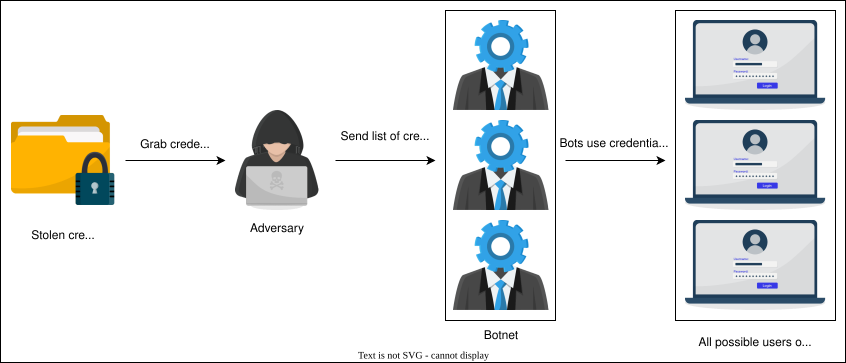

# Common_Vulnerabilities_in_Authentication_and_Authorization

Source: https://www.educative.io/courses/web-application-penetration-testing/common-vulnerabilities

---

[Home](https://www.educative.io/)

[Courses](https://www.educative.io/search?tab=courses)

[Web Application Penetration Testing](https://www.educative.io/courses/web-application-penetration-testing)

# Common Vulnerabilities

Explore common vulnerabilities related to authentication and authorization in web applications. Understand attack methods like credential stuffing, brute-force, and default credential attacks. Learn how broken access control enables unauthorized access and why strong policies and MFA are vital for security.

We'll cover the following...

- [Addressing common vulnerabilities](https://www.educative.io/courses/web-application-penetration-testing/common-vulnerabilities#Addressing-common-vulnerabilities)
- [Broken authentication](https://www.educative.io/courses/web-application-penetration-testing/common-vulnerabilities#Broken-authentication)
  - [Credential stuffing](https://www.educative.io/courses/web-application-penetration-testing/common-vulnerabilities#Credential-stuffing)
  - [Brute-force attack](https://www.educative.io/courses/web-application-penetration-testing/common-vulnerabilities#Brute-force-attack)
  - [Default credentials attack](https://www.educative.io/courses/web-application-penetration-testing/common-vulnerabilities#Default-credentials-attack)
- [Broken access control](https://www.educative.io/courses/web-application-penetration-testing/common-vulnerabilities#Broken-access-control)
  - [Admin information access](https://www.educative.io/courses/web-application-penetration-testing/common-vulnerabilities#Admin-information-access)

## Addressing common vulnerabilities[#](https://www.educative.io/courses/web-application-penetration-testing/common-vulnerabilities#Addressing-common-vulnerabilities)

Critical vulnerabilities are a major security concern. The moment such a vulnerability is discovered, notices and patches should be quickly worked on so that the damage is minimized. Vulnerabilities dealing with authentication and authorization are especially devastating; harvesting classified data from an organization’s system (and then releasing it to the public) often spells its doom. Therefore, it’s necessary to devise measures that ensure that even if a hacker gains access to a system, unless they perform stealthy privilege escalation, they won’t be able to perform decent recon or cause much harm.

A rigid user policy and MFA checks are often enough to deter less crafty attackers. Still, it’s important to know about certain attack vectors, so let’s take a look at them.

## Broken authentication[#](https://www.educative.io/courses/web-application-penetration-testing/common-vulnerabilities#Broken-authentication)

This vulnerability becomes a serious possibility when users are allowed to log in to a system without proper credentials. For example, if we have a user who wants to access a web application with a username and a password, then it’s likely that the credentials are stored in some database. Normally, as users log in, the system confirms whether the credentials entered match with those stored in the databases, and if a match is found, then the user gets logged in successfully. A session identification number is given to the user that allows them to access and interact with the web application, often for a set time.

However, if the configuration is not done correctly, then a cybercriminal can try one of the following general approaches.

### Credential stuffing[#](https://www.educative.io/courses/web-application-penetration-testing/common-vulnerabilities#Credential-stuffing)

**Credential stuffing** is when an adversary tries known login credentials they’ve collected from elsewhere in order to brute force the system. This is often carried out after first compromising more critical systems in order to loot the credentials. Hackers usually exacerbate the attack by employing botnets, which can then also result in a new botnet.

The goal of this credential stuffing attack is to use publicly exposed credentials to find still unsecured accounts

### Brute-force attack[#](https://www.educative.io/courses/web-application-penetration-testing/common-vulnerabilities#Brute-force-attack)

These are attacks where an adversary tries to brute force a system login with unknown credentials. This attack is a viable option if the application has no login attempt limit in place. Just keep in mind that it demands a lot of time and requires botnets, and we can see from the illustration above how one basically functions.

### Default credentials attack[#](https://www.educative.io/courses/web-application-penetration-testing/common-vulnerabilities#Default-credentials-attack)

Laziness and naiveté are the two biggest enemies of security protocols. Naive developers often just use basic credentials for admin accounts. Unprepared system administrators often either forget or perhaps consider it unimportant to change credentials from default options to something else. A botnet and a list of default passwords is all a hacker needs.

No matter how good our security policy, if our admin account’s username and password is “admin” and “admin,” respectively, then we’re a sitting duck.

> **Note:** Credential stuffing attacks use known credentials, brute-force attacks try credentials in random or sequential order, and default credentials attacks employ specially crafted (and often small) lists of credentials.

## Broken access control[#](https://www.educative.io/courses/web-application-penetration-testing/common-vulnerabilities#Broken-access-control)

**Access control** is the process of authorizing different users to perform actions or functions within the given scope of rights in a system. For example, a blog web application is supposed to have clearly defined roles, such as admin, moderator, proofreader, and writer. The latter three should not be able to access the admin page or dashboard. Proofreaders and writers should not be able to edit other users’ posts nor delete their blog posts. Ensuring that certain functionality is gatekept by certain roles and permissions is essential.

A page such as example.com/admin should be inaccessible by unauthorized users and unindexable

The illustration above shows just how easy it is for someone to make unauthorized requests as an authorized user. A combo of Google dorking to find the admin panel and maybe credential stuffing or a default credentials attack should grant us access in no time.

Let’s see this in a bit more detail below.

### Admin information access[#](https://www.educative.io/courses/web-application-penetration-testing/common-vulnerabilities#Admin-information-access)

As we just saw, simply appending “admin” or variants can lead us to the landing page for the admin panel. Since these panels usually have easy-to-crack or default credentials, adversaries can gain access easily. Let’s look at this through another example. If the link to a website is <https://examples.net/>, then the adversary can try addresses such as <https://examples.net/admin-info> or <https://examples.net/panelAdmin> to stumble upon these pages.

Furthermore, account information access occurs significantly when a user of the system appends an unrelated query to the URL leading them to access another user’s account in the application. For example, suppose a website link in the adversary’s browser is <https://examples.net/acctinfo?acct=Jack>, and then they adjust the URL so that it leads to another user with <https://examples.net/acctinfo?acct=Bobby> as the URL. In that case, they can access the account with the “Bobby” ID. In most cases, this is just seeing another user’s profile, but developers have been known to adopt such lax practices that we might end up with options to actually edit the account!

Fundamentals of Authentication and Authorization

Bypassing Authentication and Authorization

Ask

[Addressing common vulnerabilities](https://www.educative.io/courses/web-application-penetration-testing/common-vulnerabilities#Addressing-common-vulnerabilities)

[Broken authentication](https://www.educative.io/courses/web-application-penetration-testing/common-vulnerabilities#Broken-authentication)

[Credential stuffing](https://www.educative.io/courses/web-application-penetration-testing/common-vulnerabilities#Credential-stuffing)

[Brute-force attack](https://www.educative.io/courses/web-application-penetration-testing/common-vulnerabilities#Brute-force-attack)

[Default credentials attack](https://www.educative.io/courses/web-application-penetration-testing/common-vulnerabilities#Default-credentials-attack)

[Broken access control](https://www.educative.io/courses/web-application-penetration-testing/common-vulnerabilities#Broken-access-control)

[Admin information access](https://www.educative.io/courses/web-application-penetration-testing/common-vulnerabilities#Admin-information-access)