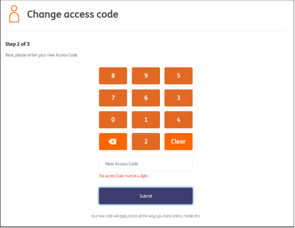

# Effective_Mitigation_Strategies_for_Authentication_and_Authorization

Source: https://www.educative.io/courses/web-application-penetration-testing/mitigation-strategies

---

[Home](https://www.educative.io/)

[Courses](https://www.educative.io/search?tab=courses)

[Web Application Penetration Testing](https://www.educative.io/courses/web-application-penetration-testing)

# Mitigation Strategies

Explore essential mitigation strategies for securing authentication and authorization mechanisms in web applications. Understand how to implement multi-factor authentication, enforce strong password practices, limit login attempts, manage server-side sessions securely, and apply the principle of least privilege to protect against common vulnerabilities.

We'll cover the following...

- [Overview](https://www.educative.io/courses/web-application-penetration-testing/mitigation-strategies#Overview)
- [Multi-factor authentication (MFA)](https://www.educative.io/courses/web-application-penetration-testing/mitigation-strategies#Multi-factor-authentication-MFA)
- [Good password practices](https://www.educative.io/courses/web-application-penetration-testing/mitigation-strategies#Good-password-practices)
- [Limits on failed logins](https://www.educative.io/courses/web-application-penetration-testing/mitigation-strategies#Limits-on-failed-logins)
- [Server-side session management](https://www.educative.io/courses/web-application-penetration-testing/mitigation-strategies#Server-side-session-management)
- [Trusted server-side policy](https://www.educative.io/courses/web-application-penetration-testing/mitigation-strategies#Trusted-server-side-policy)
- [Least privilege](https://www.educative.io/courses/web-application-penetration-testing/mitigation-strategies#Least-privilege)

## Overview[#](https://www.educative.io/courses/web-application-penetration-testing/mitigation-strategies#Overview)

Mitigating vulnerabilities stemming from faults in authentication and authorization is a critical element that developers often overlook. These vulnerabilities are some of the very first ones that hackers and pentesters start checking when they set a target, so fortifying the most common attack vectors makes sense.

## Multi-factor authentication (MFA)[#](https://www.educative.io/courses/web-application-penetration-testing/mitigation-strategies#Multi-factor-authentication-MFA)

We’ve already discussed the need for MFA earlier in this chapter. The most common form of MFA for almost all web applications available today is one-time password (OTP) codes that are sent to email accounts and phones. For example, it’s now almost impossible to create a new Google, Facebook, and Twitter account without handing them our phone number for two-factor authentication (2FA).

At a broader level, important employees of large companies are often given long, strong passwords from a password store that frequently change and a physical key card with a chip, without which they can’t gain physical entry into locations and use their company provided laptops. At some places, the laptops may also require OTP codes that are sent to the employees’ company managed phones (and numbers).

## Good password practices[#](https://www.educative.io/courses/web-application-penetration-testing/mitigation-strategies#Good-password-practices)

Passwords are integral. They may not be optimal, but in some cases, they’re the most the average user is willing to put up with. That’s why there has been a lot of work put into them. Some important points to consider are:

- Web applications should encourage users to generate strong, memorable passwords. Strong passwords are always long and personalized to the user setting them. For example, an American rancher with a sweet tooth is more likely to remember a long password such as “rockflagAndBIGjollyrancher\*.”
- Websites should place reasonable character limits for passwords. Password managers are becoming increasingly common, and as such, a character limit of 8 or even 32 just isn’t going to cut it anymore.
- Discourage users from using easy, common, or short passwords. These types of passwords make their way into **rainbow tables** (a list of common passwords) and prove disastrous. So no, variants of “password,” like “pa55w0rD,” are not secure.
- Developers should ensure that their password store at the very least employs salted hashing. Using a robust hashing algorithm is a good idea because when an attacker compromises the system, all they’ll see is hashes. These hashes are not worth much to the average hacker. However, more determined and resourceful adversaries will always have the time, power, and money to crack these hashes in due time. **Salting** refers to appending some random text to the user’s password before hashing it in an effort to ensure that the same password does not result in the same hash.
- Implement honeywords. If a hacker uses a rainbow table, passwords or hashes from known breaches, or even old passwords from the target’s own password store to log in, the target system raises an alarm, and then the system administrator can decide on a counter strategy.

These security issues should be considered in depth before deciding how to set up password authentication for our website. For a comprehensive look at what *not* to do, check out the collection at [Dumb Password Rules](https://dumbpasswordrules.com/).

Let’s look at an example from the collection of what we absolutely should not do. ING Australia, a bank, once decided that a four character long, only numerical password was good enough. For extra safety, they randomized the numbers on the keypad, but that’s not even close to the level of security required to hinder the efforts of a determined hacker.

Randomized keypad for ING Australia's access code reset screen

## Limits on failed logins[#](https://www.educative.io/courses/web-application-penetration-testing/mitigation-strategies#Limits-on-failed-logins)

Limiting login attempts will help regulate the number of times a user can try to log in to the system. Just a few attempts should be reasonable for a user who actually is who they claim to be to try out their password. When the limit is reached, a number of things can be done:

- Account login is temporarily locked.
- The system notifies the user via phone or email that log in attempts are being made.
- Temporarily enforce 2FA if the user hasn’t already enabled it.

The limit mitigates the usefulness of rainbow tables and credential stuffing and shuts down brute-force checks altogether.

Limiting account log in attempts usually rattles the average hacker

## Server-side session management[#](https://www.educative.io/courses/web-application-penetration-testing/mitigation-strategies#Server-side-session-management)

A user has to authenticate themselves by logging in to a web application. In response to successful authentication, the web application server sends a session ID back to the user in a cookie. It’s this cookie that allows the user to view their data and enables them to perform authorized actions on the web application. This is shown in the illustration below.

A simplified view of how server-side sessions work

Developers configure the server to manage the created session between the user and the system. This enables the system to detect inactivity over a period of time. If there’s no activity, the system automatically logs the user out. Care should be taken to ensure that the session ID isn’t visible to anyone but the user themselves and the server. A common pitfall is just encrypting the session ID in authentication pages and then using it out in the open; an easy sniff with Wireshark will grab that session ID for us.

## Trusted server-side policy[#](https://www.educative.io/courses/web-application-penetration-testing/mitigation-strategies#Trusted-server-side-policy)

Developers ensure that the system’s access control features are thoroughly checked so that users can only perform actions they are permitted to do. This also strengthens the separation of roles within the system so that functions don’t overlap and don’t accidentally come under the control of a user who isn’t supposed to perform them. In essence, developers should properly test their code.

## Least privilege[#](https://www.educative.io/courses/web-application-penetration-testing/mitigation-strategies#Least-privilege)

The principle of least privilege ensures that users are given the minimum level of rights required to perform tasks in a system. Going by our previous example of a blog site, a user with the “writer” role definitely does not need privileges to create and delete users in order to write articles.

Bypassing Authentication and Authorization

Quiz Yourself on Authentication and Authorization

Ask

[Overview](https://www.educative.io/courses/web-application-penetration-testing/mitigation-strategies#Overview)

[Multi-factor authentication (MFA)](https://www.educative.io/courses/web-application-penetration-testing/mitigation-strategies#Multi-factor-authentication-MFA)

[Good password practices](https://www.educative.io/courses/web-application-penetration-testing/mitigation-strategies#Good-password-practices)

[Limits on failed logins](https://www.educative.io/courses/web-application-penetration-testing/mitigation-strategies#Limits-on-failed-logins)

[Server-side session management](https://www.educative.io/courses/web-application-penetration-testing/mitigation-strategies#Server-side-session-management)

[Trusted server-side policy](https://www.educative.io/courses/web-application-penetration-testing/mitigation-strategies#Trusted-server-side-policy)

[Least privilege](https://www.educative.io/courses/web-application-penetration-testing/mitigation-strategies#Least-privilege)