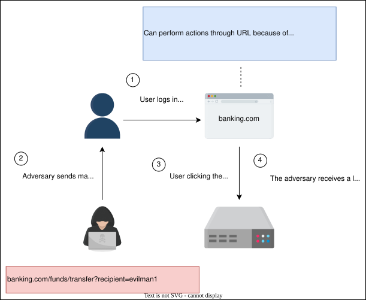

# Understanding_and_Preventing_Cross-Site_Request_Forgery_Attacks

Source: https://www.educative.io/courses/web-application-penetration-testing/cross-site-request-forgery

---

[Home](https://www.educative.io/)

[Courses](https://www.educative.io/search?tab=courses)

[Web Application Penetration Testing](https://www.educative.io/courses/web-application-penetration-testing)

# Cross-Site Request Forgery

Explore how Cross-Site Request Forgery attacks manipulate authenticated users into unintended actions on vulnerable web apps. Learn to identify link-based, form-based, and image-based CSRF methods, and apply mitigation strategies to protect web applications from these security risks.

We'll cover the following...

- [Overview](https://www.educative.io/courses/web-application-penetration-testing/cross-site-request-forgery#Overview)
- [What is a CSRF attack?](https://www.educative.io/courses/web-application-penetration-testing/cross-site-request-forgery#What-is-a-CSRF-attack)
- [Types of CSRF](https://www.educative.io/courses/web-application-penetration-testing/cross-site-request-forgery#Types-of-CSRF)
  - [Link-based CSRF](https://www.educative.io/courses/web-application-penetration-testing/cross-site-request-forgery#Link-based-CSRF)
  - [Form-based CSRF](https://www.educative.io/courses/web-application-penetration-testing/cross-site-request-forgery#Form-based-CSRF)
  - [Image-based CSRF](https://www.educative.io/courses/web-application-penetration-testing/cross-site-request-forgery#Image-based-CSRF)

## Overview[#](https://www.educative.io/courses/web-application-penetration-testing/cross-site-request-forgery#Overview)

Technological advancements have led to the development of rather sophisticated attacks. With each passing day, adversaries are mitigated, but that doesn’t stop them; they come up with new ways of circumventing security. One such act of cleverness, at least when it was first discovered, is the **cross-site request forgery (CSRF)** attack.

## What is a CSRF attack?[#](https://www.educative.io/courses/web-application-penetration-testing/cross-site-request-forgery#What-is-a-CSRF-attack)

A CSRF attack targets a user with an account on a vulnerable web application. The goal is to trick users to perform actions that they don’t intend to perform, and the approach aims to bypass the same-origin policy. This might sound similar to some other forms of attacks so let’s take a deeper look.

For a CSRF attack to be crafted, the web application should rely on cookie-based session handling. For authentication and authorization, the web application should only be looking at the cookie of the user. Any extra validation steps will greatly increase the difficulty of a CSRF attack taking place.

Let’s assume a web application, [example.com](http://example.com), is highly vulnerable to CSRF. A user is currently logged in. The web application has a simple mechanism for changing a user’s own password—a basic HTTP request that automatically includes the user’s session ID (from the cookie) and the only user-input parameter is the new password. An adversary can make a simple web page, for example, that contains a form with a hidden input field that submits a new password for the user chosen by the adversary. If the target user clicks on the web page, because the cookie is automatically picked up by the user’s browser (since they’re logged in), the user’s password will be changed to one picked by the adversary. Keep in mind that a simple check of asking the user for their current password before making the password change request will mitigate this attack.

Now imagine this happening with a banking website. The consequences could be catastrophic. This is one of the main reasons why they log us out after just a few minutes of inactivity. A further multi-factor authentication step, such as a randomly generated passcode being sent to our email or phone for verification, is also used to bolster security.

## Types of CSRF[#](https://www.educative.io/courses/web-application-penetration-testing/cross-site-request-forgery#Types-of-CSRF)

As with most bad things, CSRF comes in a range of flavors. Let’s look at some of the most common approaches.

### Link-based CSRF[#](https://www.educative.io/courses/web-application-penetration-testing/cross-site-request-forgery#Link-based-CSRF)

The attacker creates a malicious link that, when clicked by the victim, causes the victim’s browser to send a request to the target web application. Some form of phishing is often necessary to get the malicious link to target users, either through email, instant messaging, social media posts, or even strategically placed ads.

Let’s look at an example. Assume that there’s a banking website that uses the `GET` method to make requests. The request automatically picks up the logged-in user’s cookie session ID. This means that actions such as transferring funds can take place by just entering the URL if the user is logged in. An attacker can simply send a URL to the user that, if clicked, sends a request to the bank website’s server to conduct an online funds transfer to the attacker’s account. This is illustrated below.



A simplified example of a link-based CSRF attack

### Form-based CSRF[#](https://www.educative.io/courses/web-application-penetration-testing/cross-site-request-forgery#Form-based-CSRF)

This approach targets the `POST` method. Simply sending an edited URL of the vulnerable web application isn’t enough. A web page has to be created by the adversary with a form and hidden elements that input values on behalf of the user. Yes, the scenario we discussed earlier about password changing is a form-based CSRF attack. It’s illustrated below.


Form-based attack illustration

### Image-based CSRF[#](https://www.educative.io/courses/web-application-penetration-testing/cross-site-request-forgery#Image-based-CSRF)

The same principles and vectors as link-based and form-based CSRF apply here. Instead of just a malicious URL or web page, it’s simply an image with a malicious link set as its `src` attribute. When the image loads, the attack is automatically performed.

How is the image used, though? It can simply be sent to the target user by email. With some sharp thinking and research, other methods can also be tried. For example, assume that there’s a bustling forum at [xyz.com](http://xyz.com). After minimal research, we realize that a good number of forum visitors would probably have bank accounts with Best XYZ Bank Int. The forum post editor allows for raw HTML styling. An adversary simply posts the following and will be rich:

```
Hello guys! I'm new here lol


```

Visitors who view our post won’t see the image but they *will* lose a cool $100.

Quiz Yourself on Authentication and Authorization

Exploiting and Finding CSRF Vulnerabilities

Ask

[Overview](https://www.educative.io/courses/web-application-penetration-testing/cross-site-request-forgery#Overview)

[What is a CSRF attack?](https://www.educative.io/courses/web-application-penetration-testing/cross-site-request-forgery#What-is-a-CSRF-attack)

[Types of CSRF](https://www.educative.io/courses/web-application-penetration-testing/cross-site-request-forgery#Types-of-CSRF)

[Link-based CSRF](https://www.educative.io/courses/web-application-penetration-testing/cross-site-request-forgery#Link-based-CSRF)

[Form-based CSRF](https://www.educative.io/courses/web-application-penetration-testing/cross-site-request-forgery#Form-based-CSRF)

[Image-based CSRF](https://www.educative.io/courses/web-application-penetration-testing/cross-site-request-forgery#Image-based-CSRF)