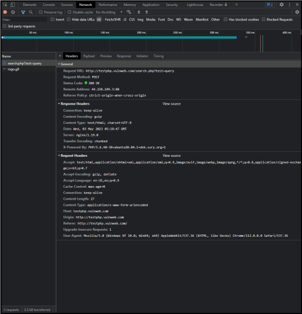

# Discover_How_to_Find_and_Exploit_CSRF_Vulnerabilities

Source: https://www.educative.io/courses/web-application-penetration-testing/exploiting-and-finding-csrf-vulnerabilities

---

[Home](https://www.educative.io/)

[Courses](https://www.educative.io/search?tab=courses)

[Web Application Penetration Testing](https://www.educative.io/courses/web-application-penetration-testing)

# Exploiting and Finding CSRF Vulnerabilities

Explore methods to identify and exploit Cross-Site Request Forgery vulnerabilities through manual testing and automation. Understand the use of key tools such as Burp Suite, OWASP ZAP, and Wireshark. Practice attacking vulnerable web applications to recognize how CSRF works and learn mitigation approaches to strengthen web app security.

We'll cover the following...

- [Overview](https://www.educative.io/courses/web-application-penetration-testing/exploiting-and-finding-csrf-vulnerabilities#Overview)
- [Discovering CSRF vulnerabilities](https://www.educative.io/courses/web-application-penetration-testing/exploiting-and-finding-csrf-vulnerabilities#Discovering-CSRF-vulnerabilities)
- [Tools for discovering CSRF vulnerabilities](https://www.educative.io/courses/web-application-penetration-testing/exploiting-and-finding-csrf-vulnerabilities#Tools-for-discovering-CSRF-vulnerabilities)
- [Practice](https://www.educative.io/courses/web-application-penetration-testing/exploiting-and-finding-csrf-vulnerabilities#Practice)
  - [Finding a CSRF vulnerability](https://www.educative.io/courses/web-application-penetration-testing/exploiting-and-finding-csrf-vulnerabilities#Finding-a-CSRF-vulnerability)
  - [Changing a user’s username through CSRF](https://www.educative.io/courses/web-application-penetration-testing/exploiting-and-finding-csrf-vulnerabilities#Changing-a-users-username-through-CSRF)

## Overview[#](https://www.educative.io/courses/web-application-penetration-testing/exploiting-and-finding-csrf-vulnerabilities#Overview)

We’ve discussed what CSRF is and its various types. We’ve looked at a few simple examples as well. It’s now time to learn how to test for this vulnerability, automate the process, and do a bit of practice.

## Discovering CSRF vulnerabilities[#](https://www.educative.io/courses/web-application-penetration-testing/exploiting-and-finding-csrf-vulnerabilities#Discovering-CSRF-vulnerabilities)

The standard methods for discovering CSRF vulnerabilities include:

- **Manual testing:** This involves manually sending requests to the web application and analyzing the responses to determine if the application is vulnerable to CSRF attacks. Tools such as Wireshark and Burp Suite are often invaluable in this case.
- **Using a tool:** Tools such as OWASP ZAP and Burp Suite have a fair success rate when it comes to discovering CSRF vulnerabilities automatically.
- **Static code analysis:** This involves reviewing the source code of the web application to identify any potential vulnerabilities. This can be done manually or by using an analysis tool.

## Tools for discovering CSRF vulnerabilities[#](https://www.educative.io/courses/web-application-penetration-testing/exploiting-and-finding-csrf-vulnerabilities#Tools-for-discovering-CSRF-vulnerabilities)

Using tools can often save time and help in catching vulnerabilities manual testing might sometimes miss. As such, it’s imperative that we provide a brief list of some popular choices:

- **Burp Suite:** This is a widely used web application security testing tool with several features for testing CSRF vulnerabilities. It allows us to intercept and modify HTTP requests and analyze responses to identify potential vulnerabilities.
- **OWASP ZAP (Zed Attack Proxy):** This also allows us to intercept and modify HTTP requests and analyze responses. Being open source is a huge plus as well.
- **Wireshark:** Wireshark’s capability of capturing individual packets and showing the request being sent in detail can often provide lots of clues.

Tools are nice, but at the end of the day, being overreliant on them spells bad news. A combination of certain tools and some manual digging is always a good approach to finding vulnerabilities.

## Practice[#](https://www.educative.io/courses/web-application-penetration-testing/exploiting-and-finding-csrf-vulnerabilities#Practice)

Let’s now perform some basic CSRF attacks so we can truly understand how they work.

### Finding a CSRF vulnerability[#](https://www.educative.io/courses/web-application-penetration-testing/exploiting-and-finding-csrf-vulnerabilities#Finding-a-CSRF-vulnerability)

We’ve already used [Acunetix’s vulnerable web application](http://testphp.vulnweb.com/) for several previous test cases. Let’s now use it once more:

1. Open the website’s home page, <http://testphp.vulnweb.com/>, in your own browser.
2. Open the DevTools and then the “Networks” tab.
3. Search for any query in the search field in the sidebar of the site. We’ve gone with `hello`.
4. Click `search.php?test=query` to show the request sent and the response received. We’re interested in the request. Another point of interest is the contents of the “Payloads” tab. Refer to the image below for what should be visible.



The output on the Chrome browser

5. Because there don’t seem to be any anti-CSRF tokens (more on this later), unpredictable parameters, or even any authentication or authorization checks with a cookie (reasonable since we haven’t logged in), we can assume that a form-based CSRF attack is possible. Try this while logged in: use `test` for both the username and the password.
6. We make a simple web page called `csrftest.html`, the content of which we can view below. We won’t serve it. We’ll simply open it directly in the browser and verify with Wireshark. Click the “Run” button below, and the playground will open up. Chrome and Wireshark will launch. Recall our Wireshark fundamentals, the filter packets for the IP address `44.228.249.3`, which corresponds to Acunetix’s test website. Then open our custom web page in Chrome with `/usercode/csrftest.html` in the URL field. If we click the “Contact us!” button, we might see the page redirect to the target website. We can also verify the `POST` with Wireshark by looking up the relevant packet.

> **Note:** For this to work with a logged-in user, we’ll first have to have a tab open while logged in and then open `crsftest.html`.

```
<html>
  <body>
    <h1>Congrats! You have won the lottery.</h1>
    <script>history.pushState(",", "/")</script>
    <form action="http://testphp.vulnweb.com/search.php?test=query" method="POST">
      <input type="hidden" name="searchFor" value="This is a CSRF test.">
      <input type="hidden" name="goButton" value="go">
      <input type="submit" value="Contact us!">
    </form>
  </body>
</html>
```

Playground for Chrome and Wireshark

The illustration below shows what we should see when we find the relevant packet in Wireshark. We could also further filter the packets for the `HTTP` protocol.


The relevant packet in Wireshark

### Changing a user’s username through CSRF[#](https://www.educative.io/courses/web-application-penetration-testing/exploiting-and-finding-csrf-vulnerabilities#Changing-a-users-username-through-CSRF)

For this exercise, we’ll go back to Juice Shop yet again. The goal here is to log in as any of the users already registered on the web application and change their username to one of our own choosing. Let’s get started:

1. If we went through the SQL injection section and retrieved the list of credentials of all the users, we’ll have a test subject ready (if, of course, we also cracked the passwords afterward). To speed things up, we’ll use Jim as our example. After opening Juice Shop, log in with `jim@juice-sh.op` and `ncc-1701`. Go the profile page, and edit Jim’s username to whatever you like.
2. In your browser, open a new tab and go to the <http://htmledit.squarefree.com> website. Paste the contents of `csrftest.html` in the upper frame of the page. In the lower frame, you’ll see either a blank page or an error message.
3. In Juice Shop, navigate to Jim’s profile page. We’ll see that it’ll now say “Jimothy” under the avatar.

> **Note:** This works well with Chrome and Firefox. Also, we used the third-party website because it’s required by Juice Shop. Realistically, an adversary would be using their own malicious web application and sending out the link to their target.

```
<form action="{{EDUCATIVE_LIVE_VM_URL}}/profile" method="POST">
  <input name="username" value="Jimothy"/>
  <input type="submit"/>
</form>
<script>document.forms[0].submit();</script>
```

Playground with Juice Shop

Cross-Site Request Forgery

Mitigation of Cross-Site Request Forgery

Ask

[Overview](https://www.educative.io/courses/web-application-penetration-testing/exploiting-and-finding-csrf-vulnerabilities#Overview)

[Discovering CSRF vulnerabilities](https://www.educative.io/courses/web-application-penetration-testing/exploiting-and-finding-csrf-vulnerabilities#Discovering-CSRF-vulnerabilities)

[Tools for discovering CSRF vulnerabilities](https://www.educative.io/courses/web-application-penetration-testing/exploiting-and-finding-csrf-vulnerabilities#Tools-for-discovering-CSRF-vulnerabilities)

[Practice](https://www.educative.io/courses/web-application-penetration-testing/exploiting-and-finding-csrf-vulnerabilities#Practice)

[Finding a CSRF vulnerability](https://www.educative.io/courses/web-application-penetration-testing/exploiting-and-finding-csrf-vulnerabilities#Finding-a-CSRF-vulnerability)

[Changing a user’s username through CSRF](https://www.educative.io/courses/web-application-penetration-testing/exploiting-and-finding-csrf-vulnerabilities#Changing-a-users-username-through-CSRF)