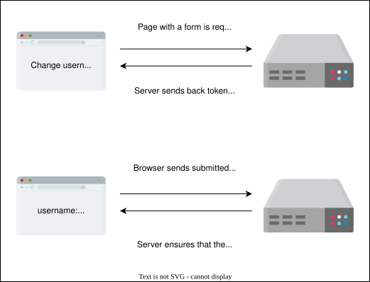
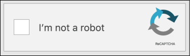

# Mitigation_Techniques_for_Cross-Site_Request_Forgery_Attacks

Source: https://www.educative.io/courses/web-application-penetration-testing/mitigation-of-cross-site-request-forgery

---

[Home](https://www.educative.io/)

[Courses](https://www.educative.io/search?tab=courses)

[Web Application Penetration Testing](https://www.educative.io/courses/web-application-penetration-testing)

# Mitigation of Cross-Site Request Forgery

Explore strategies to defend web applications against Cross-Site Request Forgery by understanding anti-CSRF tokens, browser-based cookie protections like SameSite, and implementing strong CAPTCHA challenges to verify user authenticity.

We'll cover the following...

- [Overview](https://www.educative.io/courses/web-application-penetration-testing/mitigation-of-cross-site-request-forgery#Overview)
- [Anti-CSRF tokens](https://www.educative.io/courses/web-application-penetration-testing/mitigation-of-cross-site-request-forgery#Anti-CSRF-tokens)
- [SameSite cookies](https://www.educative.io/courses/web-application-penetration-testing/mitigation-of-cross-site-request-forgery#SameSite-cookies)
- [CAPTCHA controls](https://www.educative.io/courses/web-application-penetration-testing/mitigation-of-cross-site-request-forgery#CAPTCHA-controls)

## Overview[#](https://www.educative.io/courses/web-application-penetration-testing/mitigation-of-cross-site-request-forgery#Overview)

From the practice session, we have developed an understanding of the sort of damage CSRF attacks can cause. Thankfully, protecting web applications against CSRF is rather simple. Let’s look at the various methods of mitigation.

## Anti-CSRF tokens[#](https://www.educative.io/courses/web-application-penetration-testing/mitigation-of-cross-site-request-forgery#Anti-CSRF-tokens)

Each **anti-CSRF token** is a random, unique, and secret value with a short expiration time that’s generated on the server and then shared with the client. User actions, such as form submissions, ask the client to include the correct anti-CSRF token in the request for a successful response. Without the token, the attacker can’t really do anything.

If poor coding or design practices have been employed, a crafty adversary could probably remove the use of the token or its requirement altogether or even use the token of another compromised account. A very brief example would be a web application using anti-CSRF tokens with the `GET` method. The adversary could then clearly see the token and simply use it themselves.

How anti-CSRF tokens work

## SameSite cookies[#](https://www.educative.io/courses/web-application-penetration-testing/mitigation-of-cross-site-request-forgery#SameSite-cookies)

Modern browsers have come a long way in terms of security. **SameSite cookies** are one such way a browser actively guards users against harm. SameSite settings prevent the browser from sending cookies along with cross-site requests. For example, assume that we’re logged in to Facebook and that the SameSite value is set to `strict`. This means if we’re browsing TikTok and find a link sending us to a Facebook page and liking it, SameSite will not allow this.

## CAPTCHA controls[#](https://www.educative.io/courses/web-application-penetration-testing/mitigation-of-cross-site-request-forgery#CAPTCHA-controls)

We can use various methods to implement strong CAPTCHA controls, such as displaying a distorted image or audio file that a human can easily decipher but a computer cannot. The CAPTCHA can also ask the user to answer a simple question or solve a puzzle. Another option is to use a third-party CAPTCHA service, such as Google’s reCAPTCHA, which provides various CAPTCHA options and is regularly updated to prevent automated attacks.

Now we know why we keep seeing this

Exploiting and Finding CSRF Vulnerabilities

Quiz Yourself on Cross-Site Request Forgery

Ask

[Overview](https://www.educative.io/courses/web-application-penetration-testing/mitigation-of-cross-site-request-forgery#Overview)

[Anti-CSRF tokens](https://www.educative.io/courses/web-application-penetration-testing/mitigation-of-cross-site-request-forgery#Anti-CSRF-tokens)

[SameSite cookies](https://www.educative.io/courses/web-application-penetration-testing/mitigation-of-cross-site-request-forgery#SameSite-cookies)

[CAPTCHA controls](https://www.educative.io/courses/web-application-penetration-testing/mitigation-of-cross-site-request-forgery#CAPTCHA-controls)