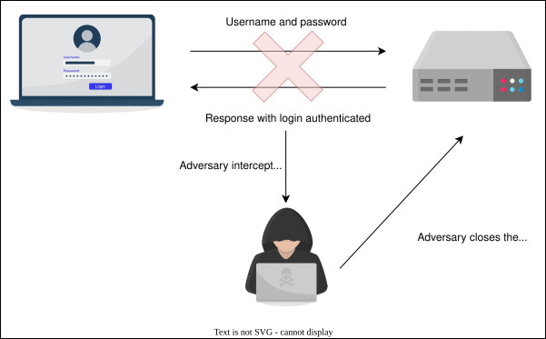

# Man-in-the-Middle_Attacks_and_Network_Interception_Techniques

Source: https://www.educative.io/courses/web-application-penetration-testing/man-in-the-middle-mitm-attacks

---

[Home](https://www.educative.io/)

[Courses](https://www.educative.io/search?tab=courses)

[Web Application Penetration Testing](https://www.educative.io/courses/web-application-penetration-testing)

# Man-in-the-Middle (MITM) Attacks

Explore man-in-the-middle (MITM) attacks to understand how attackers intercept and decrypt network traffic. Learn key interception techniques like IP spoofing, ARP spoofing, and DNS spoofing. Understand how attackers bypass HTTPS security through methods such as HTTPS spoofing and SSL hijacking. This lesson equips you to identify vulnerabilities in network communications and apply effective mitigation strategies.

We'll cover the following...

- [TLS and HTTPS](https://www.educative.io/courses/web-application-penetration-testing/man-in-the-middle-mitm-attacks#TLS-and-HTTPS)
- [The MITM attack](https://www.educative.io/courses/web-application-penetration-testing/man-in-the-middle-mitm-attacks#The-MITM-attack)
  - [Interception](https://www.educative.io/courses/web-application-penetration-testing/man-in-the-middle-mitm-attacks#Interception)
    - [IP spoofing](https://www.educative.io/courses/web-application-penetration-testing/man-in-the-middle-mitm-attacks#IP-spoofing)
    - [Address Resolution Protocol (ARP) spoofing](https://www.educative.io/courses/web-application-penetration-testing/man-in-the-middle-mitm-attacks#Address-Resolution-Protocol-ARP-spoofing)
    - [DNS spoofing](https://www.educative.io/courses/web-application-penetration-testing/man-in-the-middle-mitm-attacks#DNS-spoofing)
  - [Decryption](https://www.educative.io/courses/web-application-penetration-testing/man-in-the-middle-mitm-attacks#Decryption)
    - [HTTPS spoofing](https://www.educative.io/courses/web-application-penetration-testing/man-in-the-middle-mitm-attacks#HTTPS-spoofing)
    - [SSL hijacking](https://www.educative.io/courses/web-application-penetration-testing/man-in-the-middle-mitm-attacks#SSL-hijacking)

## TLS and HTTPS[#](https://www.educative.io/courses/web-application-penetration-testing/man-in-the-middle-mitm-attacks#TLS-and-HTTPS)

**Transport Layer Security (TLS)** is a cryptographic protocol that allows client-server applications to communicate across different network nodes to prevent eavesdropping and tampering in the computer network setup. Before the advent of TLS, unless specifically designed, applications and sites sent data over the internet openly. Any unethical person could simply intercept those packets and have a fun day.

Nowadays, web developers should ensure that all client-server communication is done over HTTPS, which uses the TLS protocol. Generally, if we see a website running on just HTTP, the only correct course of action is to either run away or use the website inside a properly configured virtual machine.

## The MITM attack[#](https://www.educative.io/courses/web-application-penetration-testing/man-in-the-middle-mitm-attacks#The-MITM-attack)

The adversary positions themselves in the network in such a way that the communication between a user and a web application can be eavesdropped upon. This can also be extended to intercept the communications and masquerade as either party in order to gain sensitive information. As such, here the hacker is, quite literally, a man (person) in the middle.

Man-in-the-middle (MITM) attacks are easiest to perform with unencrypted communications and also if we’re present in the same network as our target. We’ll notice that we’ve already performed a basic MITM attack with Wireshark.

Before diving deeper, let’s look at a simple MITM attack. Assume we’ve found an old forum running on HTTP and decided to sign up. An adversary using the same Wi-Fi as us can simply intercept our communications with the website. Therefore, when we try to log in, the adversary captures our credentials and uses them to log in themselves. This is illustrated below.

A basic MITM attack; a smart user might catch on if the attacker is hasty

A successful MITM attack covers two independent stages: interception and decryption. Let’s look at both in detail.

### Interception[#](https://www.educative.io/courses/web-application-penetration-testing/man-in-the-middle-mitm-attacks#Interception)

The initial stage involves intercepting the target’s traffic across the network before traffic reaches its destination.

By distributing free, malicious Wi-Fi hotspots among the general population, an attacker can carry out a passive attack, which is the most typical (and straightforward) method of achieving this. They usually don’t have password protection, and their names generally match where they are. For example, an attacker can set up a Wi-Fi hotspot called “Starbucks-WiFi” at, well, a Starbucks. Once a victim connects to one of these hotspots, the attacker can access any online data transfer.

Attackers who want to engage in more direct interception may carry out one of the following methods.

#### IP spoofing[#](https://www.educative.io/courses/web-application-penetration-testing/man-in-the-middle-mitm-attacks#IP-spoofing)

In **IP spoofing**, the source IP address of a packet is changed to make it appear as though it originated from a different device or network. Because network devices don’t always authenticate or verify IP addresses, this attack is feasible for devices used in the network. An attacker can conceal their genuine name and location by simply changing the source IP address of a packet, making it challenging to identify them as the source of the attack.

There are several potential motivations for IP spoofing attacks, including:

- **Hiding the attacker’s identity:** By disguising the packet’s source, the attacker can make it more difficult for defenders to trace the attack back to them.
- **Amplifying the attack:** Using a spoofed IP address, an attacker can make it appear as if the attack were coming from multiple sources, making it more difficult to defend against.
- **Bypassing security controls:** Some security controls, such as network firewalls, may be configured to allow traffic from specific IP addresses and block traffic from others. By spoofing the source IP address of a packet, an attacker can bypass these controls and gain access to a system or network.

With spoofed source IP addresses, the web server assumes that it's communicating with a trusted party

#### Address Resolution Protocol (ARP) spoofing[#](https://www.educative.io/courses/web-application-penetration-testing/man-in-the-middle-mitm-attacks#Address-Resolution-Protocol-ARP-spoofing)

**Address Resolution Protocol (ARP)** is a protocol used by devices on a LAN to map the IP addresses of other devices to their corresponding MAC addresses. **ARP spoofing**, also known as **ARP poisoning** or **ARP cache poisoning**, is a type of attack in which an adversary sends fake or forged ARP messages to a network. By doing this, an attacker can effectively redirect traffic from one device to another, allowing them to intercept, modify, or block the traffic.

There are several potential motivations for ARP spoofing attacks, including:

- **Hijacking network traffic:** By redirecting traffic from one device to another, an attacker can intercept sensitive information transmitted across the network.
- **Disrupting network communications:** An attacker can use ARP spoofing to disrupt network communications, causing devices to become disconnected or unable to communicate with each other.

As a result of the poisoning, User A now thinks the adversary is User B, and User B thinks the adversary is User A

If we enter `arp -a` in the terminal, then we’ll be able to look at the ARP table. Of course, running the command in our terminal is going to show just one device—the one we’re interacting with.

#### DNS spoofing[#](https://www.educative.io/courses/web-application-penetration-testing/man-in-the-middle-mitm-attacks#DNS-spoofing)

**DNS spoofing**, often called **DNS cache poisoning**, is an attack in which an adversary modifies the DNS server’s domain name to IP address mapping. By changing this, a hacker can divert users from trustworthy websites to malicious ones, where their private data can be taken.

There are a couple of other motivations as well for DNS spoofing attacks, including:

- **Distributed denial-of-service (DDoS) attacks:** DNS spoofing can be used to launch DDoS attacks, where many fake or malicious requests are sent to a website, overwhelming the server and making it unavailable to legitimate users.
- **Malware distribution:** An attacker can use DNS spoofing to redirect users from legitimate websites to websites that contain malware, allowing the attacker to infect their devices and steal sensitive information.

Any time the user tries to visit example.com, they will be redirected to examples.net

### Decryption[#](https://www.educative.io/courses/web-application-penetration-testing/man-in-the-middle-mitm-attacks#Decryption)

Any two-way SSL traffic that has been intercepted needs to be decrypted without notifying the user or application. There are several ways to do this:

#### HTTPS spoofing[#](https://www.educative.io/courses/web-application-penetration-testing/man-in-the-middle-mitm-attacks#HTTPS-spoofing)

**HTTPS spoofing** is a type of attack in which an adversary uses fake or malicious certificates to impersonate a legitimate website and steal sensitive information from unsuspecting users. This attack is possible because HTTPS relies on digital certificates to authenticate the website’s identity and encrypt the data transmitted between the user’s computer and the website. In an HTTPS spoofing attack, the attacker creates a fake or malicious certificate that appears legitimate and uses it to set up a fake website that looks and behaves just like the real thing. When users try to access a legitimate website, they are instead directed to a fake website, where their sensitive information can be stolen.

#### SSL hijacking[#](https://www.educative.io/courses/web-application-penetration-testing/man-in-the-middle-mitm-attacks#SSL-hijacking)

**SSL hijacking**, often referred to as **SSL stripping**, occurs when an adversary intercepts and alters data being communicated between a user’s web browser and a website. In an SSL hijack, the attacker first discreetly disrupts communications, intercepting the packets from the user. They then forward those encrypted packets to the intended server. The server responds, which the attacker then mimics with HTTP and sends back to the user. The illustration below provides an example of this process.

SSL hijacking is usually performed in conjunction with other attacks, such as phishing and the distribution of malware.

How SSL hijacking is performed

Social-Engineer Toolkit (SET)

A Deeper Look at Phishing

Ask

[TLS and HTTPS](https://www.educative.io/courses/web-application-penetration-testing/man-in-the-middle-mitm-attacks#TLS-and-HTTPS)

[The MITM attack](https://www.educative.io/courses/web-application-penetration-testing/man-in-the-middle-mitm-attacks#The-MITM-attack)

[Interception](https://www.educative.io/courses/web-application-penetration-testing/man-in-the-middle-mitm-attacks#Interception)

[IP spoofing](https://www.educative.io/courses/web-application-penetration-testing/man-in-the-middle-mitm-attacks#IP-spoofing)

[Address Resolution Protocol (ARP) spoofing](https://www.educative.io/courses/web-application-penetration-testing/man-in-the-middle-mitm-attacks#Address-Resolution-Protocol-ARP-spoofing)

[DNS spoofing](https://www.educative.io/courses/web-application-penetration-testing/man-in-the-middle-mitm-attacks#DNS-spoofing)

[Decryption](https://www.educative.io/courses/web-application-penetration-testing/man-in-the-middle-mitm-attacks#Decryption)

[HTTPS spoofing](https://www.educative.io/courses/web-application-penetration-testing/man-in-the-middle-mitm-attacks#HTTPS-spoofing)

[SSL hijacking](https://www.educative.io/courses/web-application-penetration-testing/man-in-the-middle-mitm-attacks#SSL-hijacking)