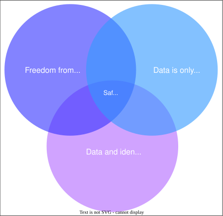

# Understanding_Security,_Privacy,_and_Anonymity_in_Web_Applications

Source: https://www.educative.io/courses/web-application-penetration-testing/security-anonymity-and-privacy

---

[Home](https://www.educative.io/)

[Courses](https://www.educative.io/search?tab=courses)

[Web Application Penetration Testing](https://www.educative.io/courses/web-application-penetration-testing)

# Security, Anonymity, and Privacy

Explore how security, anonymity, and privacy intersect in web applications. Learn about methods such as Tor networks, VPNs, proxy servers, and encrypted mail to limit tracking and enhance online anonymity. Understand the challenges of auditing and securing web traffic while maintaining privacy and how these tools help protect user data from surveillance and malicious actors.

We'll cover the following...

- [Relationship between security, anonymity, and privacy](https://www.educative.io/courses/web-application-penetration-testing/security-anonymity-and-privacy#Relationship-between-security-anonymity-and-privacy)
- [How does the internet track our activities?](https://www.educative.io/courses/web-application-penetration-testing/security-anonymity-and-privacy#How-does-the-internet-track-our-activities)
  - [Onion network](https://www.educative.io/courses/web-application-penetration-testing/security-anonymity-and-privacy#Onion-network)
    - [Tor project](https://www.educative.io/courses/web-application-penetration-testing/security-anonymity-and-privacy#Tor-project)
  - [Proxy server](https://www.educative.io/courses/web-application-penetration-testing/security-anonymity-and-privacy#Proxy-server)
  - [Virtual private network (VPN)](https://www.educative.io/courses/web-application-penetration-testing/security-anonymity-and-privacy#Virtual-private-network-VPN)
    - [Types of VPNs](https://www.educative.io/courses/web-application-penetration-testing/security-anonymity-and-privacy#Types-of-VPNs)
  - [Private encrypted mail](https://www.educative.io/courses/web-application-penetration-testing/security-anonymity-and-privacy#Private-encrypted-mail)
- [Other resources](https://www.educative.io/courses/web-application-penetration-testing/security-anonymity-and-privacy#Other-resources)

## Relationship between security, anonymity, and privacy[#](https://www.educative.io/courses/web-application-penetration-testing/security-anonymity-and-privacy#Relationship-between-security-anonymity-and-privacy)

Security is an essential aspect of every web application developed today. Software developers must always ensure that their systems are secure and not prone to breaches by adversaries. As users interact with different web applications, their activities on the internet might be tracked by other external web applications and security agencies. This raises questions of privacy and anonymity. Why do these external powers get to see more of our data than necessary, and how do we stop them? Why do these external entities keep tracking us across the web and undermining our anonymity?

As such, security, privacy, and anonymity come together and feed into each other to create a safe environment.

We can only have a safe application or network when we have all three features

We can try to limit the tracking of our activities on the internet using the following four tools and methods:

- Onion network
- Proxy servers
- Virtual private network (VPN)
- Private encrypted mail

Hackers try as much as possible to use the methods above to keep their activities secret when browsing so that they can mask their illegal activities. This, in turn, can make the auditing of web applications and their security standards rather difficult.

## How does the internet track our activities?[#](https://www.educative.io/courses/web-application-penetration-testing/security-anonymity-and-privacy#How-does-the-internet-track-our-activities)

IP addresses are included in each packet sent over the internet, together with the source and destination data. Once a packet locates its destination server, it hops over various routers along its path. Depending on certain factors, these hops can be as many as 20 to 30, but usually, the hops tend to be less than 15. Because these different packets traverse the internet from the source to the destination, anyone can intercept them and read where they’re coming from and where they’re going. This is how websites can automatically tell who we are and log our activities. This principle is used in various forms of tracking processes. We’ve already seen how easy it is to get this information through Wireshark and how third-party ads keep tabs on users.

Let’s see how we can mitigate the tracking process. These aren’t surefire methods and tools but, in certain combinations, they prove quite useful.

### Onion network[#](https://www.educative.io/courses/web-application-penetration-testing/security-anonymity-and-privacy#Onion-network)

The US Office of Naval Research developed the Onion network project to enable them to send encrypted information easily through the internet. This was a plan to separate their traffic from the standard internet routers that could encrypt the traffic as it traversed through the different routers in the internet. Therefore, anyone watching their traffic could not determine the origin or destination of the packets. This research was known as the Onion Router (Tor) Project in 2002. It has been available to the general public and has proved to be a relatively safe and decently anonymous way to navigate the internet.

#### Tor project[#](https://www.educative.io/courses/web-application-penetration-testing/security-anonymity-and-privacy#Tor-project)

The Tor browser has made it challenging to identify the source and destination of users’ data. A packet delivered over the internet is routed through many routers worldwide rather than following the usual convection of the traffic flow. Each packet generated by Tor also has its data, destination, and sender IP address encrypted. This means that instead of the origin’s IP address, each packet sent over Tor carries information about the previous hop along the path. Therefore, if the data is intercepted, only the previous hop will be visible to the interceptor. The website owner will only be able to view the IP address of the last router or device that provided the traffic, often guaranteeing internet anonymity.

Keep in mind that it’s often recommended to keep the Tor browser and VPNs separate from each other, though advanced users can glean some benefits from using both together. Also, honeypots may exist in the form of compromised entry and exit nodes. While thi not an immediate threat, users could eventually be identified through correlation techniques. As such, we need to ensure that we go through the [user manual](https://tb-manual.torproject.org/) before messing around with the Tor browser.

Let’s now look a bit more closely at how Tor works. In the Tor network, there are millions of connected devices called nodes or relays. When we want to visit [example.com](http://example.com), Tor will randomly choose a path of relays and forward all the packets through it. The last relay is called the exit relay; it provides our data to [example.com](http://example.com). The website then responds to our request. This response is then sent along the same path back to us. Any compromised relay in the middle attempting to crack our data won’t be able to do so without the assistance of all the other relays in the path. If we decide to visit [examples.net](http://examples.net) next, Tor will choose a new path. This is illustrated below:

1 / 3

Tor takes a layered approach; hence, the inclusion of Onion

1 / 3

1 / 3

### Proxy server[#](https://www.educative.io/courses/web-application-penetration-testing/security-anonymity-and-privacy#Proxy-server)

We covered proxy servers in detail earlier in the course.

There might be cases where using a VPN may prove costly or too overbearing, and using the Tor browser may mark us as a suspicious user. This is where simple proxies come in. Just remember that free, open proxies are generally not safe.

### Virtual private network (VPN)[#](https://www.educative.io/courses/web-application-penetration-testing/security-anonymity-and-privacy#Virtual-private-network-VPN)

An encrypted link from the source computer to the destination computer over the internet is known as a **virtual private network (VPN)**. Essentially, it’s used to create a private tunnel that masks our data and separates it from its source, i.e., us. A VPN hides our IP address, and all the data being received on the internet from a VPN generally can’t be traced back to us unless the VPN service provider gives up our logs. That’s why it’s important that we select safe and reliable VPN service providers, especially ones that don’t keep logs.

Adversaries use VPNs to encrypt their traffic and maintain online anonymity. As a web penetration tester, understanding how a VPN functions from an adversary’s perspective is crucial in the event of a breach.

A VPN client on our device ensures that our data is encrypted and nobody can see it. The VPN server, which is usually in another country than ours, then forwards our data to our destination website so we can interact with it. To the destination website, the data looks like it came from a source other than us.

Between the VPN client and server, our ISP cannot read our data nor match it to us

#### Types of VPNs[#](https://www.educative.io/courses/web-application-penetration-testing/security-anonymity-and-privacy#Types-of-VPNs)

Some common types of VPNs include:

- **Remote access VPNs:** These VPNs allow users to connect to the internet and access their company’s or institution’s network remotely, such as from home or while traveling.
- **Site-to-site VPNs:** These VPNs connect two or more networks, such as a company’s main office network and a branch office network, allowing users on each network to access the other network as if they were directly connected.
- **Mobile VPNs:** These VPNs are designed for mobile devices, such as smartphones and tablets. They provide secure access to the internet for users who’re on the go.
- **Virtual LAN (VLAN) VPNs:** These VPNs use VLANs to segment networks and create logical subnetworks within a more extensive network. This allows users on different subnetworks to communicate with each other as if they were on the same network. These are quite popular when it comes to playing pirated games online.

There are other types as well, but they’re generally just used in special scenarios.

### Private encrypted mail[#](https://www.educative.io/courses/web-application-penetration-testing/security-anonymity-and-privacy#Private-encrypted-mail)

Unlike major email services, such as Gmail and Outlook, email services like [Proton Mail](https://proton.me/) allow users to send and receive emails through publicly audited encryption protocols. Their users can know for sure that their communication is indeed visible only to themselves and their intended recipients instead of just relying on the words of large corporations. The same advantage as good VPN service providers applies here; these service providers will not give up our data to law enforcement and governments when threatened.

We could also set up our own private email servers, but do keep in mind that misconfigurations will cost us dearly.

## Other resources[#](https://www.educative.io/courses/web-application-penetration-testing/security-anonymity-and-privacy#Other-resources)

Service providers and software alike keep evolving with time. What were once reliable and safe services or applications may not be as such anymore, either due to being bought out, not maintaining standards, or just getting caught lying to customers.

If we value our security, anonymity, and privacy, then we have to be on top of this.

Quiz Yourself on Social Engineering

Denial-of-Service

Ask

[Relationship between security, anonymity, and privacy](https://www.educative.io/courses/web-application-penetration-testing/security-anonymity-and-privacy#Relationship-between-security-anonymity-and-privacy)

[How does the internet track our activities?](https://www.educative.io/courses/web-application-penetration-testing/security-anonymity-and-privacy#How-does-the-internet-track-our-activities)

[Onion network](https://www.educative.io/courses/web-application-penetration-testing/security-anonymity-and-privacy#Onion-network)

[Tor project](https://www.educative.io/courses/web-application-penetration-testing/security-anonymity-and-privacy#Tor-project)

[Proxy server](https://www.educative.io/courses/web-application-penetration-testing/security-anonymity-and-privacy#Proxy-server)

[Virtual private network (VPN)](https://www.educative.io/courses/web-application-penetration-testing/security-anonymity-and-privacy#Virtual-private-network-VPN)

[Types of VPNs](https://www.educative.io/courses/web-application-penetration-testing/security-anonymity-and-privacy#Types-of-VPNs)

[Private encrypted mail](https://www.educative.io/courses/web-application-penetration-testing/security-anonymity-and-privacy#Private-encrypted-mail)

[Other resources](https://www.educative.io/courses/web-application-penetration-testing/security-anonymity-and-privacy#Other-resources)