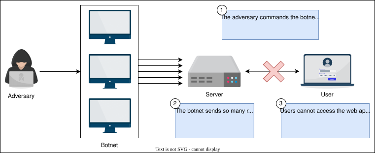

# Understanding_Denial_of_Service_Attacks_in_Web_Security

Source: https://www.educative.io/courses/web-application-penetration-testing/denial-of-service

---

[Home](https://www.educative.io/)

[Courses](https://www.educative.io/search?tab=courses)

[Web Application Penetration Testing](https://www.educative.io/courses/web-application-penetration-testing)

# Denial-of-Service

Explore the concept of denial-of-service (DoS) attacks and understand their impact on web applications. Learn about different types such as flooding attacks, application-level disruptions, and distributed denial-of-service (DDoS) attacks. This lesson helps you recognize attack methods and the tools involved in testing system resilience against DoS threats.

We'll cover the following...

- [What is denial of service?](https://www.educative.io/courses/web-application-penetration-testing/denial-of-service#What-is-denial-of-service)
- [Types of DoS attacks](https://www.educative.io/courses/web-application-penetration-testing/denial-of-service#Types-of-DoS-attacks)
  - [Flooding attacks](https://www.educative.io/courses/web-application-penetration-testing/denial-of-service#Flooding-attacks)
  - [Application-level attacks](https://www.educative.io/courses/web-application-penetration-testing/denial-of-service#Application-level-attacks)
- [Distributed denial of service](https://www.educative.io/courses/web-application-penetration-testing/denial-of-service#Distributed-denial-of-service)
- [Tools used for performing DoS attacks](https://www.educative.io/courses/web-application-penetration-testing/denial-of-service#Tools-used-for-performing-DoS-attacks)

## What is denial of service?[#](https://www.educative.io/courses/web-application-penetration-testing/denial-of-service#What-is-denial-of-service)

A **denial-of-service (DoS) attack** is one where the adversary makes a system unavailable to users who need it. This unavailability could refer to data being inaccessible or the web application simply being too slow or refusing to load. This attack can be made through browser redirection, closing connections, destruction of data, and resource exhaustion. There are a lot of vectors, and bad actors are getting more and more creative by the day.

## Types of DoS attacks[#](https://www.educative.io/courses/web-application-penetration-testing/denial-of-service#Types-of-DoS-attacks)

There are two main types of DoS attacks, each using several methods to disrupt a computer or network resource. Simply put, we either overload the application, rendering it useless, or we directly cause such harm to its inner structure that it simply cannot work. Let’s look at this in detail.

### Flooding attacks[#](https://www.educative.io/courses/web-application-penetration-testing/denial-of-service#Flooding-attacks)

These attacks involve overwhelming the target with traffic or requests, causing the system to crash or become unresponsive. This can be done using a single device (a DoS attack) or multiple devices (a **distributed denial-of-service** or **DDoS** attack).

A simple example of a distributed DoS attack

An example of this type is **TCP-SYN flooding**, where the three-way handshake is compromised such that many requests are sent in quick succession to a server, but the final ACK is never sent. This results in the handshake never getting completed, therefore eating up resources and eventually crashing. Users trying to access the web application will be unable to do so.

Another example takes into consideration that the attacker’s requests can be amplified by a third party, such as a DNS server, to generate a large amount of traffic that can then be directed at the target. This can allow the attacker to carry out a DoS attack using relatively small resources.

### Application-level attacks[#](https://www.educative.io/courses/web-application-penetration-testing/denial-of-service#Application-level-attacks)

These attacks target specific applications or services, such as a website or an email server. The attacker may use various techniques, such as sending malformed requests or exploiting vulnerabilities in the application, to disrupt its operation.

Simply compromising a server and shutting it down counts as denial of service since users won’t be able to interact with the server if it’s not up. Another example can be the destruction of data. The adversary can delete data (usually web pages) from a server leading to a “resource not found” error when a user requests that file. If a web application is vulnerable to injection attacks, the hacker can drop the database file, causing a DoS attack.

Remember that time we mentioned how easy it is for an adversary to redirect users to websites of their choosing? Well, the same principle occurs with **browser redirection**, where the attacker redirects the user’s packet requests from a specific site to another one.

How browser redirection takes place with DNS spoofing

## Distributed denial of service[#](https://www.educative.io/courses/web-application-penetration-testing/denial-of-service#Distributed-denial-of-service)

In a DDoS attack, a group of connected devices—often referred to as a **botnet**—are used to create a large amount of traffic aimed at a single target. As such, a DDoS attack seeks to flood the target with traffic, making it crash or stop responding. The large number of devices makes it more challenging to defend against a DDoS attack. DDoS attacks can seriously impair a network (let alone a single system), but modern hosting services and content delivery networks (CDNs) often provide protection against it right off the bat. For the lone developer, fending off a DDoS attack is very difficult because extreme vigilance is required to detect such an onslaught.

DDoS attacks follow and build upon the same principles as normal DoS attacks. The major difference is the amount of computational power in the hands of the adversary. Imagine TCP-SYN flooding, but now we have hundreds and thousands of devices doing that against our website; it’ll be dead instantly.

## Tools used for performing DoS attacks[#](https://www.educative.io/courses/web-application-penetration-testing/denial-of-service#Tools-used-for-performing-DoS-attacks)

Established, advanced adversaries often have their own botnets at the ready for whenever a DDoS is required. Owners of websites that see large traffic every day can also easily make a simple yet effective botnet. For example, suppose there’s a popular anime piracy website called A that notices that a rival website, B, is scraping (or illegally copying) its database of pirated content. The owner of website A decides to take action by writing a simple scrip that manipulates the behavior of website A. The script causes every user of website A to send meaningless or garbage requests to website B’s servers. In this way, website A essentially carries out a DDoS attack against website B, potentially making it difficult or impossible for users to access B’s content or services.

For users who don’t have such resources but still want to know firsthand what a DDoS feels like, they can try out some of the tools mentioned below on their web applications:

- **Low Orbit Ion Cannon (LOIC):** This is an open-source program that enables users to bombard a target with a lot of traffic to overwhelm it and impair its availability.
- **Distributed Denial of Service Simulator (DDOSIM):** This tool allows users to simulate a DDoS attack in a lab environment.
- **GoldenEye:** This is largely only useful in a lab environment.
- **Slowloris:** This is a simple Python script that’s rather effective against default configured threaded servers, like that of Apache.

> **Note:** It’s vital to remember that employing these tools to launch a DoS attack is prohibited in many nations and carries harsh penalties, such as fines and jail time. Educative will not be held responsible for this and does not encourage using the knowledge learned here for illegal reasons. We are discussing this just for educational purposes.

Security, Anonymity, and Privacy

Auditing Web Services

Ask

[What is denial of service?](https://www.educative.io/courses/web-application-penetration-testing/denial-of-service#What-is-denial-of-service)

[Types of DoS attacks](https://www.educative.io/courses/web-application-penetration-testing/denial-of-service#Types-of-DoS-attacks)

[Flooding attacks](https://www.educative.io/courses/web-application-penetration-testing/denial-of-service#Flooding-attacks)

[Application-level attacks](https://www.educative.io/courses/web-application-penetration-testing/denial-of-service#Application-level-attacks)

[Distributed denial of service](https://www.educative.io/courses/web-application-penetration-testing/denial-of-service#Distributed-denial-of-service)

[Tools used for performing DoS attacks](https://www.educative.io/courses/web-application-penetration-testing/denial-of-service#Tools-used-for-performing-DoS-attacks)