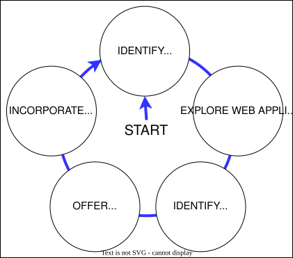

# Auditing_Web_Services_to_Identify_Vulnerabilities_and_Improve_Security

Source: https://www.educative.io/courses/web-application-penetration-testing/auditing-web-services

---

[Home](https://www.educative.io/)

[Courses](https://www.educative.io/search?tab=courses)

[Web Application Penetration Testing](https://www.educative.io/courses/web-application-penetration-testing)

# Auditing Web Services

Explore the fundamentals of auditing web applications to detect improper use and vulnerabilities, understand various security auditing types, and utilize tools to assess and improve web service security.

We'll cover the following...

- [What is auditing?](https://www.educative.io/courses/web-application-penetration-testing/auditing-web-services#What-is-auditing)
- [The auditing process](https://www.educative.io/courses/web-application-penetration-testing/auditing-web-services#The-auditing-process)
- [Types of security auditing](https://www.educative.io/courses/web-application-penetration-testing/auditing-web-services#Types-of-security-auditing)
  - [Black box (External security assessment)](https://www.educative.io/courses/web-application-penetration-testing/auditing-web-services#Black-box-External-security-assessment)
  - [White box (Internal security assessment)](https://www.educative.io/courses/web-application-penetration-testing/auditing-web-services#White-box-Internal-security-assessment)
  - [Grey box](https://www.educative.io/courses/web-application-penetration-testing/auditing-web-services#Grey-box)
- [Auditing tools](https://www.educative.io/courses/web-application-penetration-testing/auditing-web-services#Auditing-tools)
  - [Screaming Frog](https://www.educative.io/courses/web-application-penetration-testing/auditing-web-services#Screaming-Frog)

## What is auditing?[#](https://www.educative.io/courses/web-application-penetration-testing/auditing-web-services#What-is-auditing)

Auditing a web application is an essential practice that has to be done to identify the improper use of its functions and vulnerabilities and to ensure that data models and the application logic are correct and working as intended.

Web penetration, in a way, is simply auditing web applications, but the scope is generally limited to the security aspect. Nevertheless, both pentesters and auditors (commonly known as software quality assurance engineers) should be able to perform different audit services on web applications based on the specification requirements and both company and legal policies.

## The auditing process[#](https://www.educative.io/courses/web-application-penetration-testing/auditing-web-services#The-auditing-process)

Web auditing looks for potential problems or opportunities for improvement and offers suggestions for them. The steps involved in the web auditing process are summarized as follows:

1. Identify the goals and objectives of the audit. This will help determine the focus and scope of the audit, as well as the specific tools and techniques that need to be used.
2. Conduct a thorough website analysis, including its design, content, code, and performance. This may involve using various web auditing tools, such as website performance analysis tools, security scanners, and search engine optimization (SEO) tools.
3. Using the findings of the analysis, pinpoint any potential problems or areas that need improvement. This could involve issues with the website’s functionality, security, and quality and the potential to enhance its design.
4. Provide recommendations for addressing the identified issues and improving the website. These recommendations may include changes to the website’s design, content, or code and suggestions for improving its performance or security.
5. Implement the suggested adjustments and conduct follow-up audits to ensure the website operates at its peak and is protected from attacks.

In the context of a pentester, the cycle is pretty much the same.

The audit cycle

## Types of security auditing[#](https://www.educative.io/courses/web-application-penetration-testing/auditing-web-services#Types-of-security-auditing)

Depending on the application or service that needs to be audited, auditors are given information in up to three different levels: auditors may be told everything, nothing, or just enough to get their work reasonably started. Top organizations generally require that auditors are told nothing about the internal structure of both their software products and networks, so being highly prepared is essential. For security auditors, the policies are stricter.

Let’s look at the clearance levels in detail.

### Black box (External security assessment)[#](https://www.educative.io/courses/web-application-penetration-testing/auditing-web-services#Black-box-External-security-assessment)

Auditors only have publicly available information about the web application or service. This test aims to simulate the real-world scenario of an attacker who’s unaware or has no knowledge of the web application’s inner workings, its operations, or the internal network infrastructure of the organization that owns it. As such, black box auditing helps in practically testing out the performance, robustness, and secureness of a web application.

Black box auditing can be further divided into **blind** and **double-blind testing**. The former is a proper real-world simulation, but the organization and its employees are aware of it, while in the latter, only employees in the highest positions in the organization know about the audit.

### White box (Internal security assessment)[#](https://www.educative.io/courses/web-application-penetration-testing/auditing-web-services#White-box-Internal-security-assessment)

Auditors are given a full briefing about the web application or service, possibly including information about the company’s internal network as well. White box auditing helps simulate a worst-case scenario where the attacker has in-depth knowledge of either the web application or the organization’s network infrastructure. It allows organizations to prepare for attacks from inside threats or from attackers who may have gained access to systems but can’t do much without root privileges or getting detected. This process is usually faster and helps reveal more vulnerabilities since the team undertaking the audit services has access to all the web application infrastructures. Sometimes, it even extends to source code audits, application design reviews, and even modification of specification requirements.

Just like black box auditing, this approach can also be further divided into blind and double-blind approaches. In the case of double-blind testing, if the audit results in grave findings, a major security education program becomes mandatory for the employees of the organization.

### Grey box[#](https://www.educative.io/courses/web-application-penetration-testing/auditing-web-services#Grey-box)

The audit team is given partial information, which generally just comprises policy documents, infrastructure schematics, and credentials. It aims to deliver a cost-effective service while focusing on areas critical to the web application’s functions. It also helps to simulate an attack from an average adversary who has done the bare minimum research to exploit some publicly known (usually zero-day) exploit.

## Auditing tools[#](https://www.educative.io/courses/web-application-penetration-testing/auditing-web-services#Auditing-tools)

About every tool that we’ve discussed so far can be used to audit web applications and services. Metasploit, Nmap, and Wireshark all have their specific uses that can help auditors throughout the exploration phase of the auditing process.

There are a number of firms as well that provide professional auditing services. Large companies often first perform an internal audit by themselves and then reach out to well-known firms for an external audit to ensure that nothing has been missed.

### Screaming Frog[#](https://www.educative.io/courses/web-application-penetration-testing/auditing-web-services#Screaming-Frog)

Before we move on, let’s look at one audit tool (used mainly for SEO purposes) that enables auditors to check the overall design, quickly provide suggestions to improve SEO, and even warn about general security issues. Let’s check out the free version below:

1. Click the “Run” button to start the application.
2. Click the “Accept” button to accept the “End User License Agreement” that comes up. A prompt about memory configurations may pop up; proceed as normal.
3. The website we’ll audit is <http://testphp.vulnweb.com>. Ensure that you don’t use HTTPS in the application’s search field for this website. Wait for Screaming Frog to fully crawl the website.
4. Once it’s done crawling, we can click the “Issues” tab to check all the problems found. Of course, most of these will be related to SEO, but we’ll also see some basic security warnings. For example, we’ll find warnings about using forms over HTTP.
5. Click the “Structure” tab to check the outline of the website’s file system structure.

There are other things we can do as well, so feel free to explore.

Playground for Screaming Frog

Denial-of-Service

Auditing Strategies

Ask

[What is auditing?](https://www.educative.io/courses/web-application-penetration-testing/auditing-web-services#What-is-auditing)

[The auditing process](https://www.educative.io/courses/web-application-penetration-testing/auditing-web-services#The-auditing-process)

[Types of security auditing](https://www.educative.io/courses/web-application-penetration-testing/auditing-web-services#Types-of-security-auditing)

[Black box (External security assessment)](https://www.educative.io/courses/web-application-penetration-testing/auditing-web-services#Black-box-External-security-assessment)

[White box (Internal security assessment)](https://www.educative.io/courses/web-application-penetration-testing/auditing-web-services#White-box-Internal-security-assessment)

[Grey box](https://www.educative.io/courses/web-application-penetration-testing/auditing-web-services#Grey-box)

[Auditing tools](https://www.educative.io/courses/web-application-penetration-testing/auditing-web-services#Auditing-tools)

[Screaming Frog](https://www.educative.io/courses/web-application-penetration-testing/auditing-web-services#Screaming-Frog)