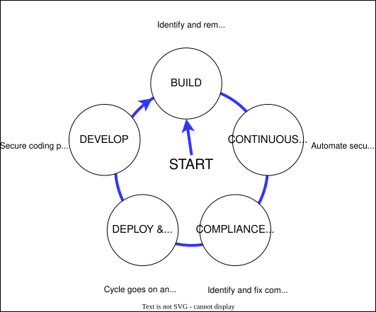

# Effective_Auditing_Strategies_for_Web_Application_Security_Testing

Source: https://www.educative.io/courses/web-application-penetration-testing/auditing-strategies

---

[Home](https://www.educative.io/)

[Courses](https://www.educative.io/search?tab=courses)

[Web Application Penetration Testing](https://www.educative.io/courses/web-application-penetration-testing)

# Auditing Strategies

Explore effective auditing strategies in web application penetration testing. Learn to apply automated techniques like static, dynamic, and interactive application security testing combined with manual methods to identify vulnerabilities such as XSS. Understand how to use tools like Burp Suite to enhance security assessments while balancing accuracy and performance.

We'll cover the following...

- [Overview](https://www.educative.io/courses/web-application-penetration-testing/auditing-strategies#Overview)
- [Automated testing](https://www.educative.io/courses/web-application-penetration-testing/auditing-strategies#Automated-testing)
- [Static application security testing (SAST)](https://www.educative.io/courses/web-application-penetration-testing/auditing-strategies#Static-application-security-testing-SAST)
  - [Dynamic application security testing (DAST)](https://www.educative.io/courses/web-application-penetration-testing/auditing-strategies#Dynamic-application-security-testing-DAST)
  - [Interactive application security testing (IAST)](https://www.educative.io/courses/web-application-penetration-testing/auditing-strategies#Interactive-application-security-testing-IAST)

## Overview[#](https://www.educative.io/courses/web-application-penetration-testing/auditing-strategies#Overview)

As already established, sniffing out vulnerabilities is an essential skill for a pentester. Finding XSS vulnerabilities requires both manual testing and scans with powerful automated tools, such as Burp Suite.

The process begins with automated tools; basic XSS vulnerabilities are quickly spotted. Then manual testing is done to catch more advanced XSS attack vectors. For manual testing, any forms, fields, and editable URLs are all noted, the related source code (if available or unobfuscated) is analyzed, and then special input is crafted for the attack. Trial and error may also be employed, but that will take up a lot of time.

> **Note:** The techniques and approaches discussed in this lesson can be applicable to other types of vulnerabilities as well.

## Automated testing[#](https://www.educative.io/courses/web-application-penetration-testing/auditing-strategies#Automated-testing)

Let’s look at some popular strategies used for automated testing.

## Static application security testing (SAST)[#](https://www.educative.io/courses/web-application-penetration-testing/auditing-strategies#Static-application-security-testing-SAST)

This technique is used to check the security of a web application by reviewing the source code for the identification of vulnerabilities when said source code is not in the production server. This provides static code analysis without impeding service; end users are unaffected while testing is underway. This enhances the inspection of the source code because every nook and cranny can be checked in depth, which makes it much faster and cheaper to find vulnerabilities.

The SAST cycle

### Dynamic application security testing (DAST)[#](https://www.educative.io/courses/web-application-penetration-testing/auditing-strategies#Dynamic-application-security-testing-DAST)

**Dynamic application security testing (DAST)** is a technique that involves using automated tools to identify the security flaws in live web applications. The testing happens directly on the production build. Unlike SAST, the DAST strategy has no access to the source code. As such, through dynamic analysis, security flaws are checked against real-world scenarios, just like how actual hackers would attack a web application. A strategy called fizzing is always being incorporated in dynamic testing to help in uncovering any of the XSS flaws within the web application. Burp Suite’s use, mentioned at the start of this lesson, is quite popular with this strategy.

### Interactive application security testing (IAST)[#](https://www.educative.io/courses/web-application-penetration-testing/auditing-strategies#Interactive-application-security-testing-IAST)

The **interactive application security testing (IAST)** strategy came about relatively recently, and it employs a combination of both DAST and SAST techniques. IAST’s broader range of access to data allows it to compare source code and its intended behavior with metrics gained from what’s actually being done through the web application. This makes IAST more accurate than the other two, though at the cost of performance since the strategy is programmatically baked into the application itself.

## Application Security Testing Approaches

|  |  |  |
| --- | --- | --- |
| **SAST** | **DAST** | **IAST** |
| Best at unncovering vulnerabilities at earlier stages of development | Does not work well until the web application (or a sufficient prototype) is ready | Works well during the development process, but the initial stage of development includes coding the IAST functionality itself |
| Vulnerable code is discovered directly | Only functionality is tested; matching the vulnerabilities to the code is on the tester | Vulnerable code is discovered directly |
| Can be used with CI with some adjustments | ----- | Can be used easily with CI/CD |
| Application logic and shoddy configurations have to be done manually | Application logic and configurations are thoroughly tested | Application logic and configurations are thoroughly tested |
| Many false positives and false negatives | Not as many false positives as DASR | More accurate results than SAST and DAST |
| Struggles with dynamic languages | Works great with dynamic languages and multiple,wildly different frameworks working in tandem | Works great with dynamic languages and multiple wildly different frameworks working in tandem |

Auditing Web Services

Security Operations Center (SOC)

Ask

[Overview](https://www.educative.io/courses/web-application-penetration-testing/auditing-strategies#Overview)

[Automated testing](https://www.educative.io/courses/web-application-penetration-testing/auditing-strategies#Automated-testing)

[Static application security testing (SAST)](https://www.educative.io/courses/web-application-penetration-testing/auditing-strategies#Static-application-security-testing-SAST)

[Dynamic application security testing (DAST)](https://www.educative.io/courses/web-application-penetration-testing/auditing-strategies#Dynamic-application-security-testing-DAST)

[Interactive application security testing (IAST)](https://www.educative.io/courses/web-application-penetration-testing/auditing-strategies#Interactive-application-security-testing-IAST)