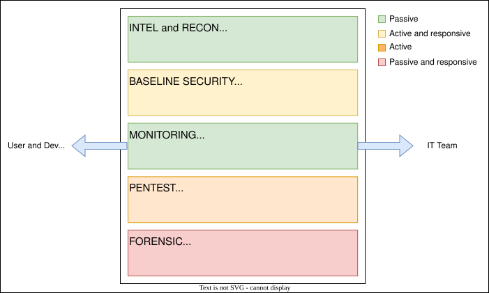

# Understanding_the_Role_and_Tools_of_a_Security_Operations_Center

Source: https://www.educative.io/courses/web-application-penetration-testing/security-operations-center-soc

---

[Home](https://www.educative.io/)

[Courses](https://www.educative.io/search?tab=courses)

[Web Application Penetration Testing](https://www.educative.io/courses/web-application-penetration-testing)

# Security Operations Center (SOC)

Explore the functions and structure of a Security Operations Center (SOC), including how it monitors security threats, manages responses, and utilizes tools such as intrusion detection systems, vulnerability scanners, and SIEM platforms. Understand the roles of SOC teams and how they protect organizational IT infrastructure through real-time threat analysis and mitigation.

We'll cover the following...

- [What is the security operations center?](https://www.educative.io/courses/web-application-penetration-testing/security-operations-center-soc#What-is-the-security-operations-center)
- [How does an SOC work?](https://www.educative.io/courses/web-application-penetration-testing/security-operations-center-soc#How-does-an-SOC-work)
- [SOC tools](https://www.educative.io/courses/web-application-penetration-testing/security-operations-center-soc#SOC-tools)
  - [Intrusion detection and prevention systems (IDPSs)](https://www.educative.io/courses/web-application-penetration-testing/security-operations-center-soc#Intrusion-detection-and-prevention-systems-IDPSs)
  - [Vulnerability scanners](https://www.educative.io/courses/web-application-penetration-testing/security-operations-center-soc#Vulnerability-scanners)
  - [Threat intelligence platforms](https://www.educative.io/courses/web-application-penetration-testing/security-operations-center-soc#Threat-intelligence-platforms)
- [Security information and event management (SIEM)](https://www.educative.io/courses/web-application-penetration-testing/security-operations-center-soc#Security-information-and-event-management-SIEM)

## What is the security operations center?[#](https://www.educative.io/courses/web-application-penetration-testing/security-operations-center-soc#What-is-the-security-operations-center)

A **security operations center (SOC)** is a facility that houses a security team responsible for monitoring, analyzing, and organizing the security status of products, internal networks, and even physical security in real time. Using a combination of technological solutions and a strong approach to threat analysis and response, an SOC’s objective is to identify, investigate, and respond to cybersecurity issues.

The SOC is staffed with security analysts, engineers, and managers who oversee operations. This is generally an in-house team of information security professionals who monitor an entire organization’s IT infrastructure to detect cyber threats in real time and address them as quickly and effectively as possible. They keep up to date with the latest news regarding exploit and attack vectors and help maintain an organization’s technologies. Always keep in mind that a relaxed SOC is one doomed to fail. For example, when the Log4j critical vulnerability was first announced, a lot of companies paid the price because their SOCs did not update their systems and software in time.

## How does an SOC work?[#](https://www.educative.io/courses/web-application-penetration-testing/security-operations-center-soc#How-does-an-SOC-work)

An SOC’s policies and procedures will vary depending on the organization and its requirements. In general, however, a typical SOC will use a combination of technology and human expertise to monitor an organization’s networks and systems for potential security threats.

When a potential threat is detected, the SOC team will typically take the following measures:

1. Identify the nature and scope of the threat.
2. Contain the threat to prevent it from spreading or causing further damage.
3. Investigate the threat to determine its origin and any potential impact.
4. Remediate the threat by removing it and taking steps to prevent it from happening again.
5. Communicate with stakeholders, such as management and other relevant parties, about the threat and its resolution.

In addition to monitoring and responding to threats, an SOC may also be responsible for managing security risks and implementing security controls to help prevent future incidents. This can include conducting regular security assessments, implementing security protocols and standards, and providing training and education to employees to help them recognize and avoid potential threats.

In a typical SOC, there are five teams that work in tandem and rely on each other to ensure that the organization’s network and software products are secure. These teams are:

- **Intel and Recon:** This team is responsible for keeping up to date with all the latest security updates and incidents.
- **Baseline Security:** This team routinely performs general vulnerability scans and ensures that compliance policies are followed.
- **Monitoring:** This team maintains constant vigilance by checking all sorts of log feeds.
- **Pentest:** This team performs detailed vulnerability testing, either black box or white box, and generates follow-through write-ups for the SQA (or development) team.
- **Forensic:** This team performs detailed analyses of logs and investigates all sorts of previous attacks to harden security measures.

The SOC then advises the general IT team on how to keep the internal network secure and update hardware and patch software as appropriate. The general user (for example, accountants and designers) and development teams also benefit from the SOC’s efforts, the latter team directly improving the product’s security measures.

General structure of an SOC

## SOC tools[#](https://www.educative.io/courses/web-application-penetration-testing/security-operations-center-soc#SOC-tools)

SOCs are typically staffed by security analysts who use various tools to identify and respond to potential security threats. Let’s now look at some of the standard tools used in an SOC.

### Intrusion detection and prevention systems (IDPSs)[#](https://www.educative.io/courses/web-application-penetration-testing/security-operations-center-soc#Intrusion-detection-and-prevention-systems-IDPSs)

This is a network security technology that monitors traffic for suspicious activity. It can alert administrators or take automatic action to block potential threats. It’s designed to identify and prevent unauthorized access, misuse, and other malicious activities on a network.

There are two main types of IDPSs:

- **Network-based IDPS:** This monitors traffic on the entire network.
- **Host-based IDPS:** This monitors activity on individual devices connected to the network.

Examples of IDPSs include firewalls and antivirus software. Some IDPSs also use machine learning algorithms to analyze network traffic and identify patterns indicative of potential threats.

### Vulnerability scanners[#](https://www.educative.io/courses/web-application-penetration-testing/security-operations-center-soc#Vulnerability-scanners)

A **vulnerability scanner** is used to detect security flaws in computer systems, networks, and online applications. It examines the system, network, or application to find any potential security flaws, such as outdated security updates, passwords that are not strong enough, and incorrectly configured settings. The scanner then notifies the user of these vulnerabilities and offers suggestions for repairing them. By now, we’ve already used some sort of vulnerability scanner, like Screaming Frog.

Organizations commonly use vulnerability scanners to identify and address security weaknesses in their systems and networks. Individual users can also use them to scan their devices and network for vulnerabilities. Some popular vulnerability scanners include Nessus, OpenVAS, and Acunetix.

Let’s also check some types of vulnerability scans:

- **Database:** This identifies vulnerabilities in databases and database servers.
- **Host:** This type identifies vulnerabilities in devices themselves, such as OS exploits and outdated software versions.
- **Application:** This identifies publicly known vulnerabilities in applications and services and warns about faulty configurations.
- **Network:** This type identifies misconfigurations in networks and points out possible vulnerabilities.
- **Wireless:** This identifies unsecured access points and checks for rogue connections.

Types of vulnerability scans

### Threat intelligence platforms[#](https://www.educative.io/courses/web-application-penetration-testing/security-operations-center-soc#Threat-intelligence-platforms)

Threat intelligence is the analysis of data using tools and techniques to formulate insights on current and emerging threat actors and vectors in order to gauge risk. As such, threat intelligence platforms are generally software solutions that assist in gathering, evaluating, and acting on threat intelligence. Organizations can quickly identify, prioritize, and respond to new and raised stakes using a threat intelligence platform.

These platforms typically provide the capacity to gather and store threat data from various sources, including OSINT sources, paid intelligence feeds, and internal data, such as access and network traffic logs. Additionally, they frequently integrate with other security technologies, IDPSs, vulnerability scanners, and tools for categorizing and ranking threats.

Examples of threat intelligence platforms include Anomali, ThreatConnect, and ThreatQuotient. These platforms can be used by businesses of all sizes to strengthen their defenses against attacks and enhance security postures.

## Security information and event management (SIEM)[#](https://www.educative.io/courses/web-application-penetration-testing/security-operations-center-soc#Security-information-and-event-management-SIEM)

**Security information and event management** (**SIEM** but pronounced as “sim”) is, in base terms, an amalgamation of cybersecurity products and services, resulting in a methodology that provides real-time analysis of security incidents generated by software and networks. All the tools we’ve talked about, and systems such as IDPS and threat intelligence platforms, come together as one in a SIEM dashboard so that everything is seamlessly integrated in one place.

The typical approach of a SIEM is that of detection of deviance in what is the norm. Let’s discuss this with two examples:

- Imagine we have a grocery delivery service web application localized to a certain city or country. Suddenly, we start receiving a large amount of requests from users outside our target user base trying to establish a connection to our app’s home page. An alarm will be raised on our SIEM dashboard notifying us of a possible DDoS attack.
- Remember honeywords from way earlier in the course? Well, they are a deception technique used in good SIEMs. An alarm is raised on our SIEM dashboard whenever a honeyword is used, and user login may either be temporarily ceased or severely rate limited.

Overall, SIEMs intend to make the lives of security professionals easier.

Auditing Strategies

Quiz Yourself on Broader Security Concepts

Ask

[What is the security operations center?](https://www.educative.io/courses/web-application-penetration-testing/security-operations-center-soc#What-is-the-security-operations-center)

[How does an SOC work?](https://www.educative.io/courses/web-application-penetration-testing/security-operations-center-soc#How-does-an-SOC-work)

[SOC tools](https://www.educative.io/courses/web-application-penetration-testing/security-operations-center-soc#SOC-tools)

[Intrusion detection and prevention systems (IDPSs)](https://www.educative.io/courses/web-application-penetration-testing/security-operations-center-soc#Intrusion-detection-and-prevention-systems-IDPSs)

[Vulnerability scanners](https://www.educative.io/courses/web-application-penetration-testing/security-operations-center-soc#Vulnerability-scanners)

[Threat intelligence platforms](https://www.educative.io/courses/web-application-penetration-testing/security-operations-center-soc#Threat-intelligence-platforms)

[Security information and event management (SIEM)](https://www.educative.io/courses/web-application-penetration-testing/security-operations-center-soc#Security-information-and-event-management-SIEM)